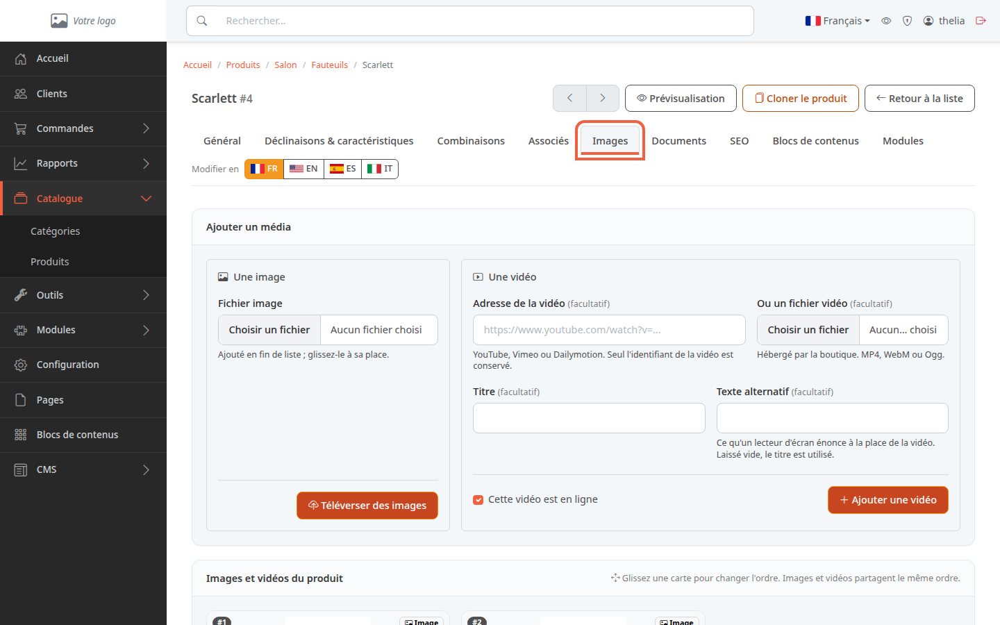
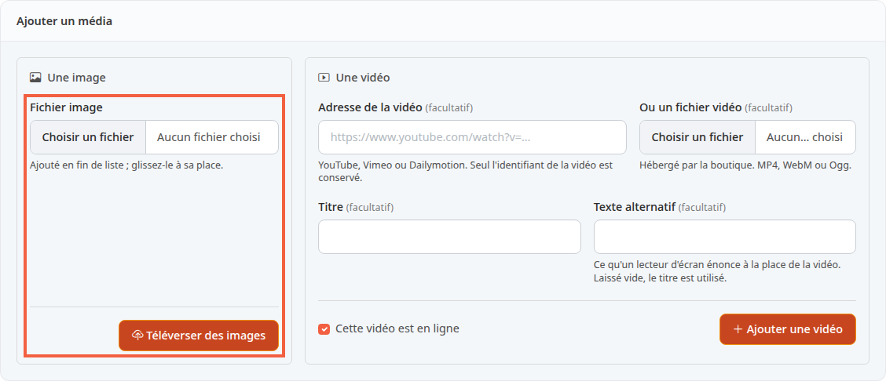
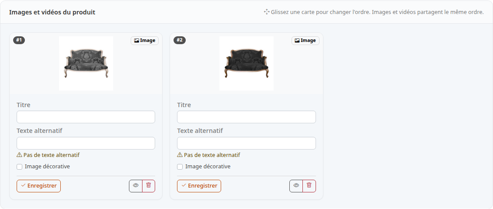
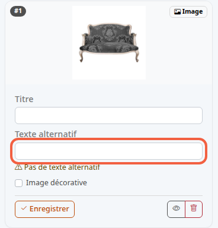

Les images sont les photos de votre produit : sans elles, le client ne voit que du texte. Ce tutoriel montre comment en ajouter, les classer et décrire chacune.

**Avant de commencer :** il vous faut un produit existant (voir [Créer un produit](/catalog/create-product/)) et un fichier image sur votre ordinateur. Pour entrer dans le back-office, voir [Découvrir le back-office](/getting-started/back-office-tour/).

## Étape 1 : ouvrir l'onglet Images

1. Dans le menu de gauche, cliquez sur **Catalogue**, puis sur **Produits**.
2. Cliquez sur le nom du produit, par exemple **Scarlett**.
3. Cliquez sur l'onglet **Images**.

L'onglet contient deux blocs : **Ajouter un média** en haut, et la liste **Images et vidéos du produit** en dessous. La vidéo se règle dans le même bloc, mais ce tutoriel ne traite que les images.

## Étape 2 : téléverser une image

Téléverser, c'est envoyer un fichier de votre ordinateur vers votre boutique.

1. Dans le cadre **Une image**, cliquez sur **Choisir un fichier**.
2. Choisissez la photo sur votre ordinateur, par exemple `fauteuil-scarlett.jpg`.
3. Cliquez sur **Téléverser des images**.

L'image est ajoutée à la fin de la liste. Le champ ne propose que des fichiers image. Pour en ajouter d'autres, recommencez les trois actions.

## Étape 3 : choisir l'ordre des images

La liste **Images et vidéos du produit** affiche une carte par image, avec son rang en haut à gauche : **#1**, **#2**, etc.

1. Faites glisser une carte avec la souris jusqu'à sa nouvelle place.
2. Relâchez : les rangs se renumérotent et le nouvel ordre est enregistré tout de suite, sans bouton.

Il n'existe pas de réglage « image principale ». Sur la boutique, la vignette du produit dans les listes est la première image non masquée de cette liste, et la page du produit affiche les photos dans le même ordre. Placez donc votre meilleure photo en **#1**.

## Étape 4 : renseigner le texte alternatif

Le texte alternatif décrit l'image avec des mots. Un lecteur d'écran (le logiciel qui lit la page à voix haute pour une personne malvoyante) le prononce à la place de la photo, sur la page du produit. S'il est vide, la boutique utilise le **Titre** de l'image, puis le nom du produit, sauf pour une image cochée **Image décorative** : son texte reste vide.

Sous une image sans description, l'écran affiche **Pas de texte alternatif**.

1. Dans **Titre**, saisissez un nom, par exemple `Fauteuil Scarlett, vue de face`.
2. Dans **Texte alternatif**, décrivez ce que montre la photo, par exemple `Fauteuil gris à pieds en bois, vu de face`.
3. Cliquez sur **Enregistrer** en bas de la carte.

Pour une image qui ne fait que décorer, cochez **Image décorative** : le champ **Texte alternatif** se grise et la mention **Masqué pour une image décorative** s'affiche dessous. Sur la page du produit, le lecteur d'écran passera alors l'image sous silence. Cliquez ensuite sur **Enregistrer**.

Chaque carte a son propre bouton **Enregistrer** : il n'enregistre que les champs de cette carte.

## Étape 5 : masquer ou supprimer une image

En bas de chaque carte, deux boutons à icône :

- l'œil masque l'image sans la supprimer : elle n'apparaît plus sur la boutique (survolez-le pour lire **Masquer**, ou **Afficher** si l'image est déjà masquée). Une image masquée porte le badge **Masqué** ;
- la corbeille supprime l'image après une demande de confirmation (le message du navigateur est affiché en anglais : **Are you sure?**).

## Le résultat

Les cartes de l'onglet **Images** reprennent vos photos dans l'ordre choisi. Pour vérifier l'effet sur la boutique, cliquez sur **Prévisualisation** en haut de la fiche. La mise en ligne du produit lui-même se règle dans [Mettre un produit en ligne ou hors ligne](/catalog/publish-product/).
