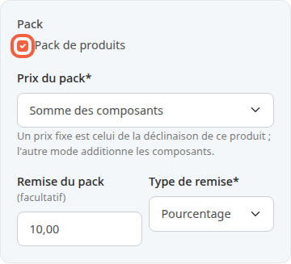
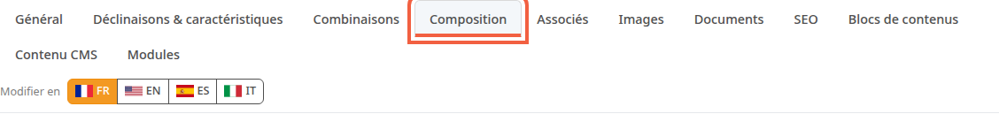
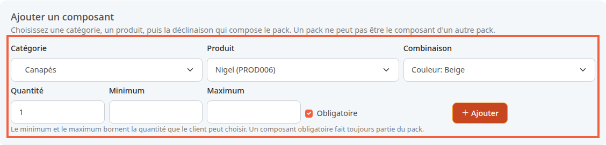
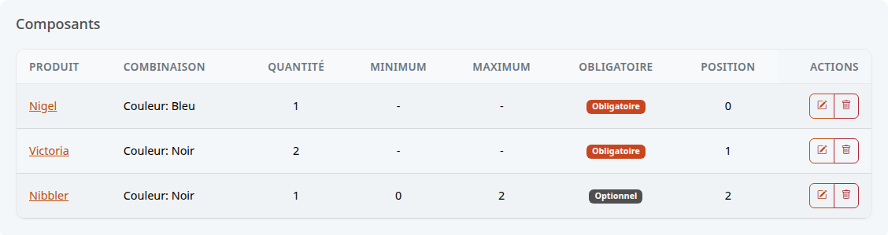
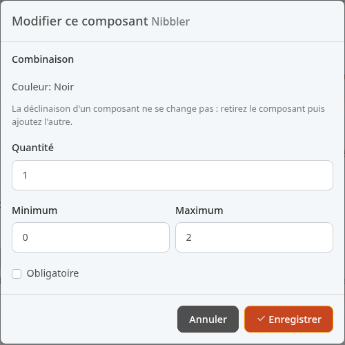
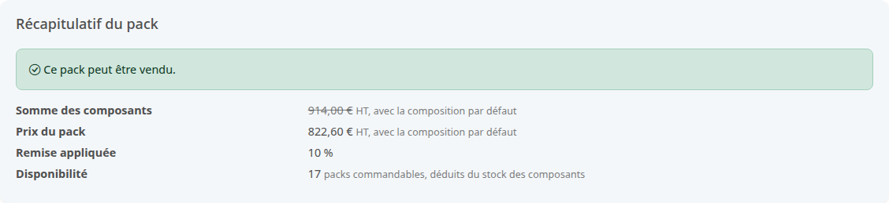
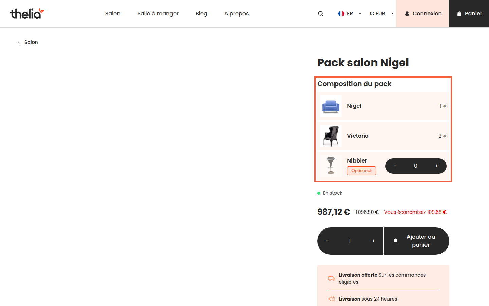

Un pack vend plusieurs produits ensemble, comme un seul produit. Par exemple, un « Pack salon Nigel » réunit un canapé Nigel, deux fauteuils Victoria et, si l'acheteur le veut, un ou deux tabourets Nibbler, avec 10 % de remise.

L'acheteur met le pack dans son panier en une fois. Vous ne gérez pas de stock à part : le pack se sert dans le stock de chaque produit qui le compose.

**Avant de commencer :** les produits qui composent le pack existent déjà dans votre catalogue. Le pack de l'exemple n'existe pas dans les données de démonstration : il a été créé pour cette page.

## Étape 1 : créer le produit du pack

Un pack est un produit comme un autre. Créez-le comme indiqué dans [Créer un produit](/catalog/create-product/), avec par exemple :

- **Référence produit** : PACK-SALON-NIGEL
- **Titre du produit** : Pack salon Nigel
- **Catégorie par défaut** : Salon

Créez un produit neuf pour le pack. Un produit qui a déjà plusieurs combinaisons (par exemple plusieurs couleurs) ne peut pas devenir un pack. Les messages des packs appellent aussi une combinaison « déclinaison » : Thelia l'indique par le message **Le produit … a … déclinaisons : un pack n'en a qu'une, il ne peut donc pas devenir un pack.**

## Étape 2 : en faire un pack et choisir son prix

1. Dans la fiche du produit, restez sur l'onglet **Général**.
2. Dans le bloc **Pack**, cochez **Pack de produits**.
3. Dans **Prix du pack**, choisissez comment le prix se calcule.
4. Si vous avez choisi **Somme des composants**, saisissez la remise dans **Remise du pack**, par exemple 10.
5. Dans **Type de remise**, choisissez **Pourcentage** ou **Montant**.
6. Cliquez sur **Enregistrer**.

Les deux façons de fixer le prix :

- **Prix fixe** : le pack a son propre prix, celui que vous saisissez pour ce produit, comme dans [Fixer le prix et le stock](/catalog/set-price-stock/).
- **Somme des composants** : Thelia additionne le prix des produits que l'acheteur a gardés, puis retire la remise. Si vous changez le prix d'un fauteuil, le prix du pack suit.

Une remise en pourcentage ne peut pas dépasser 100. Les champs de remise n'apparaissent qu'avec **Somme des composants**.

## Étape 3 : ajouter les produits du pack

Une fois le produit enregistré comme pack, un onglet **Composition** apparaît dans sa fiche.

1. Cliquez sur l'onglet **Composition**.

2. Dans le bloc **Ajouter un composant**, choisissez une **Catégorie**, par exemple Canapés.
3. Choisissez le **Produit**, par exemple Nigel.
4. Choisissez la **Combinaison**, par exemple Couleur: Bleu.
5. Dans **Quantité**, saisissez combien de fois ce produit entre dans le pack, par exemple 1.
6. Laissez **Obligatoire** coché pour un produit toujours présent dans le pack.
7. Cliquez sur **Ajouter**.
8. Recommencez pour chaque produit, par exemple Victoria avec la quantité 2.

Une combinaison déjà dans le pack n'est plus proposée : sur la capture, Nigel bleu est déjà un composant, la liste propose donc ses autres couleurs.

Un composant est un produit qui entre dans le pack. Un pack ne peut pas contenir un autre pack.

### Laisser l'acheteur choisir un produit en option

Pour un produit que l'acheteur peut prendre ou non, comme le tabouret Nibbler :

1. Saisissez la **Quantité**, par exemple 1. Elle doit rester entre le minimum et le maximum.
2. Dans **Minimum**, saisissez 0 : l'acheteur peut ne pas le prendre.
3. Dans **Maximum**, saisissez la quantité la plus haute qu'il peut choisir, par exemple 2.
4. Décochez **Obligatoire**.
5. Cliquez sur **Ajouter**.

Le minimum et le maximum bornent la quantité que l'acheteur peut choisir. Laissés vides, la quantité est fixe.

La liste **Composants** montre ce que contient le pack. Le badge **Obligatoire** ou **Optionnel** indique si l'acheteur peut retirer le produit.

Pour changer une quantité, cliquez sur le crayon de la ligne, modifiez les champs, puis cliquez sur **Enregistrer**. La combinaison d'un composant ne se change pas : retirez le composant avec la corbeille, puis ajoutez l'autre combinaison.

## Étape 4 : vérifier le prix et la disponibilité

En haut de l'onglet **Composition**, le bloc **Récapitulatif du pack** dit si le pack peut être vendu, et à quel prix.

Avec l'exemple, le prix se calcule sur la composition par défaut, c'est-à-dire sans le tabouret optionnel :

- **Somme des composants** : 638,00 € pour le canapé, plus 2 × 138,00 € pour les fauteuils, soit 914,00 € HT.
- **Prix du pack** : 914,00 € moins 10 %, soit 822,60 € HT.
- **Disponibilité** : 46 canapés bleus et 34 fauteuils noirs en stock. Chaque pack prend 1 canapé et 2 fauteuils : les canapés suffisent pour 46 packs, les fauteuils pour 17. Le plus petit des deux chiffres donne 17 packs commandables.

Le stock que vous saisiriez pour le produit du pack lui-même n'est pas utilisé : l'onglet **Combinaisons** le rappelle.

Si le bloc affiche **Un composant obligatoire est hors ligne ou supprimé : ce pack ne peut pas être vendu.** ou **Un composant est en rupture de stock : ce pack ne peut pas être commandé pour le moment.**, remettez en ligne ou réapprovisionnez le produit concerné.

## Ce que voit l'acheteur

Sur la page du pack, en boutique, la **Composition du pack** liste chaque produit avec sa quantité. Un produit optionnel porte l'étiquette **Optionnel**. Avec un minimum et un maximum, comme le tabouret, il a un sélecteur de quantité : l'acheteur l'ajoute avec **+**, et le prix se met à jour. Sans minimum ni maximum, c'est une case à cocher **Ajouter … au pack**.

Le prix affiché est celui de la composition choisie, avec le prix barré de la somme et la ligne **Vous économisez**. Ici, 987,12 € TTC au lieu de 1 096,80 €, soit 822,60 € HT plus la TVA du produit pack.

Sans image, la place de la photo reste vide : ajoutez une image au pack comme pour tout produit, voir [Ajouter des images à un produit](/catalog/add-product-images/).

Le prix tient compte de la remise du groupe du client connecté, et s'affiche hors taxes si son groupe voit les prix hors taxes.

## Le résultat

Le pack apparaît dans votre catalogue et en boutique comme un produit. À chaque commande, Thelia retire du stock chaque produit du pack, pas le pack lui-même. Sur la facture et le bon de livraison, les produits du pack sont listés sous la ligne du pack.
