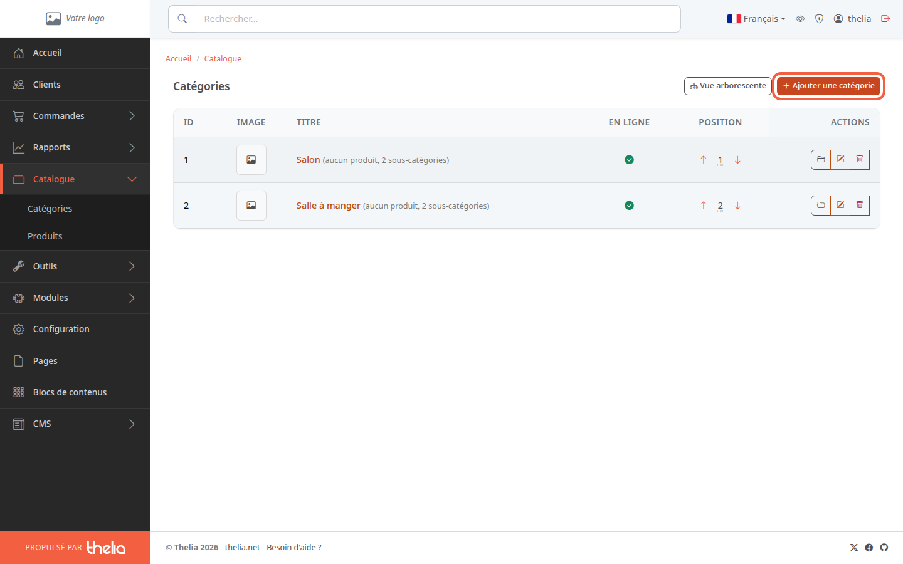
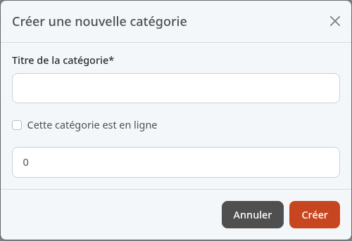
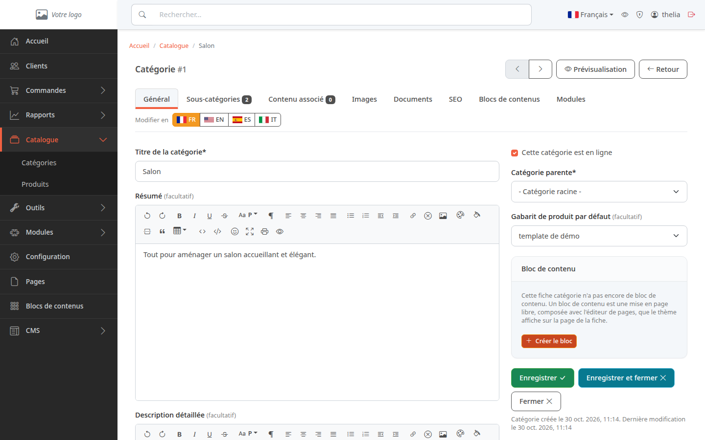
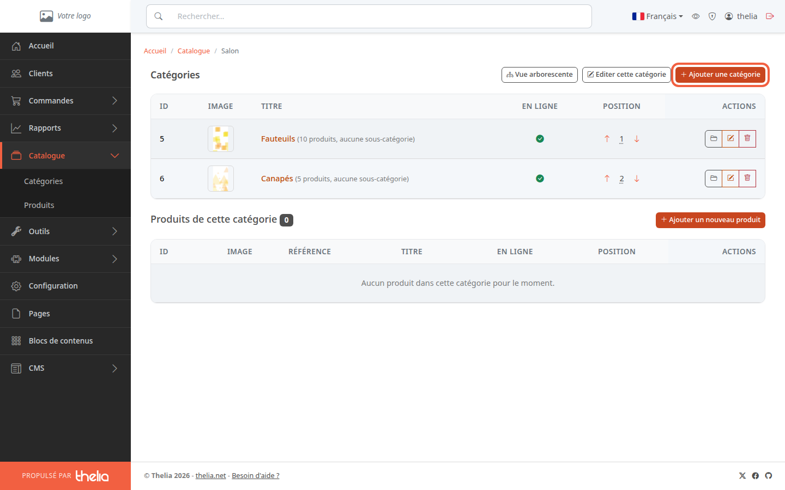

Une catégorie regroupe des produits, par exemple **Salon** ou **Salle à manger** dans une boutique de meubles. Elle sert à ranger votre catalogue et à le faire parcourir par vos clients.

**Avant de commencer :** il vous faut un compte administrateur (voir [Découvrir le back-office](/getting-started/back-office-tour/)).

## Étape 1 : ouvrir la liste des catégories

1. Dans le menu de gauche, cliquez sur **Catalogue**.
2. Cliquez sur **Catégories**.

La page **Catégories** liste les catégories de premier niveau. Chaque ligne indique le nombre de produits et de sous-catégories.

## Étape 2 : ouvrir le formulaire de création

1. Cliquez sur **Ajouter une catégorie**, en haut à droite.

Une fenêtre **Créer une nouvelle catégorie** s'ouvre.

## Étape 3 : remplir la fenêtre

1. Dans **Titre de la catégorie**, saisissez le nom que verront vos clients, par exemple `Chaussures`. Ce champ est obligatoire (il porte une étoile).
2. Cochez **Cette catégorie est en ligne** si les clients doivent la voir tout de suite. Décochée, la catégorie est créée hors ligne : les clients ne peuvent pas ouvrir sa page.
3. Cliquez sur **Créer**.

Pour fermer la fenêtre sans rien créer, cliquez sur **Annuler**.

Le champ numérique sans libellé sous la case (il affiche `0`) indique la catégorie parente. Laissez-le tel quel : `0` crée une catégorie de premier niveau.

## Étape 4 : compléter la fiche

Après le clic sur **Créer**, la fiche de la catégorie s'ouvre. Elle est montrée ici avec la catégorie **Salon** de la démo.

Le drapeau surligné à côté de **Modifier en** indique la langue de la fiche. Elle n'est pas toujours celle de l'interface : sur la démo, la fiche s'ouvre sur **EN**. Si le titre que vous venez de saisir n'apparaît pas, cliquez sur le drapeau de votre langue, par exemple **FR**.

Vous pouvez y ajouter un **Résumé** et une **Description détaillée** (facultatifs), choisir la **Catégorie parente** et regarder les onglets **Sous-catégories**, **Images** et **SEO**. Cliquez sur **Enregistrer** pour garder vos changements, ou sur **Enregistrer et fermer** pour revenir à la liste des catégories.

## Créer une sous-catégorie

Une sous-catégorie est une catégorie rangée dans une autre, par exemple **Fauteuils** dans **Salon**.

1. Dans la liste des catégories, cliquez sur le titre de la catégorie parente, par exemple **Salon**.
2. Cliquez sur **Ajouter une catégorie**.
3. Remplissez la fenêtre comme à l'étape 3. La catégorie parente est déjà renseignée : le champ numérique affiche son numéro, par exemple `1` pour **Salon** (colonne **ID** de la liste).

## Le résultat

La nouvelle catégorie apparaît dans **Catalogue**, **Catégories**, avec sa pastille verte dans la colonne **En ligne** si vous l'avez cochée. Vous pouvez maintenant y [créer un produit](/catalog/create-product/).
