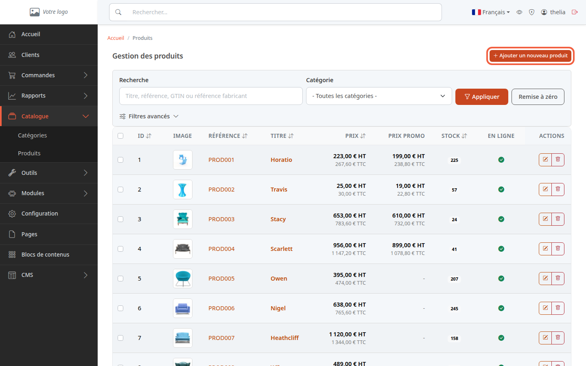
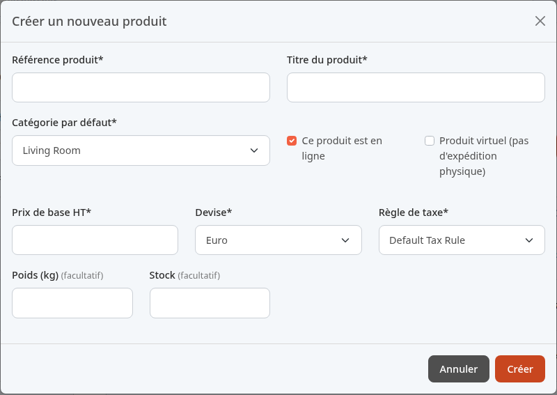
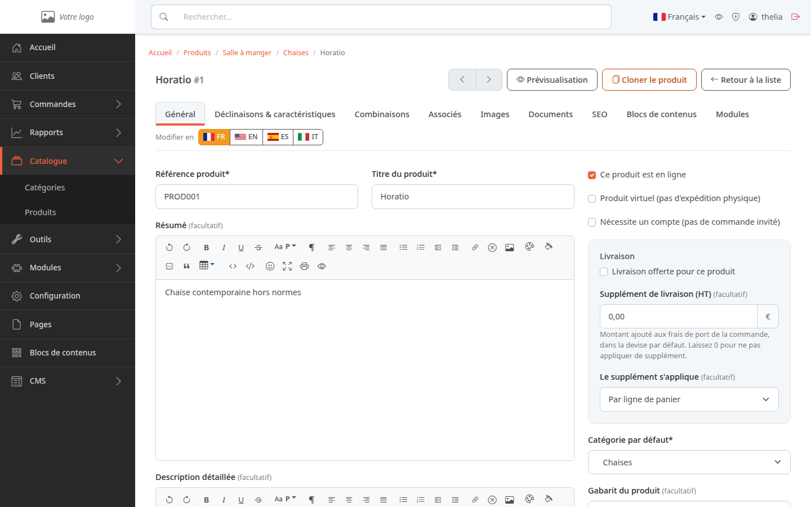
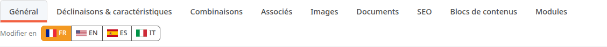

Un produit est un article que vous vendez, avec sa référence, son titre, son prix et sa catégorie. Ce tutoriel crée la fiche d'un produit avec un premier prix. Les photos, et le détail du prix et du stock, se règlent ensuite dans leurs propres pages.

**Avant de commencer :** il vous faut au moins une [catégorie](/catalog/create-category/) et une règle de taxe (la boutique en contient une par défaut, voir [Régler la TVA](/settings/tax-rules/)).

## Étape 1 : ouvrir le formulaire

1. Dans le menu de gauche, cliquez sur **Catalogue**, puis sur **Produits**.
2. Cliquez sur **Ajouter un nouveau produit**, en haut à droite.

Vous pouvez aussi cliquer sur le titre d'une catégorie dans **Catalogue**, **Catégories**, puis sur **Ajouter un nouveau produit** : la catégorie est alors déjà choisie.

## Étape 2 : remplir la fenêtre

La fenêtre **Créer un nouveau produit** s'ouvre. Un libellé suivi d'une étoile est obligatoire. Un libellé suivi de **(facultatif)** peut rester vide.

Champs obligatoires :

1. Dans **Référence produit**, saisissez un code que vous choisissez pour retrouver le produit, par exemple `TSHIRT-BIO-01`.
2. Dans **Titre du produit**, saisissez le nom affiché aux clients, par exemple `T-shirt coton bio`.
3. Dans **Catégorie par défaut**, choisissez le rayon du produit, par exemple `Vêtements`. La liste présélectionne la catégorie d'où vous avez ouvert la fenêtre, ou, depuis la liste des produits, la première catégorie créée : changez-la si ce n'est pas la bonne.
4. Dans **Prix de base HT**, saisissez le prix hors taxes, par exemple `25`. « HT » veut dire hors taxes : le prix avant la TVA.
5. Dans **Devise**, gardez la devise proposée.
6. Dans **Règle de taxe**, choisissez la TVA du produit. Les règles sont listées dans l'ordre de leur création : la première est celle créée à l'installation, qui reste la règle par défaut tant que vous ne l'avez pas changée.

Champs facultatifs :

- **Ce produit est en ligne** : cochée au départ. Le produit est visible par les clients dès sa création. Décochez la case si la fiche n'est pas prête (voir [Mettre un produit en ligne ou hors ligne](/catalog/publish-product/)).
- **Produit virtuel (pas d'expédition physique)** : à cocher pour un article sans livraison, par exemple un fichier à télécharger.
- **Poids (kg)** : par exemple `0,2`.
- **Stock** : le nombre d'unités disponibles, par exemple `50`.

Sur la boutique de démonstration, cette fenêtre affiche certains noms en anglais alors que l'interface est en français : **Living Room** pour la catégorie **Salon**, **Default Tax Rule** pour la règle de taxe par défaut. Ce sont les mêmes éléments.

Si un champ obligatoire reste vide, le produit n'est pas créé. Le prix TTC, la TVA et le stock se règlent plus finement dans [Fixer le prix, la TVA et le stock](/catalog/set-price-stock/).

## Étape 3 : créer le produit

1. Cliquez sur **Créer**.

Pour fermer la fenêtre sans rien créer, cliquez sur **Annuler**.

## Étape 4 : compléter la fiche

La fiche du nouveau produit s'ouvre sur l'onglet **Général**. Elle est montrée ici avec le produit de démo **Horatio**.

Le drapeau surligné à côté de **Modifier en** indique la langue dans laquelle vous modifiez la fiche. Elle n'est pas toujours celle de l'interface : sur la démo, la fiche s'ouvre sur **EN**. Pour écrire le titre et les textes dans une autre langue, cliquez sur son drapeau.

Dans cet onglet, vous renseignez le **Résumé** (une ou deux phrases) et la **Description détaillée** (le texte complet). Cliquez sur **Enregistrer**, plus bas dans la page, pour garder vos changements.

Les autres onglets servent à compléter la fiche :

- **Déclinaisons & caractéristiques** : les déclinaisons (couleur, taille) et les caractéristiques (matière) du produit. L'onglet demande d'abord de choisir un gabarit de produit, la liste des déclinaisons et caractéristiques qu'il propose.
- **Combinaisons** : les variantes vendues, chacune avec sa référence, son prix et son stock, par exemple un T-shirt en taille M et en bleu.
- **Associés** : des contenus du site et des produits à proposer avec celui-ci (accessoires, produits complémentaires).
- **Images** : voir [Ajouter des images à un produit](/catalog/add-product-images/).
- **Documents** : une notice ou une fiche technique à joindre.
- **SEO** : le texte et l'adresse de la page pour les moteurs de recherche.

## Le résultat

Le produit apparaît dans **Catalogue**, **Produits**, avec sa référence, son titre et son prix. Une pastille verte dans la colonne **En ligne** signale qu'il est visible des clients.
