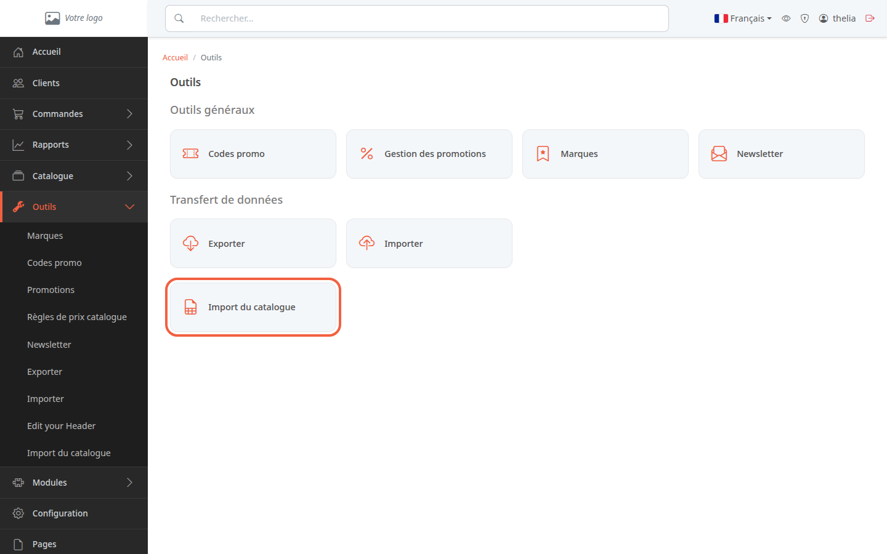
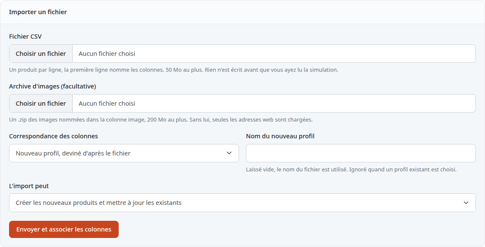
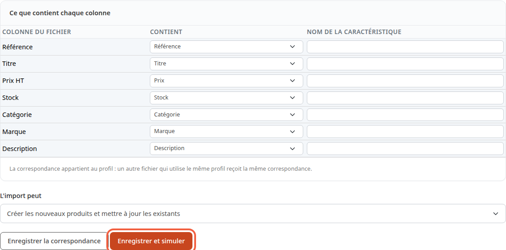
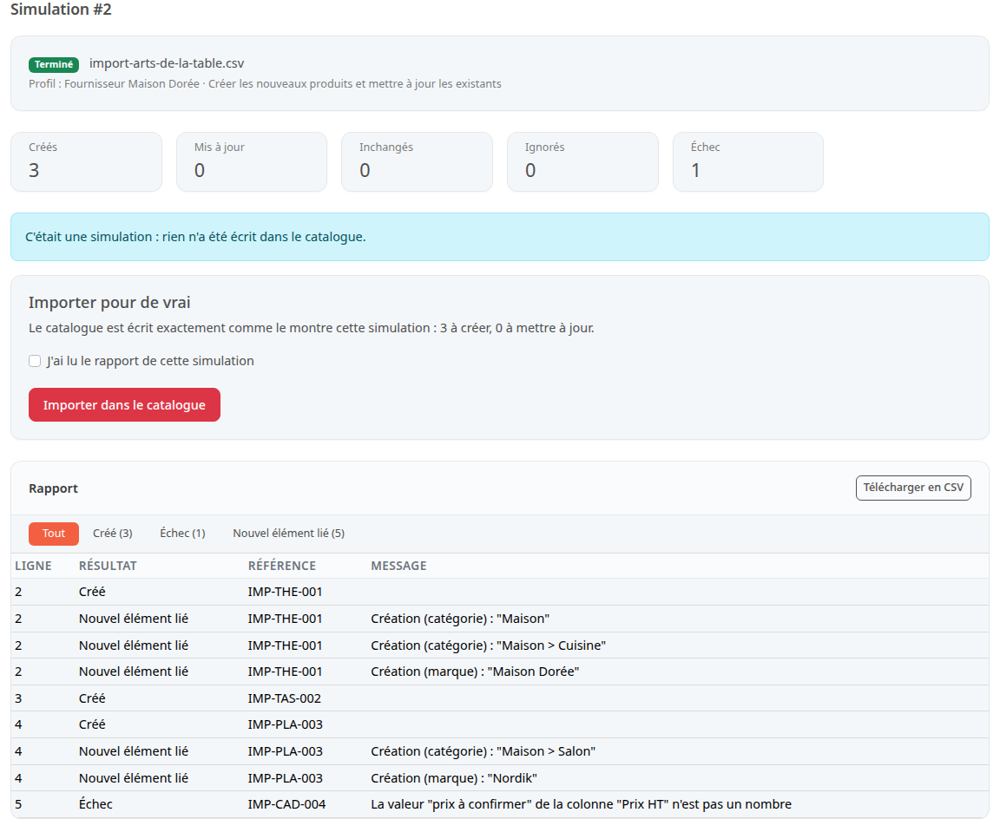
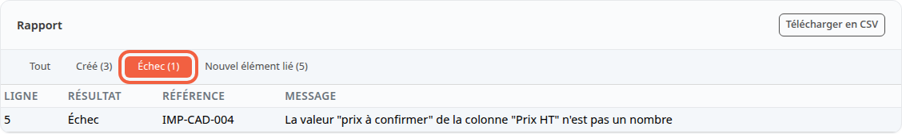

Vous allez ajouter ou mettre à jour plusieurs produits d'un coup, à partir d'un fichier de tableur. C'est utile quand un fournisseur vous envoie sa liste de nouveautés, ou quand vous reprenez un catalogue tenu dans un tableur : dix produits se chargent en une fois au lieu de dix fiches à remplir.

**Avant de commencer :** le module **CSV Importer** doit être installé et activé (voir [Installer, activer ou désactiver un module](/settings/manage-modules/)). Il vous faut aussi un fichier CSV, c'est-à-dire un tableau enregistré en texte, que tout tableur sait produire avec **Enregistrer sous**, format CSV.

## Étape 1 : préparer le fichier

Le fichier contient un produit par ligne. La première ligne donne le nom des colonnes. Voici un exemple de quatre produits pour une boutique d'arts de la table :

```csv
Référence;Titre;Prix HT;Stock;Catégorie;Marque;Description
IMP-THE-001;Théière en fonte;39,90;12;Maison > Cuisine;Maison Dorée;<p>Théière en fonte émaillée, 1,2 L.</p>
IMP-TAS-002;Tasse en grès;8,50;40;Maison > Cuisine;Maison Dorée;<p>Tasse en grès.</p>
IMP-PLA-003;Plaid en laine;59,00;15;Maison > Salon;Nordik;<p>Plaid en laine mérinos.</p>
IMP-CAD-004;Cadre photo;prix à confirmer;10;Maison > Décoration;Luma;<p>Cadre en chêne.</p>
```

Les règles à connaître :

- **Référence** est la seule colonne obligatoire. Elle identifie le produit : une référence déjà présente dans la boutique met ce produit à jour, une référence nouvelle crée un produit.
- Pour créer un produit, il faut aussi un titre, une catégorie et un prix.
- Le prix est hors taxes. La virgule ou le point sont acceptés pour les centimes : `39,90` ou `39.90`.
- La catégorie s'écrit du niveau le plus haut au plus bas, séparés par `>` : `Maison > Cuisine`. Une catégorie ou une marque qui n'existe pas encore est créée par l'import.
- Une colonne dont le nom commence par `C:` devient une caractéristique du produit, par exemple `C:Matière` avec la valeur `Fonte`.
- Le séparateur (point-virgule, virgule) et l'encodage du fichier sont reconnus seuls.

La dernière ligne de l'exemple a volontairement un prix illisible : vous verrez plus bas ce qu'en fait le rapport.

L'import ne gère que les produits simples. Les déclinaisons (tailles, couleurs) ne sont pas encore importées : une colonne `D:Taille` est refusée.

## Étape 2 : envoyer le fichier

1. Dans le menu à gauche, cliquez sur **Outils**.
2. Dans le groupe **Transfert de données**, cliquez sur **Import du catalogue**.



Le bloc **Importer un fichier** s'affiche.



3. Dans **Fichier CSV**, cliquez sur **Choisir un fichier** et choisissez votre fichier. Il fait 50 Mo au plus.
4. Laissez **Correspondance des colonnes** sur **Nouveau profil, deviné d'après le fichier** pour un premier import.
5. Dans **Nom du nouveau profil**, tapez un nom qui parle, par exemple `Fournisseur Maison Dorée`. Laissé vide, le nom du fichier est utilisé.
6. Dans **L'import peut**, gardez **Créer les nouveaux produits et mettre à jour les existants**. Les deux autres choix limitent l'import : **Mettre à jour les produits existants seulement** ou **Créer les nouveaux produits seulement**.
7. Cliquez sur **Envoyer et associer les colonnes**.

Un profil retient à quoi correspond chaque colonne. Le mois suivant, quand le même fournisseur envoie un fichier de même forme, choisissez son profil dans **Correspondance des colonnes** : vous n'aurez rien à réassocier.

Le champ **Archive d'images (facultative)** reçoit un fichier .zip des photos nommées dans une colonne image. Sans archive, seules les images données par une adresse web sont chargées.

## Étape 3 : vérifier les colonnes et lancer la simulation

La page suivante montre le tableau **Ce que contient chaque colonne**. Pour chaque **Colonne du fichier**, la liste **Contient** propose le champ deviné d'après son nom. Avec le fichier de l'exemple, les sept colonnes sont reconnues : **Prix HT** devient **Prix**, **Catégorie** devient **Catégorie**.



1. Relisez chaque ligne du tableau.
2. Corrigez une colonne mal devinée en choisissant le bon champ dans sa liste **Contient**, par exemple **Description courte**.
3. Choisissez **Ignorée** pour une colonne que vous ne voulez pas importer, par exemple une colonne de notes internes.
4. Cliquez sur **Enregistrer et simuler**.

Une simulation est un essai à blanc : elle lit tout le fichier et calcule ce que l'import ferait, sans rien écrire dans le catalogue.

Si la référence n'est associée à aucune colonne, la page affiche **La colonne qui porte la référence est obligatoire** et la simulation ne part pas. Le bouton **Enregistrer la correspondance** garde vos choix sans simuler.

## Étape 4 : lire le rapport de simulation

La simulation tourne en arrière-plan. Pendant ce temps, la page affiche **Le travail attend son démarrage. Cette page se rafraîchit toute seule.**, puis le nombre de lignes lues. Le rapport s'affiche de lui-même à la fin.

Le rapport commence par cinq compteurs : **Créés**, **Mis à jour**, **Inchangés**, **Ignorés** et **Échec**. Le message **C'était une simulation : rien n'a été écrit dans le catalogue.** vous rappelle que rien n'a changé.

Avec le fichier de l'exemple, la simulation compte 3 produits créés et 1 échec.



Le tableau **Rapport** détaille chaque ligne avec **Ligne**, **Résultat**, **Référence** et **Message**. Le numéro de ligne est celui du fichier : la ligne 1 porte les noms de colonnes, le premier produit est donc en ligne 2.

- Chaque produit à créer a sa ligne **Créé**.
- Chaque catégorie ou marque qui n'existe pas encore a sa ligne **Nouvel élément lié**, par exemple **Création (marque) : "Nordik"** ou **Création (catégorie) : "Maison > Cuisine"**. L'exemple en compte 5.
- La ligne de `IMP-CAD-004` porte le résultat **Échec** et le message **La valeur "prix à confirmer" de la colonne "Prix HT" n'est pas un nombre**.

Les boutons au-dessus du tableau filtrent le rapport. Cliquez sur **Échec (1)** pour ne voir que les lignes refusées.



**Télécharger en CSV** enregistre le rapport pour le lire dans votre tableur.

## Étape 5 : comprendre les lignes refusées

Une ligne fausse n'arrête pas l'import : elle est refusée avec son motif, et les autres lignes passent. Les motifs les plus courants :

- un prix ou un stock qui n'est pas un nombre ;
- un produit à créer sans titre, sans catégorie ou sans prix : **Un produit à créer demande une valeur dans :** suivi des champs manquants ;
- une référence vide : **La référence est absente** ;
- une référence déjà vue plus haut dans le fichier : la ligne est **Ignoré**, avec **La référence a déjà été traitée à la ligne** suivi du numéro.

Une cellule vide n'efface jamais ce que contient déjà un produit existant. Pour retirer une valeur, faites-le dans la fiche du produit.

Vous pouvez importer tout de suite les lignes correctes, puis corriger le fichier et refaire un import plus tard. Vous pouvez aussi corriger d'abord le fichier et repartir de l'étape 2 : les produits déjà importés apparaîtront alors en **Inchangé**.

## Étape 6 : importer pour de vrai

Sous les compteurs de la simulation, le bloc **Importer pour de vrai** rappelle ce qui va être écrit, par exemple **Le catalogue est écrit exactement comme le montre cette simulation : 3 à créer, 0 à mettre à jour.**

1. Cochez **J'ai lu le rapport de cette simulation**.
2. Cliquez sur **Importer dans le catalogue**.

L'import tourne en arrière-plan, comme la simulation, puis affiche son propre rapport. Chaque ligne s'écrit à part : la ligne refusée n'empêche pas les trois autres d'entrer dans le catalogue.

L'import réel n'est possible que depuis une simulation terminée, et une seule fois par simulation. La simulation doit dater de moins de 24 heures, et la correspondance des colonnes ne doit pas avoir changé depuis. Sinon, la page vous demande de simuler à nouveau.

Les produits créés sont en ligne tout de suite, visibles sur la boutique. Pour préparer des produits avant de les montrer, voir [Mettre un produit en ligne ou hors ligne](/catalog/publish-product/).

## Le résultat

Les produits importés apparaissent dans **Catalogue**, dans les catégories données par le fichier. La page **Import du catalogue** garde la liste **Imports récents** : chaque simulation et chaque import y figurent avec leur fichier, leur **Statut** et le nombre de lignes traitées, et un clic sur le numéro rouvre le rapport.
