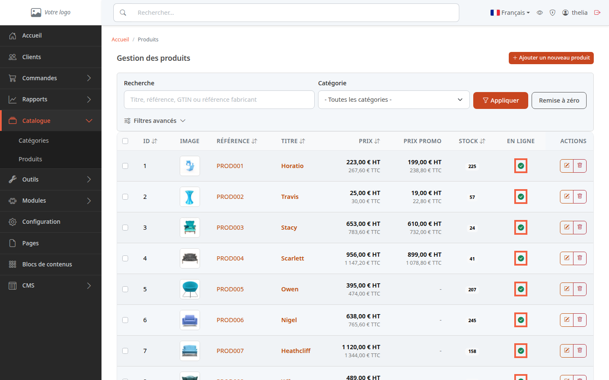
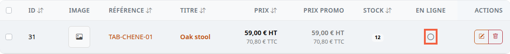
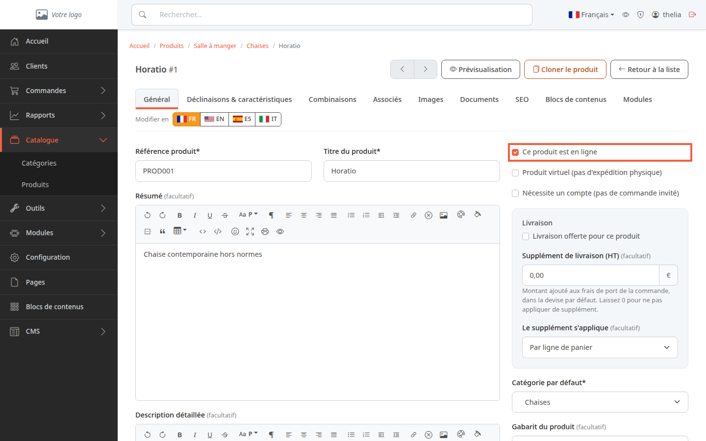
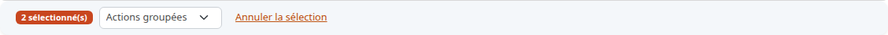

Un produit hors ligne reste dans votre catalogue, mais vos clients ne peuvent plus ouvrir sa page. C'est utile pour un produit en rupture, de saison, ou dont la fiche n'est pas finie. Rien n'est supprimé : vous le remettez en ligne quand vous voulez.

**Avant de commencer :** il vous faut un produit existant (voir [Créer un produit](/catalog/create-product/)).

## Méthode 1 : depuis la liste des produits

1. Dans le menu de gauche, cliquez sur **Catalogue**, puis sur **Produits**.
2. Repérez la colonne **En ligne**. Une pastille verte cochée signifie que le produit est en ligne. Un rond gris vide signifie qu'il est hors ligne.
3. Cliquez sur la pastille de la ligne du produit.

Le changement est immédiat : il n'y a ni confirmation ni bouton **Enregistrer**. Pour revenir en arrière, cliquez à nouveau sur la pastille.

Sur cette capture, le produit **TAB-CHENE-01**, créé pour l'exemple, est hors ligne : sa pastille est un rond gris vide. La liste affiche les titres dans la langue par défaut de la boutique, ici l'anglais.

## Méthode 2 : depuis la fiche du produit

1. Dans la liste, cliquez sur le titre du produit pour ouvrir sa fiche.
2. Dans l'onglet **Général**, repérez la case **Ce produit est en ligne**, à droite.
3. Cochez la case pour mettre le produit en ligne, décochez-la pour le mettre hors ligne.
4. Cliquez sur **Enregistrer**.

Ici, rien ne change tant que vous n'avez pas cliqué sur **Enregistrer**.

## Méthode 3 : plusieurs produits à la fois

1. Dans la liste des produits, cochez la case au début de chaque ligne concernée.
2. Une barre apparaît au-dessus du tableau avec le nombre de produits sélectionnés.
3. Ouvrez la liste **Actions groupées**.
4. Choisissez **Mettre en ligne** ou **Mettre hors ligne**. Le changement s'applique dès votre choix, sans confirmation.

Pour abandonner la sélection, cliquez sur **Annuler la sélection**.

## Ce que voit le client

Quand un produit est hors ligne, il n'apparaît plus dans les pages de catégorie ni dans les résultats de recherche de la boutique. Un client qui ouvre l'adresse de sa page voit une erreur « page introuvable » (404) au lieu de la fiche.

## Le résultat

Dans **Catalogue**, **Produits**, la colonne **En ligne** affiche une pastille verte pour un produit visible et un rond gris pour un produit caché. Le produit n'a pas bougé du catalogue : sa fiche, son prix et son stock sont intacts.
