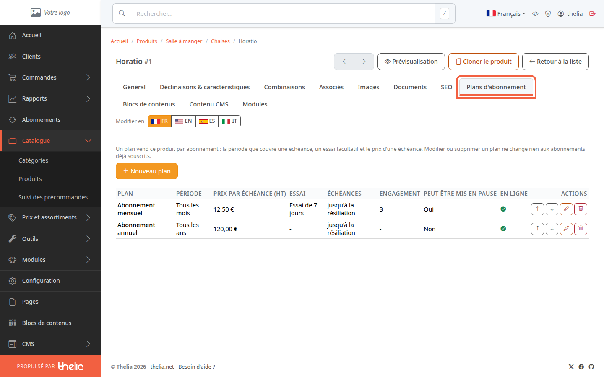
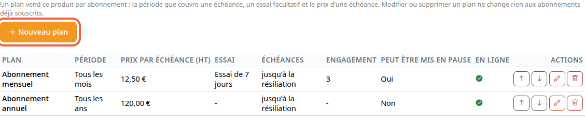
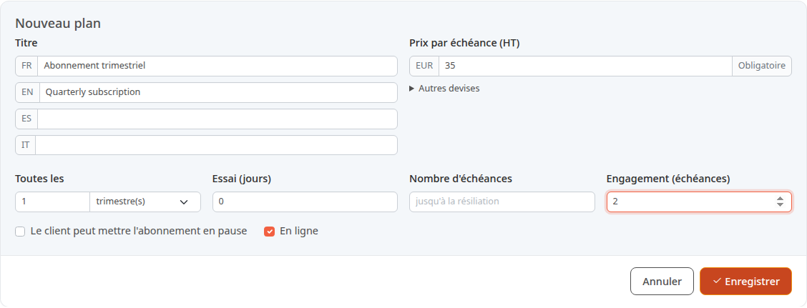
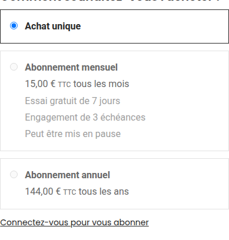

Un abonnement permet de vendre un produit une fois, puis de le facturer à chaque période sans que le client repasse commande. Un plan fixe les règles : tous les mois, tous les ans, avec ou sans essai.

Exemple : un panier de produits livré tous les mois à 12,50 € HT, avec 7 jours d'essai.

**Avant de commencer :** le produit existe et est en ligne (voir [Créer un produit](/catalog/create-product/)). Un module de paiement doit savoir prélever une carte déjà enregistrée sans le client. Aucun module livré avec Thelia ne le fait pour l'instant : sans un tel module, les plans s'affichent mais le client ne peut pas payer son premier abonnement.

## Étape 1 : ouvrir l'onglet des plans

1. Dans le menu de gauche, cliquez sur **Catalogue**, puis sur **Produits**.
2. Ouvrez le produit à vendre par abonnement.
3. Cliquez sur l'onglet **Plans d'abonnement**.

Un produit peut avoir plusieurs plans, par exemple un mensuel et un annuel. L'onglet n'apparaît que si votre boutique propose les abonnements, et seuls les profils qui peuvent modifier les produits y créent des plans.

## Étape 2 : créer un plan

1. Cliquez sur **Nouveau plan**.

2. Dans **Titre**, saisissez le nom du plan dans chaque langue, par exemple `Abonnement mensuel`.
3. Dans **Prix par échéance (HT)**, saisissez le prix d'une échéance hors taxes, par exemple `12.50`. Le prix dans la devise par défaut est obligatoire. **Autres devises** permet d'en donner d'autres.
4. Dans **Toutes les**, saisissez un nombre et choisissez l'unité : semaine, mois, trimestre ou année. Toutes les 2 semaines s'écrit `2` et `semaine(s)`.
5. Dans **Essai (jours)**, saisissez le nombre de jours offerts avant le premier prélèvement. `0` veut dire sans essai.
6. Dans **Nombre d'échéances**, saisissez combien d'échéances la boutique facture au total. Laissez vide pour continuer jusqu'à la résiliation.
7. Dans **Engagement (échéances)**, saisissez le nombre d'échéances que le client doit même s'il résilie. Laissez vide pour aucun engagement.
8. Cochez **Le client peut mettre l'abonnement en pause** si vous l'acceptez.
9. Laissez **En ligne** coché pour proposer le plan dans la boutique.
10. Cliquez sur **Enregistrer**.

Le client recopie les conditions du plan au moment où il s'abonne : prix, période et engagement. Modifier ou supprimer le plan plus tard ne change rien aux abonnements en cours.

## Étape 3 : gérer les plans existants

Dans la liste, chaque ligne a des boutons :

- la flèche haut ou bas change l'ordre d'affichage dans la boutique ;
- la pastille de la colonne **En ligne** met le plan hors ligne ou en ligne ;
- le crayon ouvre le plan pour le modifier ;
- la corbeille le supprime, après confirmation. Les abonnements déjà pris continuent.

## Ce que voit le client

Sur la fiche du produit, les plans s'affichent à côté de **Achat unique**, avec le prix d'une échéance, l'essai, l'engagement et la possibilité de pause.

- Le client doit être connecté. Un visiteur voit les plans avec **Connectez-vous pour vous abonner**.
- Un panier qui contient un abonnement ne contient rien d'autre : une commande ne prend qu'un seul abonnement, avec le moyen de paiement qui servira aux échéances suivantes.
- Avec un essai, la première commande est à 0 € et le panier donne la date du premier prélèvement.
- Un produit dont le prix est sur demande ne propose pas de plan.

## Le résultat

Le produit propose ses plans en ligne. Chaque abonnement pris apparaît ensuite dans le menu **Abonnements** (voir [Suivre les abonnements](/orders/follow-subscriptions/)).
