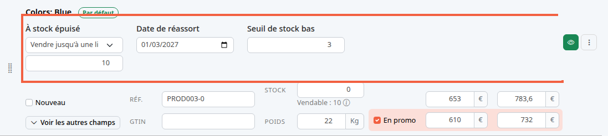
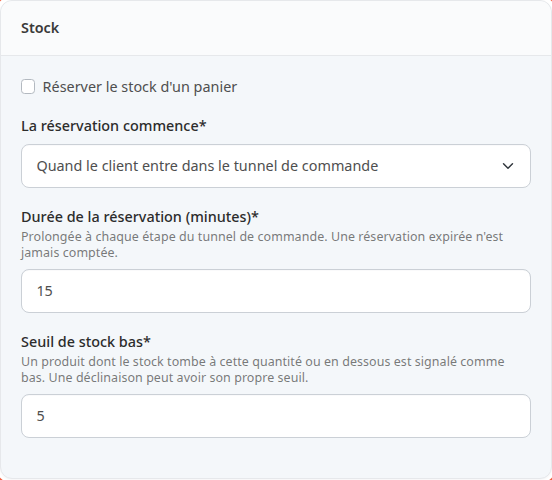
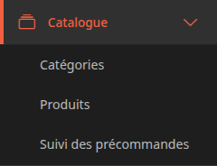
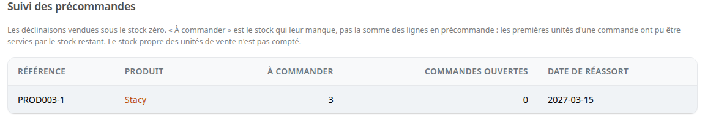
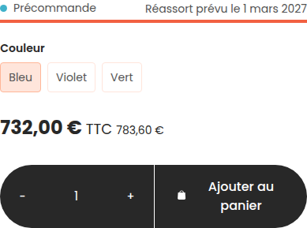
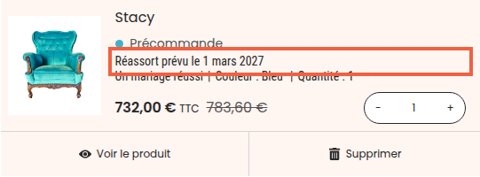

Par défaut, un produit à zéro stock ne se vend plus. Vous pouvez au contraire continuer à le vendre en précommande, avec une date de réassort, et garder le dernier article pour le client qui l'a mis au panier.

Une précommande est une vente faite avant l'arrivée du stock : le client commande, vous livrez au réassort. Par exemple, le fauteuil Stacy en bleu est épuisé et vous attendez 10 pièces début mars.

**Avant de commencer :** le produit existe et son stock est saisi. Voir [Créer un produit](/catalog/create-product/) et [Fixer le prix, la TVA et le stock d'un produit](/catalog/set-price-stock/).

## Étape 1 : choisir ce qui se passe à zéro stock

Ce choix se fait pour chaque combinaison. Une combinaison est une variante du produit, par exemple une couleur.

1. Dans le menu de gauche, cliquez sur **Catalogue**, puis sur **Produits**.
2. Ouvrez le produit, par exemple Stacy.
3. Cliquez sur l'onglet **Combinaisons**.
4. Repérez la combinaison, par exemple celle du fauteuil bleu (**Colors: Blue** dans la démo).
5. Dans **À stock épuisé**, choisissez l'une des trois options.

Les trois options :

- **Refuser la vente** : c'est le réglage de départ. À zéro, le client ne peut plus commander.
- **Continuer à vendre** : le client peut commander toute quantité, même sans stock.
- **Vendre jusqu'à une limite (précommande)** : le client peut commander jusqu'à une limite que vous fixez.

Avec la dernière option, un champ vide apparaît dessous, avec l'indication grisée **Limite de précommande**, qui disparaît quand vous saisissez un nombre. Saisissez le nombre d'unités vendables sous zéro, par exemple 10. Avec un stock de 0 et une limite de 10, vous vendez 10 unités, puis la 11e est refusée.

Pour un produit sans combinaison, les mêmes champs sont dans le bloc **Stock** de l'onglet **Combinaisons**.

Dans la liste, le libellé de la dernière option peut apparaître coupé. C'est un défaut d'affichage connu : l'option reste la bonne.

## Étape 2 : indiquer la date de réassort

1. Dans **Date de réassort**, choisissez la date à laquelle vous attendez le stock, par exemple le 1er mars 2027.
2. Cliquez sur **Enregistrer les modifications**. Ce bouton apparaît dès que vous modifiez un champ.

La date est montrée au client dès que la vente se fait sous le stock. Sans date, la boutique indique seulement qu'il s'agit d'une précommande.

Sous le champ **Stock** (ou **Quantité en stock** pour un produit sans combinaison), une ligne **Vendable : 10** indique combien d'unités le client peut encore commander : le stock, plus la limite de précommande, moins les unités que des paniers retiennent. Survolez l'icône d'information pour voir ce que retiennent les paniers.

## Étape 3 : régler la réservation du panier

Quand un client met le dernier article dans son panier, un autre client peut le lui prendre avant qu'il ait payé. La réservation retient les articles pour le client qui commande, pendant quelques minutes. Pendant ce temps, personne d'autre ne peut les acheter.

1. Dans le menu de gauche, cliquez sur **Configuration**.
2. Dans le bloc **Système**, cliquez sur **Informations de la boutique**.
3. Descendez jusqu'au bloc **Stock**.

4. Cochez **Réserver le stock d'un panier** pour l'activer. Sur une boutique neuve, la case est décochée.
5. Dans **La réservation commence**, choisissez **Quand le client entre dans le tunnel de commande** (le réglage de départ) ou **Dès qu'un article est ajouté au panier**.
6. Dans **Durée de la réservation (minutes)**, saisissez la durée, par exemple 15. Elle est prolongée à chaque étape du tunnel de commande, et une réservation expirée n'est jamais comptée.
7. Enregistrez l'écran, comme dans [Renseigner les informations de sa boutique](/getting-started/store-info/).

Le tunnel de commande est la suite d'écrans que le client parcourt entre le panier et le paiement.

## Étape 4 : être prévenu avant la rupture

La boutique vous écrit quand le stock d'une combinaison passe à un niveau bas : le seuil de stock bas.

1. Dans le bloc **Stock** de la configuration de la boutique, saisissez dans **Seuil de stock bas** le seuil de toute la boutique, par exemple 5. C'est le réglage de départ.
2. Pour une combinaison qui demande un autre seuil, saisissez-le dans son champ **Seuil de stock bas** (étape 1). Laissé vide, le seuil de la boutique s'applique. L'écran l'affiche en grisé dans le champ.

L'e-mail part quand le stock passe de plus que le seuil à égal ou en dessous. Il part une seule fois, pas à chaque vente qui suit. Il indique le produit, la référence de la combinaison, le stock restant et le seuil.

Il est envoyé aux adresses du champ **Adresses e-mail des destinataires de notifications** de l'écran **Informations de la boutique**.

## Étape 5 : suivre les précommandes

Quand des clients ont commandé sous le stock zéro, vous devez savoir combien commander à votre fournisseur.

1. Dans le menu de gauche, cliquez sur **Catalogue**.
2. Cliquez sur **Suivi des précommandes**.

L'écran liste chaque combinaison vendue sous le stock zéro :

- **À commander** : le stock qui manque à cette combinaison. Sur la capture, 3 unités de Stacy en violet, référence PROD003-1, ont été vendues sans stock.
- **Commandes ouvertes** : le nombre de commandes qui contiennent une précommande de cette combinaison et qui ne sont ni expédiées, ni annulées, ni remboursées.
- **Date de réassort** : celle que vous avez saisie. Les dates les plus proches sont en haut, et les combinaisons sans date de réassort viennent en dernier.

**À commander** n'est pas la somme des lignes en précommande : les premières unités d'une commande ont pu être servies par le stock qui restait.

Quand vous recevez le stock, saisissez-le dans le champ **Stock** de la combinaison. La ligne disparaît de l'écran dès que le stock n'est plus sous zéro.

## Ce que voit le client

Sur la page du produit, un repère **Précommande** remplace **En stock**, avec la ligne **Réassort prévu le** suivie de la date. Les listes de produits affichent aussi le repère **Précommande** sur la combinaison par défaut.

Dans le panier, la ligne du produit porte le même repère et la même date.

Le repère **Précommande** s'affiche tant que la prochaine unité vendue dépasse le stock disponible. Quand la limite de précommande est atteinte, la boutique indique **Rupture de stock**.

## Le résultat

Une combinaison à zéro stock se vend jusqu'à la limite choisie, avec sa date de réassort. L'écran **Suivi des précommandes** dit ce qu'il reste à commander, et vous recevez un e-mail quand le stock passe sous le seuil.
