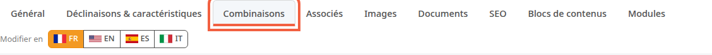
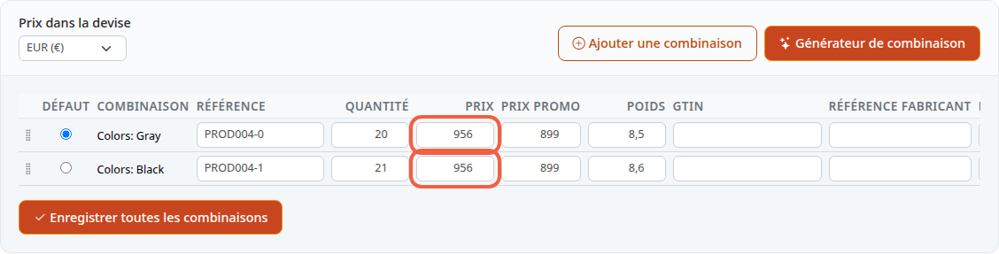
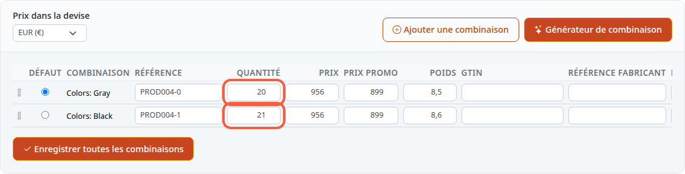

Le prix et le stock d'un produit se règlent dans un seul onglet de la fiche. Ce tutoriel vous y conduit et vous dit où se trouve la TVA. Ces réglages décident de ce que le client paie et du moment où le produit n'est plus disponible.

**Avant de commencer :** il vous faut un produit existant (voir [Créer un produit](/catalog/create-product/)). La taxe et la règle de taxe sont expliquées dans [Régler la TVA](/settings/tax-rules/) : ce tutoriel n'y revient pas.

## Étape 1 : ouvrir l'onglet Combinaisons

Le prix et le stock ne sont pas dans l'onglet **Général**. Ils sont dans l'onglet **Combinaisons**.

1. Dans le menu de gauche, cliquez sur **Catalogue**, puis sur **Produits**.
2. Cliquez sur le nom du produit, par exemple **Scarlett**.
3. Cliquez sur l'onglet **Combinaisons**.

Attention à l'onglet voisin **Déclinaisons & caractéristiques** : il sert à autre chose. Une combinaison est une variante vendable du produit, par exemple le fauteuil en gris ou en noir. Chaque combinaison a son propre prix et son propre stock.

Un produit que vous venez de créer avec la fenêtre **Créer un nouveau produit** n'a pas encore de combinaison. L'onglet affiche alors un formulaire à la place du tableau : passez directement à [Un produit sans combinaison](#un-produit-sans-combinaison).

## Étape 2 : changer le prix

Le tableau a une ligne par combinaison.

1. Dans la ligne de la combinaison, cliquez dans la colonne **Prix**.
2. Saisissez le nouveau prix, par exemple `950`.
3. Pour une promotion, saisissez le prix réduit dans **Prix promo**, par exemple `899`.
4. Faites défiler le tableau vers la droite, puis cochez la case de la colonne **Promo**. Sans cette case, le client paie le **Prix**, pas le **Prix promo**. Une promotion programmée dans **Outils**, **Promotions** coche elle-même cette case.

Le prix saisi est un prix hors taxes (HT), c'est-à-dire avant l'ajout de la TVA. Le tableau n'a pas de colonne TTC (toutes taxes comprises) : le client verra le prix HT augmenté de la taxe de la règle de taxe du produit. Si la boutique a plusieurs devises, le prix saisi est celui de la devise choisie dans **Prix dans la devise**, en haut du tableau.

## Étape 3 : changer le stock

Le stock est le nombre d'unités que vous avez à vendre.

1. Dans la ligne de la combinaison, cliquez dans la colonne **Quantité**.
2. Saisissez le nombre d'unités disponibles, par exemple `20`.

Un produit en plusieurs combinaisons a donc un stock par combinaison. Pour un fauteuil gris et un fauteuil noir, modifiez les deux lignes.

## Étape 4 : enregistrer

1. Cliquez sur **Enregistrer toutes les combinaisons**, sous le tableau.

Le bouton enregistre toutes les lignes d'un coup.

## La TVA d'un produit

Un produit est rattaché à une règle de taxe, pas à une taxe. Le tableau des combinaisons n'a pas de champ **Règle de taxe** : il garde la règle du produit sans la modifier. Ce champ n'existe que pour un produit sans combinaison.

## Un produit sans combinaison

C'est le cas d'un produit créé avec la fenêtre **Créer un nouveau produit**, tant que vous ne lui avez pas ajouté de combinaison. L'onglet **Combinaisons** affiche alors la phrase **Le prix par défaut est utilisé lorsqu'aucune combinaison n'est utilisée.**, puis un formulaire :

- **Règle de taxe** : liste de choix, **Sélectionnez une règle de taxe** ;
- **Prix du produit Hors Taxes** et **Prix du produit taxes incluses** ;
- **Quantité en stock** ;
- **Prix promo HT**, **Prix promo TTC** et la case **En promotion**.

Vous saisissez l'un des deux prix et l'autre se calcule :

1. Choisissez d'abord la **Règle de taxe**, par exemple `Règle de taxes par défaut`.
2. Saisissez le prix dans **Prix du produit Hors Taxes**, par exemple `25`, puis cliquez dans un autre champ : **Prix du produit taxes incluses** se remplit.
3. Ou saisissez le prix dans **Prix du produit taxes incluses** : le prix HT se remplit à son tour.
4. Dans **Quantité en stock**, saisissez le nombre d'unités disponibles, par exemple `20`.
5. Pour une promotion, saisissez **Prix promo HT** et cochez **En promotion**.
6. Cliquez sur **Enregistrer**, en bas du formulaire.

Sans règle de taxe choisie, rien ne se calcule. Le calcul utilise le pays par défaut de la boutique. Seul le prix HT est enregistré ; le prix TTC est un calcul d'aide. La démonstration n'a aucun produit dans ce cas : cette partie n'a donc pas de capture.

## Le résultat

Après l'enregistrement, la page se recharge sur l'onglet **Combinaisons**, qui affiche vos nouveaux prix et quantités. Le bloc **Stock faible** du tableau de bord liste au plus 5 combinaisons à 5 unités ou moins, la plus basse en premier (voir [Découvrir le back-office](/getting-started/back-office-tour/)).
