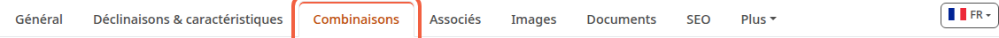
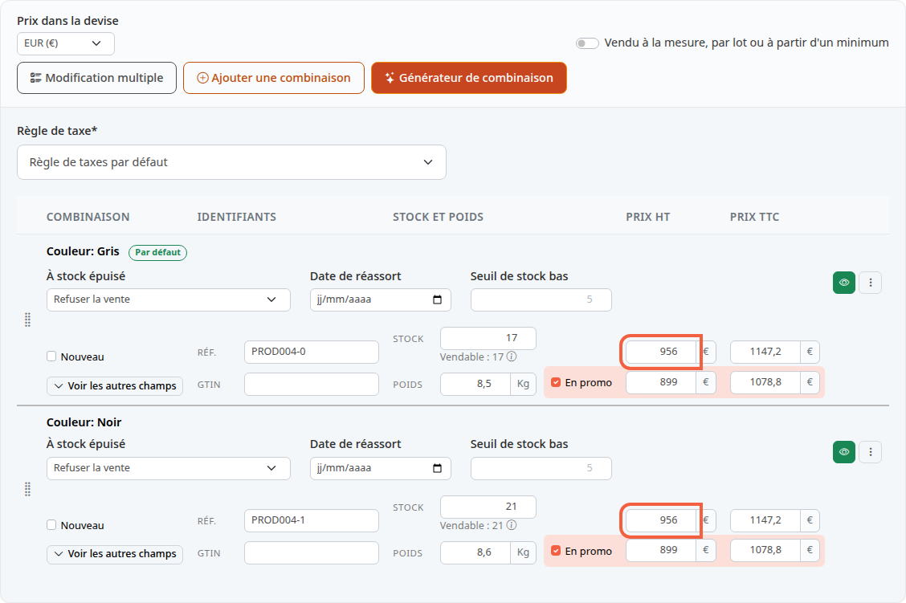
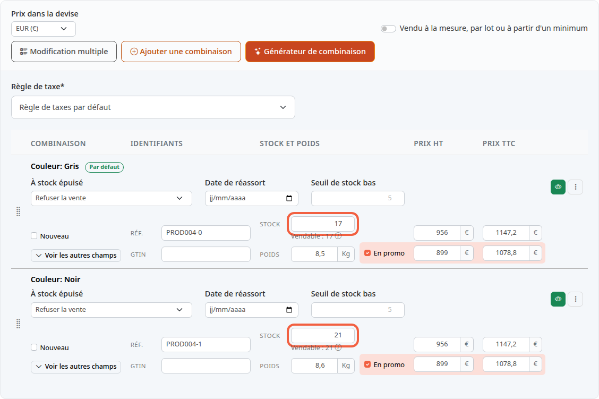
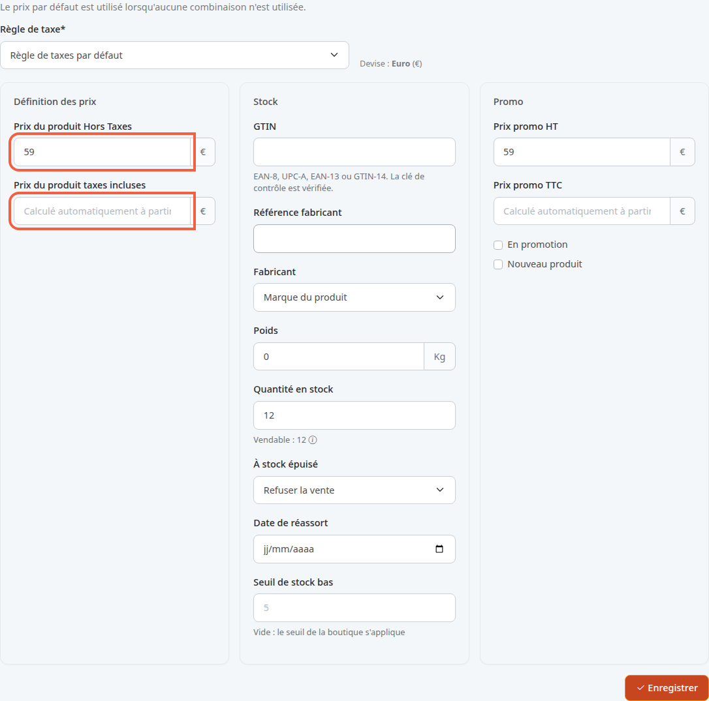

Le prix et le stock d'un produit se règlent dans un seul onglet de la fiche. Ce tutoriel vous y conduit et vous dit où se trouve la TVA. Ces réglages décident de ce que le client paie et du moment où le produit n'est plus disponible.

**Avant de commencer :** il vous faut un produit existant (voir [Créer un produit](/catalog/create-product/)). La taxe et la règle de taxe sont expliquées dans [Régler la TVA](/settings/tax-rules/) : ce tutoriel n'y revient pas.

## Étape 1 : ouvrir l'onglet Combinaisons

Le prix et le stock ne sont pas dans l'onglet **Général**. Ils sont dans l'onglet **Combinaisons**.

1. Dans le menu de gauche, cliquez sur **Catalogue**, puis sur **Produits**.
2. Cliquez sur le nom du produit, par exemple **Scarlett**.
3. Cliquez sur l'onglet **Combinaisons**.

Attention à l'onglet voisin **Déclinaisons & caractéristiques** : il sert à autre chose. Une combinaison est une variante vendable du produit, par exemple le fauteuil en gris ou en noir. Chaque combinaison a son propre prix et son propre stock.

Un produit que vous venez de créer avec la fenêtre **Créer un nouveau produit** n'a pas encore de combinaison. L'onglet affiche alors un formulaire à la place du tableau : passez directement à [Un produit sans combinaison](#un-produit-sans-combinaison).

## Étape 2 : changer le prix

Le tableau montre un bloc de trois lignes par combinaison. Le nom de la combinaison est sur la première ligne, le prix sur la deuxième, la promotion sur la troisième.

1. Dans le bloc de la combinaison, cliquez dans le champ **Prix HT**, sur la deuxième ligne.
2. Saisissez le nouveau prix, par exemple `950`, puis cliquez dans un autre champ : **Prix TTC** se remplit.
3. Pour une promotion, cochez **En promo** sur la troisième ligne. Les champs **Prix promo HT** et **Prix promo TTC** se débloquent.
4. Saisissez le prix réduit dans **Prix promo HT**, par exemple `899`.

Sans la case **En promo**, le client paie le **Prix HT**, pas le **Prix promo HT**. Une promotion programmée dans **Outils**, **Promotions** coche elle-même cette case.

Un prix HT est un prix hors taxes, c'est-à-dire avant l'ajout de la TVA. Un prix TTC est un prix toutes taxes comprises. Vous pouvez saisir l'un ou l'autre : l'autre se calcule avec la **Règle de taxe** du produit, affichée au-dessus du tableau. Seul le prix HT est enregistré.

Si la boutique a plusieurs devises, le prix saisi est celui de la devise choisie dans **Prix dans la devise**, en haut du tableau.

## Étape 3 : changer le stock

Le stock est le nombre d'unités que vous avez à vendre.

1. Dans le bloc de la combinaison, cliquez dans le champ **Stock**, sur la deuxième ligne.
2. Saisissez le nombre d'unités disponibles, par exemple `20`.

Un produit en plusieurs combinaisons a donc un stock par combinaison. Pour un fauteuil gris et un fauteuil noir, modifiez les deux blocs.

Sous le champ, la mention **Vendable : 20** indique ce que la boutique peut encore vendre, une fois retirées les unités retenues dans des paniers.

Sur la première ligne du bloc, trois réglages décident de ce qui se passe quand le stock est épuisé :

- **À stock épuisé** : **Refuser la vente**, **Continuer à vendre** ou **Vendre jusqu'à une limite (précommande)**. Avec ce dernier choix, un champ **Limite de précommande** apparaît : c'est le nombre d'unités vendables sous zéro.
- **Date de réassort** : la date à laquelle vous attendez du stock.
- **Seuil de stock bas** : le stock à partir duquel la combinaison est signalée comme faible. Laissé vide, le seuil de la boutique s'applique.

## Étape 4 : enregistrer

Dès que vous modifiez un champ, une barre apparaît en bas de l'écran.

1. Cliquez sur **Enregistrer les modifications**.

Le bouton enregistre tous les blocs d'un coup. **Annuler les modifications** remet les champs comme ils étaient.

## La TVA d'un produit

Un produit est rattaché à une règle de taxe, pas à une taxe. Le champ **Règle de taxe** se trouve au-dessus du tableau des combinaisons, et dans le formulaire d'un produit sans combinaison. La règle choisie vaut pour tout le produit : la changer recalcule les prix TTC affichés.

## Un produit sans combinaison

C'est le cas d'un produit créé avec la fenêtre **Créer un nouveau produit**, tant que vous ne lui avez pas ajouté de combinaison. L'onglet **Combinaisons** affiche alors la phrase **Le prix par défaut est utilisé lorsqu'aucune combinaison n'est utilisée.**, puis un formulaire :

- **Règle de taxe** : liste de choix, **Sélectionnez une règle de taxe** ;
- **Prix du produit Hors Taxes** et **Prix du produit taxes incluses** ;
- **Quantité en stock** ;
- **Prix promo HT**, **Prix promo TTC** et la case **En promotion**.

Vous saisissez l'un des deux prix et l'autre se calcule :

1. Vérifiez la **Règle de taxe** : elle est déjà celle du produit, **Default Tax Rule** sur la capture (la liste affiche les noms dans la langue par défaut de la boutique, ici l'anglais). Changez-la si ce n'est pas la bonne.
2. Saisissez le prix dans **Prix du produit Hors Taxes**, par exemple `25`, puis cliquez dans un autre champ : **Prix du produit taxes incluses** se remplit.
3. Ou saisissez le prix dans **Prix du produit taxes incluses** : le prix HT se remplit à son tour.
4. Dans **Quantité en stock**, saisissez le nombre d'unités disponibles, par exemple `20`.
5. Pour une promotion, saisissez **Prix promo HT** et cochez **En promotion**.
6. Cliquez sur **Enregistrer**, en bas du formulaire.

Sans règle de taxe choisie, rien ne se calcule. Le calcul utilise le pays par défaut de la boutique. Seul le prix HT est enregistré ; le prix TTC est un calcul d'aide. Sur la capture, `59` en HT donne `70,8` en TTC : le champ affiche le résultat arrondi à six décimales au plus, sans zéro inutile.

## Le résultat

Après l'enregistrement, la page se recharge sur l'onglet **Combinaisons**, qui affiche vos nouveaux prix et quantités. Le bloc **Stock faible** du tableau de bord liste au plus 5 combinaisons dont le stock est au seuil de stock bas ou en dessous, la plus basse en premier : le seuil de la combinaison s'il existe, sinon celui de la boutique, 5 au départ (voir [Découvrir le back-office](/getting-started/back-office-tour/)).
