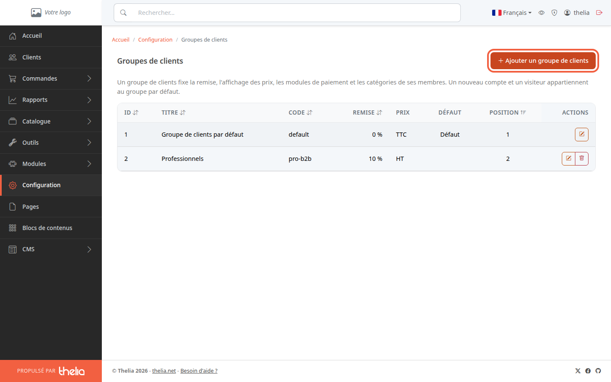
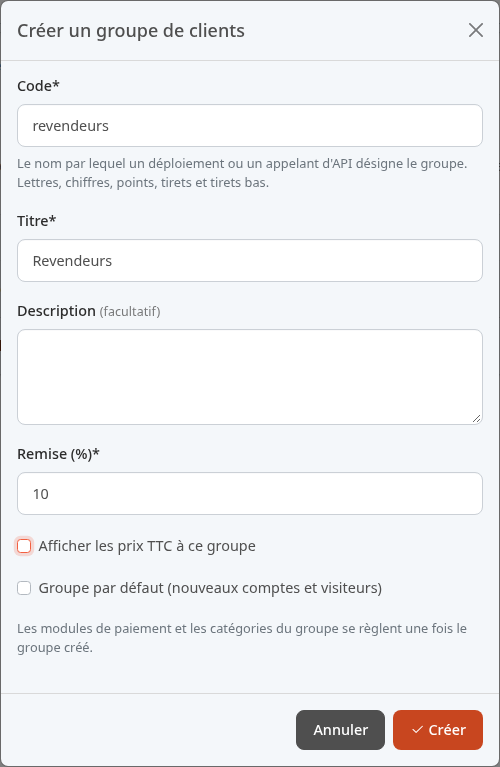
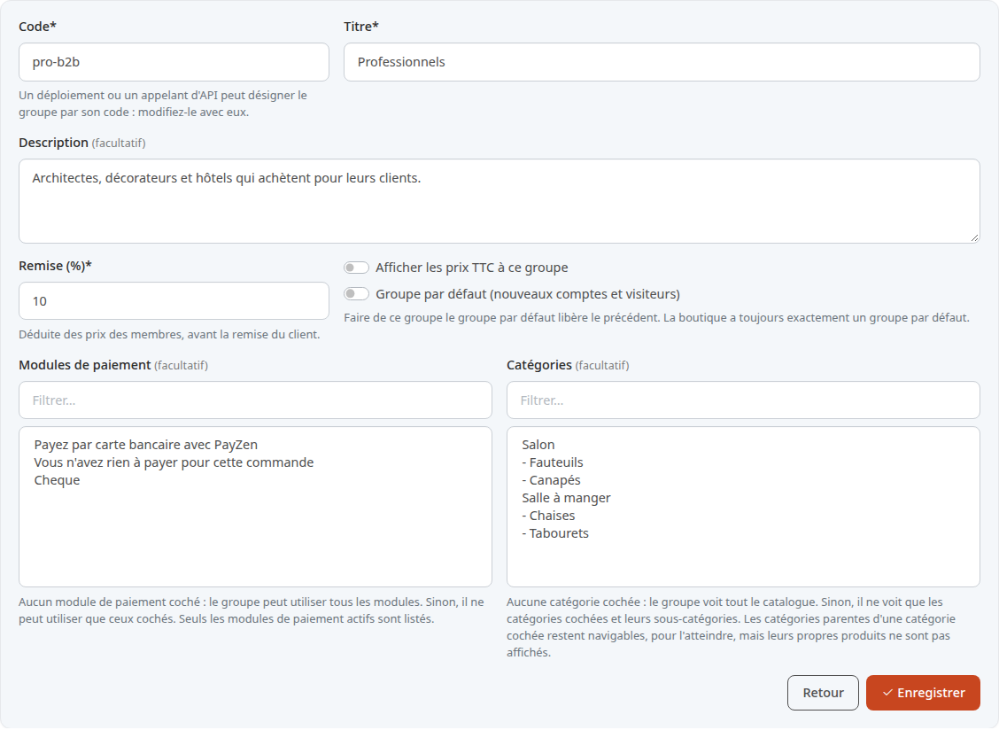
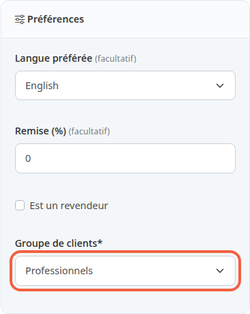
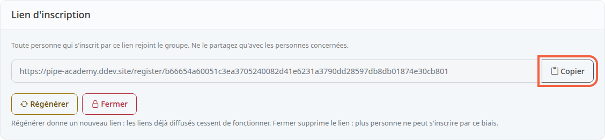
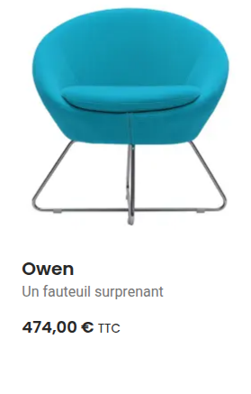
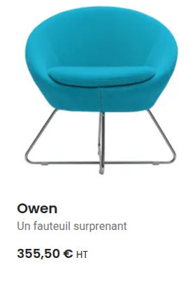
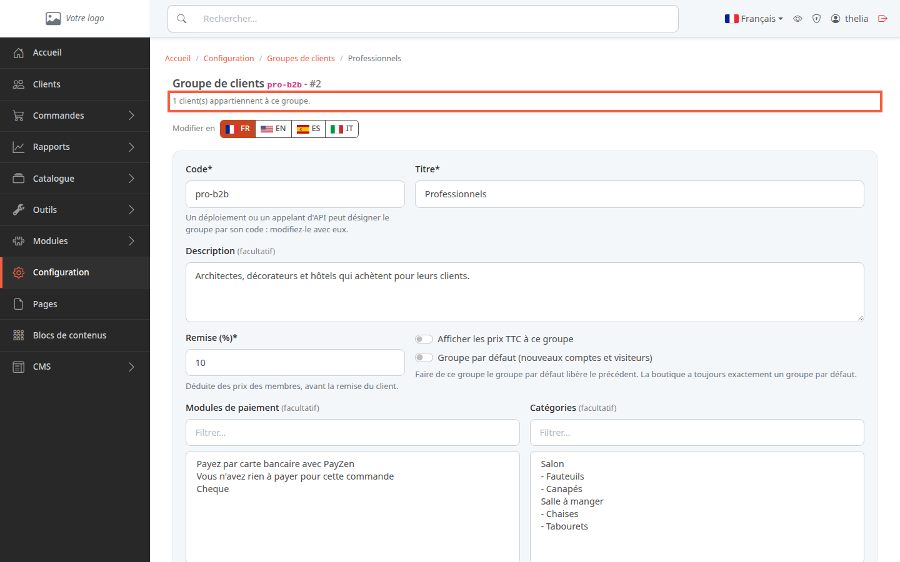

Un groupe de clients réunit des clients qui achètent aux mêmes conditions. Par exemple, vos clients professionnels ont 10 % de remise et voient leurs prix hors taxes, pendant que les particuliers paient le prix affiché toutes taxes comprises.

**Avant de commencer :** il vous faut un compte administrateur qui a le droit de gérer les groupes de clients.

Chaque client appartient à un seul groupe. Tant que vous n'avez rien créé, tout le monde est dans le **Groupe de clients par défaut** : les nouveaux comptes, et aussi les visiteurs qui n'ont pas de compte.

## Étape 1 : ouvrir la liste des groupes

1. Dans le menu à gauche, cliquez sur **Configuration**.
2. Dans la partie **Clients**, cliquez sur **Groupes de clients**.

La liste donne pour chaque groupe sa **Remise**, ses **Prix** (**TTC** ou **HT**) et le groupe marqué **Défaut**. Ici, le groupe Professionnels a déjà été créé avec les réglages de cette page.

## Étape 2 : créer le groupe

1. Cliquez sur **Ajouter un groupe de clients**.
2. Dans **Code**, saisissez un nom court sans espace, par exemple `revendeurs`. Il sert aux outils techniques et aux modules qui désignent le groupe.
3. Dans **Titre**, saisissez le nom du groupe, par exemple Revendeurs.
4. Dans **Description**, notez à qui il est destiné, si vous le souhaitez.
5. Dans **Remise (%)**, saisissez la remise du groupe, par exemple 10. Laissez 0 pour un groupe sans remise.
6. Pour un groupe de professionnels, décochez **Afficher les prix TTC à ce groupe** : ses membres verront les prix hors taxes.
7. Laissez **Groupe par défaut (nouveaux comptes et visiteurs)** décoché.
8. Cliquez sur **Créer**.

La remise va de 0 à 100. Elle s'applique au prix normal du produit, pas à son prix en promotion : le client paie le moins cher des deux.

La fiche du groupe s'ouvre. Les moyens de paiement et les catégories se règlent sur cette fiche, une fois le groupe créé.

## Étape 3 : régler le groupe

La fiche reprend les champs de la création et en ajoute deux.

- **Modules de paiement** : laissez la liste sans sélection pour que le groupe puisse payer de toutes les façons. Sélectionnez un ou plusieurs moyens pour le limiter à ceux-là, par exemple Cheque seul.
- **Catégories** : laissez la liste sans sélection pour que le groupe voie tout le catalogue. Sélectionnez des catégories pour lui réserver celles-là et leurs sous-catégories, par exemple Salle à manger pour un restaurateur.

Les deux listes ne sont pas des cases à cocher : cliquez sur une ligne pour la choisir, et tenez la touche Ctrl (Cmd sur Mac) en cliquant pour en choisir plusieurs. Le champ **Filtrer…** au-dessus de chaque liste aide à retrouver une ligne.

Ces listes ne concernent que ce groupe : les autres groupes gardent leurs propres réglages.

Cliquez sur **Enregistrer** pour garder vos réglages.

Le titre et la description se traduisent : changez de langue avec les boutons **Modifier en** (**FR**, **EN**…) en haut de la fiche, puis enregistrez dans chaque langue.

## Étape 4 : placer un client dans le groupe

1. Dans le menu à gauche, cliquez sur **Clients**.
2. Ouvrez la fiche du client, par exemple Greta Müller.
3. Dans le bloc **Préférences**, choisissez le groupe dans **Groupe de clients**, par exemple Professionnels.
4. Cliquez sur **Enregistrer**.

Le client a peut-être aussi une remise à lui, dans **Remise (%)** du même bloc. Elle s'applique après celle du groupe, sur le prix déjà remisé : un client à 5 % dans un groupe à 10 % paie 100 € × 0,90 × 0,95 = 85,50 €, et non 85,00 €.

## Étape 5 : donner un lien d'inscription

Plutôt que de déplacer chaque client à la main, vous pouvez envoyer un lien d'inscription. Toute personne qui crée son compte par ce lien entre directement dans le groupe. Le lien ne sert qu'à créer un compte : un client qui en a déjà un se place dans le groupe à la main, comme à l'étape 4.

1. En bas de la fiche du groupe, dans **Lien d'inscription**, cliquez sur **Ouvrir un lien d'inscription**.
2. Cliquez sur **Copier**.
3. Collez le lien dans le message que vous envoyez à vos clients professionnels.

Personne ne valide les comptes créés par ce lien : ne le donnez qu'aux personnes concernées. S'il circule trop, cliquez sur **Régénérer** : un nouveau lien remplace l'ancien, qui ne fonctionne plus. **Fermer** supprime le lien.

Le groupe par défaut n'a pas de lien d'inscription : on y entre par le formulaire d'inscription habituel de la boutique.

## Ce que voit le client en boutique

Voici le fauteuil Owen dans la catégorie Fauteuils. Un visiteur sans compte le voit à 474,00 € TTC.

Greta Müller, membre du groupe Professionnels, se connecte et voit le même fauteuil à 355,50 € HT : le prix hors taxes de 395,00 €, moins 10 %.

Le panier, la commande, la facture et les e-mails de commande montrent eux aussi les montants hors taxes ; le total à payer reste affiché toutes taxes comprises. Chaque commande garde le groupe, la remise et l'affichage HT ou TTC du jour de l'achat : changer le groupe plus tard ne modifie pas une facture déjà émise.

## Le groupe ailleurs dans le back-office

Une fois créé, le groupe apparaît dans d'autres écrans :

- sur la fiche d'un produit, onglet **Combinaisons**, le bloc **Prix par groupe de clients** donne au groupe un prix à lui, hors taxes, à la place de la remise du groupe (la remise propre du client s'applique encore) ;
- dans un code promo, la condition **Valable pour un ou plusieurs groupes de clients** le réserve à certains groupes ;
- une règle de prix catalogue ou une promotion peut être réservée à certains groupes.

Quand une règle de prix ou une promotion réservée donne un autre prix que celui du groupe, le client paie le moins cher des deux.

## Supprimer un groupe

Dans la liste, le bouton de suppression d'un groupe ouvre une confirmation. Ses clients passent alors dans le groupe par défaut. Ses prix par groupe sont supprimés avec lui, et il disparaît des règles de prix et des promotions qui lui étaient réservées. Les commandes passées gardent la remise et l'affichage du jour de l'achat. Le groupe par défaut ne se supprime pas.

Un client dont vous anonymisez le compte revient lui aussi dans le groupe par défaut.

## Le résultat

Le groupe apparaît dans **Groupes de clients** avec sa remise et son affichage. Ses membres voient en boutique les prix et les conditions du groupe dès leur connexion.

En haut de sa fiche, une ligne indique combien de clients il compte, par exemple **1 client(s) appartiennent à ce groupe.**

