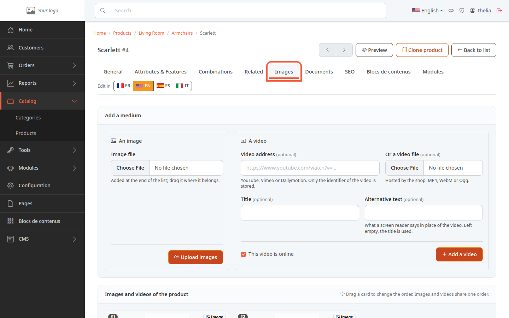
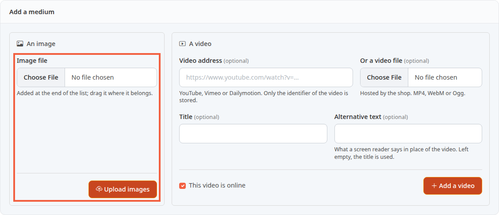
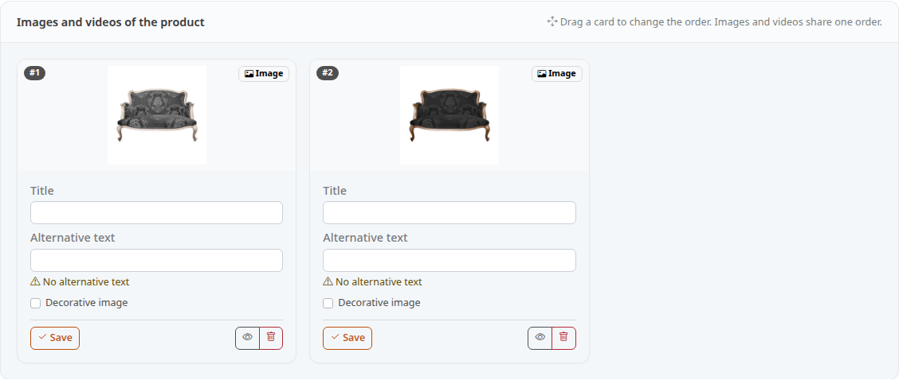
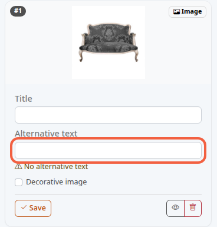

Images are your product's photos: without them, the customer only sees text. This tutorial shows how to add them, sort them and describe each one.

**Before you start:** you need an existing product (see [Create a product](/en/catalog/create-product/)) and an image file on your computer. To get into the back office, see [Discover the back office](/en/getting-started/back-office-tour/).

## Step 1: open the Images tab

1. In the left menu, click **Catalog**, then **Products**.
2. Click the product name, for example **Scarlett**.
3. Click the **Images** tab.

The tab has two blocks: **Add a medium** at the top, and the **Images and videos of the product** list below it. The video is set in the same block, but this tutorial only covers images.

## Step 2: upload an image

Uploading means sending a file from your computer to your store.

1. In the **An image** frame, click **Choose File**.
2. Choose the photo on your computer, for example `scarlett-armchair.jpg`.
3. Click **Upload images**.

The image is added at the end of the list. The field only offers image files. To add more, repeat the three actions.

## Step 3: choose the order of the images

The **Images and videos of the product** list shows one card per image, with its rank at the top left: **#1**, **#2**, and so on.

1. Drag a card with the mouse to its new place.
2. Release it: the ranks are renumbered and the new order is saved right away, without a button.

There is no "main image" setting. On the store, the product's thumbnail in lists is the first image of this list that is not hidden, and the product page shows the photos in the same order. Put your best photo at **#1**.

## Step 4: fill in the alternative text

The alternative text describes the image in words. A screen reader (software that reads the page aloud for a visually impaired person) speaks it in place of the photo, on the product page. If it is empty, the store uses the image's **Title**, then the product name. Under an image with no description, the screen shows **No alternative text**.

1. In **Title**, enter a name, for example `Scarlett armchair, front view`.
2. In **Alternative text**, describe what the photo shows, for example `Gray armchair with wooden legs, front view`.
3. Click **Save** at the bottom of the card.

For an image that is only decoration, tick **Decorative image**: the **Alternative text** field turns gray and the note **Silenced for a decorative image** appears below it. On the product page, the screen reader then skips the image. Then click **Save**.

Each card has its own **Save** button: it only saves the fields of that card.

## Step 5: hide or delete an image

At the bottom of each card, there are two icon buttons:

- the eye hides the image without deleting it: it no longer appears on the store (hover over it to read **Hide**, or **Show** if the image is already hidden). A hidden image carries the **Hidden** badge;
- the trash can deletes the image after a confirmation request (the browser message reads **Are you sure?**).

## The result

The cards of the **Images** tab show your photos in the order you chose. To check the effect on the store, click **Preview** at the top of the page. Putting the product itself online is covered in [Put a product online or offline](/en/catalog/publish-product/).
