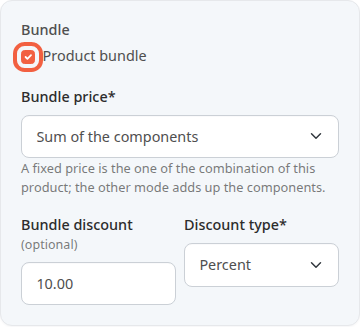
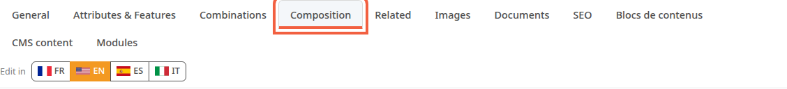
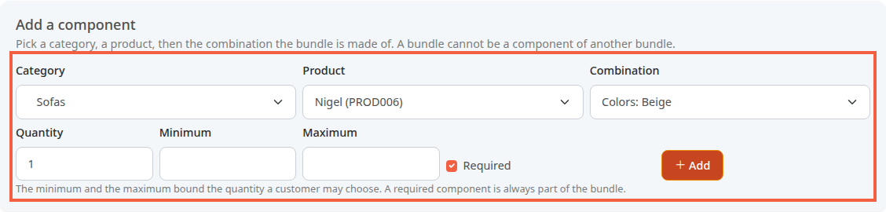
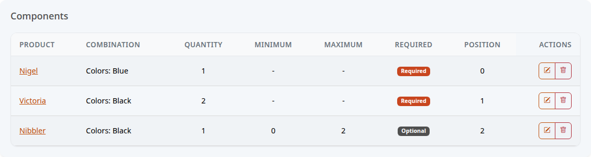
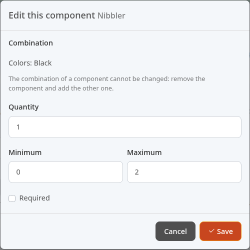
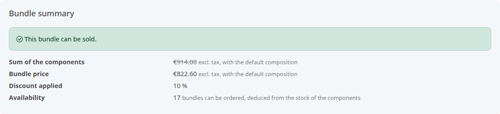
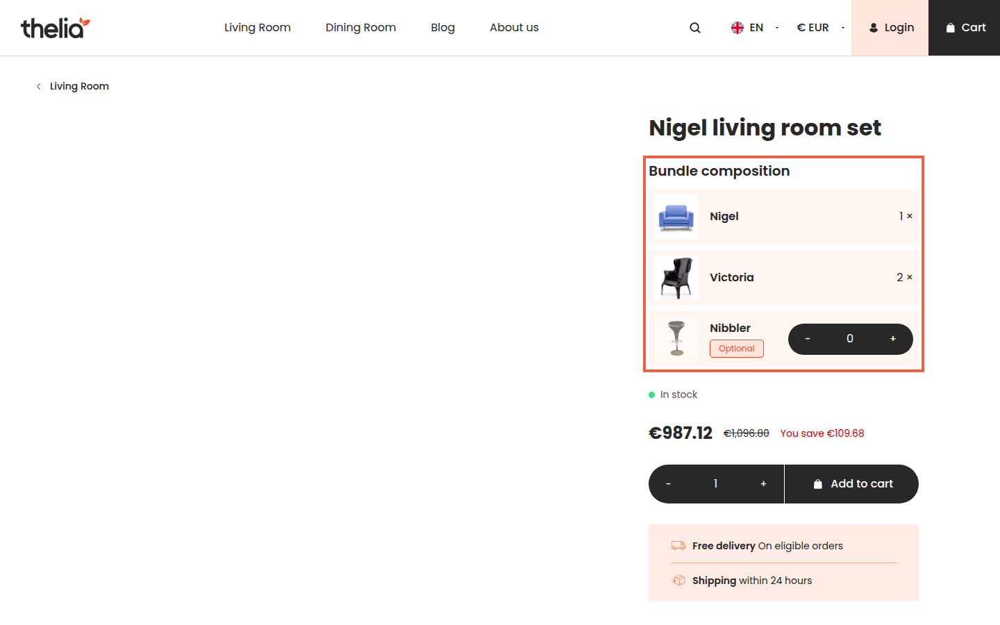

A bundle sells several products together as one product. For example, a "Nigel living room set" brings together a Nigel sofa, two Victoria armchairs and, if the customer wants, one or two Nibbler stools, with 10% off.

The customer adds the bundle to the cart in one go. You do not manage a separate stock: the bundle is served from the stock of each product it contains.

**Before you start:** the products that make up the bundle already exist in your catalog. The bundle in the example is not in the demo data: it was created for this page.

## Step 1: create the bundle's product

A bundle is a product like any other. Create it as described in [Create a product](/en/catalog/create-product/), with for example:

- **Product reference**: PACK-SALON-NIGEL
- **Product title**: Nigel living room set
- **Default product category**: Living Room

Create a new product for the bundle. A product that already has several combinations (for example several colors) cannot become a bundle. The bundle messages also call a combination a "sale element": Thelia says so with the message **Product … has … sale elements: a bundle has a single one, so it cannot become a bundle.**

## Step 2: make it a bundle and choose its price

1. In the product page, stay on the **General** tab.
2. In the **Bundle** block, tick **Product bundle**.
3. In **Bundle price**, choose how the price is calculated.
4. If you chose **Sum of the components**, enter the discount in **Bundle discount**, for example 10.
5. In **Discount type**, choose **Percent** or **Amount**.
6. Click **Save**.

The two ways to set the price:

- **Fixed price**: the bundle has its own price, the one you enter for this product, as in [Set the price, VAT and stock of a product](/en/catalog/set-price-stock/).
- **Sum of the components**: Thelia adds up the price of the products the customer kept, then subtracts the discount. If you change the price of an armchair, the bundle price follows.

A percentage discount cannot exceed 100. The discount fields only appear with **Sum of the components**.

## Step 3: add the products of the bundle

Once the product is saved as a bundle, a **Composition** tab appears in its page.

1. Click the **Composition** tab.

2. In the **Add a component** block, choose a **Category**, for example Sofas.
3. Choose the **Product**, for example Nigel.
4. Choose the **Combination**, for example Colors: Blue.
5. In **Quantity**, enter how many times this product goes into the bundle, for example 1.
6. Leave **Required** ticked for a product that is always in the bundle.
7. Click **Add**.
8. Repeat for each product, for example Victoria with quantity 2.

A combination already in the bundle is no longer offered: in the screenshot, blue Nigel is already a component, so the list offers its other colors.

A component is a product that goes into the bundle. A bundle cannot contain another bundle.

### Let the customer choose an optional product

For a product the customer may or may not take, like the Nibbler stool:

1. Enter the **Quantity**, for example 1. It must stay between the minimum and the maximum.
2. In **Minimum**, enter 0: the customer may leave it out.
3. In **Maximum**, enter the highest quantity they can choose, for example 2.
4. Untick **Required**.
5. Click **Add**.

The minimum and the maximum bound the quantity the customer can choose. Left empty, the quantity is fixed.

The **Components** list shows what the bundle contains. The **Required** or **Optional** badge tells whether the customer can remove the product.

To change a quantity, click the pencil on the line, edit the fields, then click **Save**. The combination of a component cannot be changed: remove the component with the trash can, then add the other combination.

## Step 4: check the price and the availability

At the top of the **Composition** tab, the **Bundle summary** block says whether the bundle can be sold, and at what price.

In the example, the price is calculated on the default composition, that is, without the optional stool:

- **Sum of the components**: €638.00 for the sofa, plus 2 × €138.00 for the armchairs, which makes €914.00 excl. tax.
- **Bundle price**: €914.00 minus 10%, which makes €822.60 excl. tax.
- **Availability**: 46 blue sofas and 34 black armchairs in stock. Each bundle takes 1 sofa and 2 armchairs: the sofas are enough for 46 bundles, the armchairs for 17. The smaller of the two numbers gives 17 bundles that can be ordered.

The stock you would enter for the bundle's own product is not used: the **Combinations** tab says so.

If the block shows **A required component is offline or deleted: this bundle cannot be sold.** or **A component is out of stock: this bundle cannot be ordered for now.**, put the product back online or restock it.

## What the customer sees

On the bundle page in the shop, the **Bundle composition** lists each product with its quantity. An optional product carries the **Optional** label. With a minimum and a maximum, like the stool, it has a quantity selector: the customer adds it with **+**, and the price updates. Without a minimum or maximum, it is a checkbox, **Include … in the bundle**.

The price shown is that of the chosen composition, with the sum crossed out and the **You save** line. Here, €987.12 incl. tax instead of €1,096.80, that is €822.60 excl. tax plus the VAT of the bundle product.

Without an image, the photo area stays empty: add an image to the bundle as for any product, see [Add images to a product](/en/catalog/add-product-images/).

The price takes into account the discount of the logged-in customer's group, and is shown excluding tax if their group sees prices excluding tax.

## The result

The bundle appears in your catalog and in the shop like a product. With each order, Thelia takes each product of the bundle out of stock, not the bundle itself. On the invoice and the delivery note, the bundle's products are listed under the bundle line.
