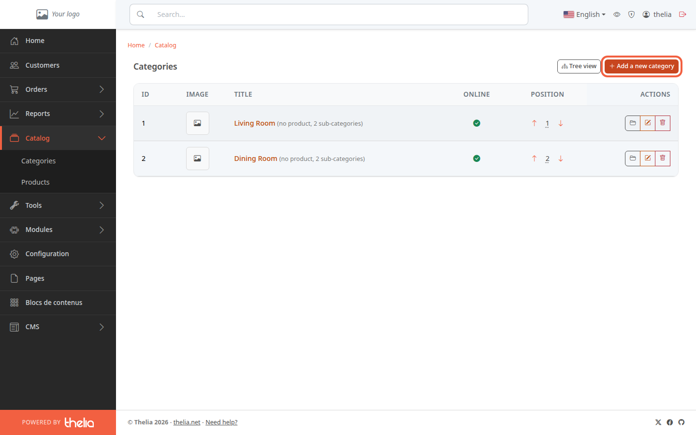
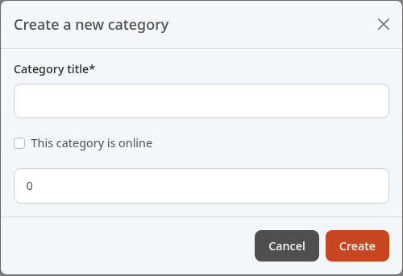
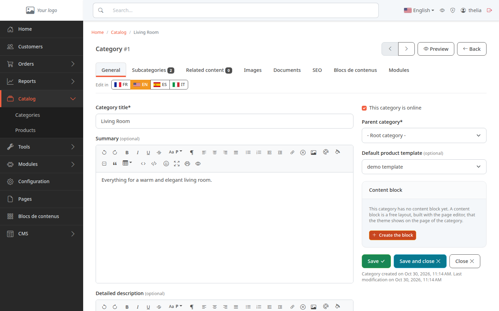
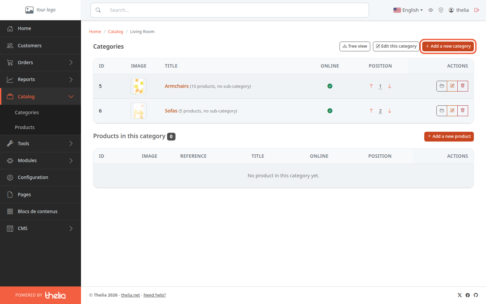

A category groups products, for example **Living Room** or **Dining Room** in a furniture store. It organizes your catalog and lets customers browse it.

**Before you start:** you need an administrator account (see [Discover the back office](/en/getting-started/back-office-tour/)).

## Step 1: open the category list

1. In the left menu, click **Catalog**.
2. Click **Categories**.

The **Categories** page lists the top-level categories. Each line shows the number of products and subcategories.

## Step 2: open the creation form

1. Click **Add a new category**, at the top right.

A **Create a new category** window opens.

## Step 3: fill in the window

1. In **Category title**, enter the name your customers will see, for example `Shoes`. This field is required (it has an asterisk).
2. Tick **This category is online** if customers should see it right away. If left unticked, the category is created offline: customers cannot open its page.
3. Click **Create**.

To close the window without creating anything, click **Cancel**.

The numeric field with no label under the checkbox (it shows `0`) holds the parent category. Leave it as is: `0` creates a top-level category.

## Step 4: complete the category page

After you click **Create**, the category page opens. It is shown here with the demo's **Living Room** category.

The highlighted flag next to **Edit in** shows the language of the page. It is not always the interface language: the page can open in another language. If the title you just entered does not appear, click the flag of your language, for example **EN**.

You can add a **Summary** and a **Detailed description** (both optional), choose the **Parent category** and look at the **Subcategories**, **Images** and **SEO** tabs. Click **Save** to keep your changes, or **Save and close** to go back to the category list.

## Create a subcategory

A subcategory is a category placed inside another one, for example **Armchairs** in **Living Room**.

1. In the category list, click the title of the parent category, for example **Living Room**.
2. Click **Add a new category**.
3. Fill in the window as in step 3. The parent category is already set: the numeric field shows its number, for example `1` for **Living Room** (**ID** column of the list).

## The result

The new category appears under **Catalog**, **Categories**, with a green dot in the **Online** column if you ticked the box. You can now [create a product](/en/catalog/create-product/) in it.
