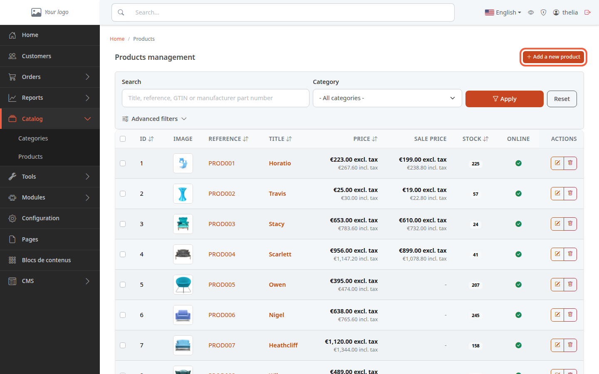
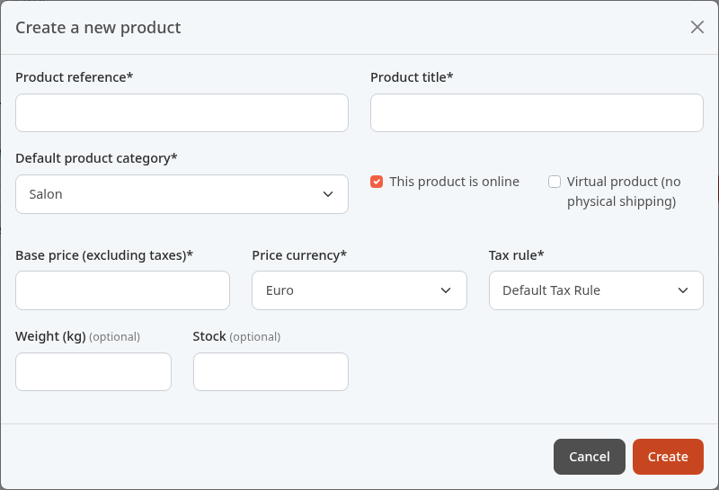
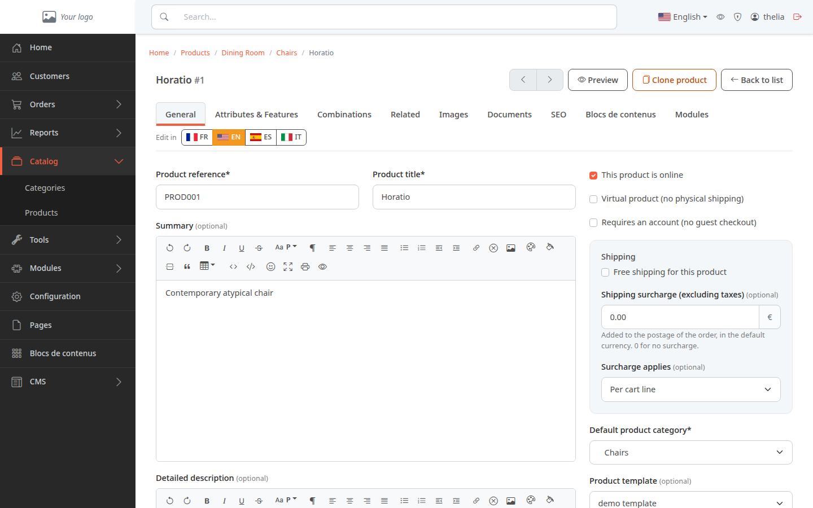
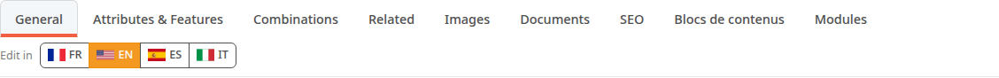

A product is an item you sell, with its reference, title, price and category. This tutorial creates a product page with a first price. Photos, and the details of price and stock, are set later on their own pages.

**Before you start:** you need at least one [category](/en/catalog/create-category/) and a tax rule (the store has one by default, see [Set up VAT](/en/settings/tax-rules/)).

## Step 1: open the form

1. In the left menu, click **Catalog**, then **Products**.
2. Click **Add a new product**, at the top right.

You can also click the title of a category under **Catalog**, **Categories**, then **Add a new product**: the category is then already chosen.

## Step 2: fill in the window

The **Create a new product** window opens. A label followed by an asterisk is required. A label followed by **(optional)** can stay empty.

Required fields:

1. In **Product reference**, enter a code of your choice to find the product again, for example `ORGANIC-TSHIRT-01`.
2. In **Product title**, enter the name shown to customers, for example `Organic cotton T-shirt`.
3. In **Default product category**, choose the department of the product, for example `Clothing`. The list first shows the first category of the catalog: change it if it is not the right one.
4. In **Base price (excluding taxes)**, enter the price before taxes, for example `25`. This is the price before VAT.
5. In **Price currency**, keep the proposed currency.
6. In **Tax rule**, choose the product's VAT. The first one in the list is the default rule, created at installation.

Optional fields:

- **This product is online**: ticked at the start. The product is visible to customers as soon as it is created. Untick the box if the page is not ready (see [Put a product online or offline](/en/catalog/publish-product/)).
- **Virtual product (no physical shipping)**: tick it for an item that is not delivered, for example a file to download.
- **Weight (kg)**: for example `0.2`.
- **Stock**: the number of units available, for example `50`.

On the demo store, this window can show some names in another language than the interface: here the category appears as **Salon**, while the category list shows **Living Room**. They are the same item.

If a required field stays empty, the product is not created. The price including tax, the VAT and the stock are set in more detail in [Set the price, VAT and stock](/en/catalog/set-price-stock/).

## Step 3: create the product

1. Click **Create**.

To close the window without creating anything, click **Cancel**.

## Step 4: complete the product page

The new product's page opens on the **General** tab. It is shown here with the demo product **Horatio**.

The highlighted flag next to **Edit in** shows the language in which you edit the page. It is not always the interface language: the page can open in another language. To write the title and texts in another language, click its flag, for example **EN**.

In this tab, you fill in the **Summary** (one or two sentences) and the **Detailed description** (the full text). Click **Save**, lower on the page, to keep your changes.

The other tabs complete the page:

- **Attributes & Features**: the product's attributes (color, size) and features (material). The tab first asks you to choose a product template, the list of attributes and features it offers.
- **Combinations**: the variants sold, each with its own reference, price and stock, for example a T-shirt in size M and blue.
- **Related**: site contents and products to offer with this one (accessories, complementary products).
- **Images**: see [Add images to a product](/en/catalog/add-product-images/).
- **Documents**: a manual or a data sheet to attach.
- **SEO**: the text and address of the page for search engines.

## The result

The product appears under **Catalog**, **Products**, with its reference, title and price. A green dot in the **Online** column shows that customers can see it.
