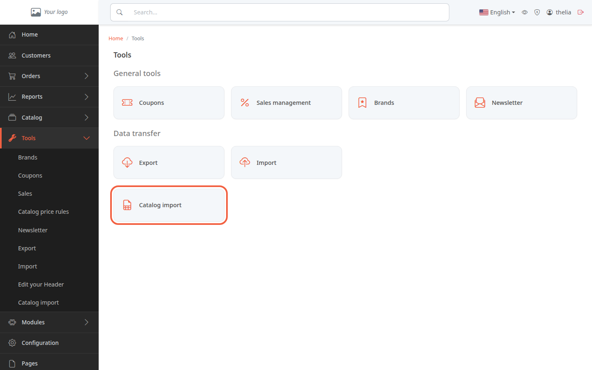
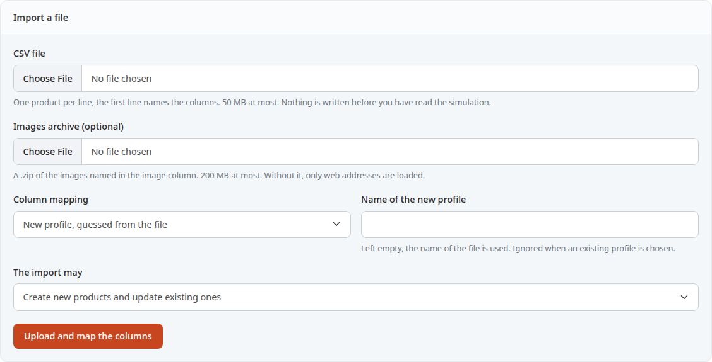
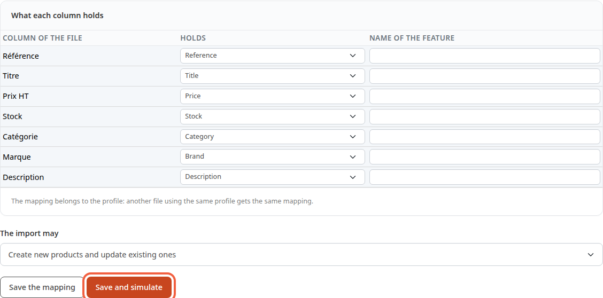
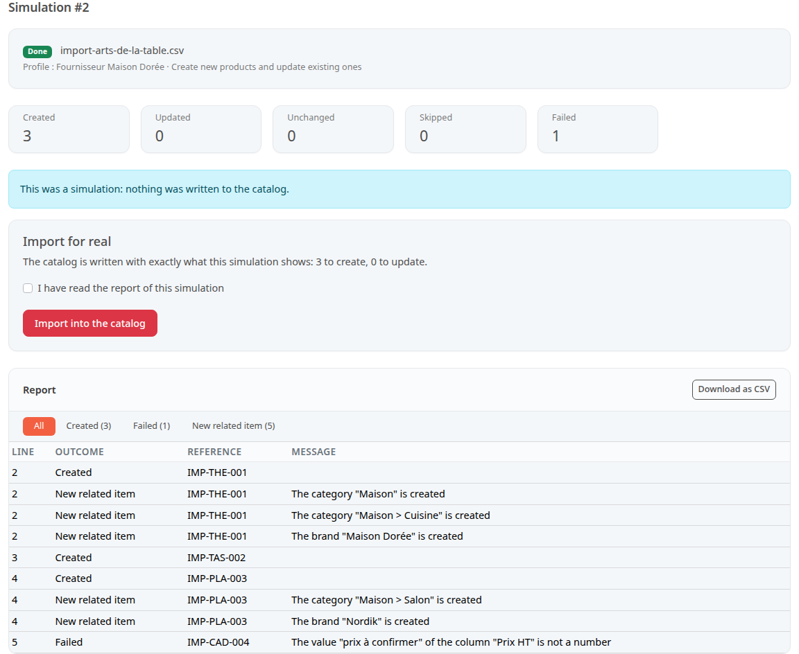
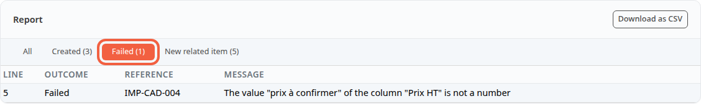

You will add or update several products at once, from a spreadsheet file. This is useful when a supplier sends you its list of new items, or when you move over a catalog kept in a spreadsheet: ten products load in one go instead of ten product pages to fill in.

**Before you start:** the **CSV Importer** module must be installed and enabled (see [Install, enable or disable a module](/en/settings/manage-modules/)). You also need a CSV file, that is, a table saved as text, which any spreadsheet can produce with **Save as**, CSV format.

## Step 1: prepare the file

The file holds one product per line. The first line gives the names of the columns. Here is an example with four products for a tableware shop:

```csv
Référence;Titre;Prix HT;Stock;Catégorie;Marque;Description
IMP-THE-001;Théière en fonte;39,90;12;Maison > Cuisine;Maison Dorée;<p>Théière en fonte émaillée, 1,2 L.</p>
IMP-TAS-002;Tasse en grès;8,50;40;Maison > Cuisine;Maison Dorée;<p>Tasse en grès.</p>
IMP-PLA-003;Plaid en laine;59,00;15;Maison > Salon;Nordik;<p>Plaid en laine mérinos.</p>
IMP-CAD-004;Cadre photo;prix à confirmer;10;Maison > Décoration;Luma;<p>Cadre en chêne.</p>
```

The rules to know:

- **Reference** is the only required column. It identifies the product: a reference already in the shop updates that product, a new reference creates a product.
- To create a product, you also need a title, a category and a price.
- The price is excluding tax. A comma or a point is accepted for the cents: `39,90` or `39.90`.
- The category is written from the highest level to the lowest, separated by `>`: `Maison > Cuisine`. A category or a brand that does not exist yet is created by the import.
- A column whose name starts with `C:` becomes a feature of the product, for example `C:Material` with the value `Cast iron`.
- The separator (semicolon, comma) and the encoding of the file are recognized automatically.

The last line of the example has an unreadable price on purpose: you will see below what the report does with it.

The import only handles simple products. Combinations (sizes, colors) are not imported yet: a `D:Size` column is refused.

## Step 2: send the file

1. In the left menu, click **Tools**.
2. In the **Data transfer** group, click **Catalog import**.



The **Import a file** block appears.



3. In **CSV file**, click **Choose File** and pick your file. It can be 50 MB at most.
4. Leave **Column mapping** on **New profile, guessed from the file** for a first import.
5. In **Name of the new profile**, type a name that says something, for example `Maison Dorée supplier`. Left empty, the name of the file is used.
6. In **The import may**, keep **Create new products and update existing ones**. The other two choices limit the import: **Update existing products only** or **Create new products only**.
7. Click **Upload and map the columns**.

A profile remembers what each column stands for. Next month, when the same supplier sends a file of the same shape, choose its profile in **Column mapping**: you will have nothing to map again.

The **Images archive (optional)** field takes a .zip file of the photos named in an image column. Without an archive, only images given by a web address are loaded.

## Step 3: check the columns and run the simulation

The next page shows the **What each column holds** table. For each **Column of the file**, the **Holds** list offers the field guessed from its name. With the example file, the seven columns are recognized: **Prix HT** becomes **Price**, **Catégorie** becomes **Category**.



1. Read each line of the table.
2. Fix a badly guessed column by choosing the right field in its **Holds** list, for example **Short description**.
3. Choose **Ignored** for a column you do not want to import, for example a column of internal notes.
4. Click **Save and simulate**.

A simulation is a dry run: it reads the whole file and works out what the import would do, without writing anything to the catalog.

If the reference is not mapped to any column, the page shows **The column holding the reference is required** and the simulation does not start. The **Save the mapping** button keeps your choices without simulating.

## Step 4: read the simulation report

The simulation runs in the background. Meanwhile, the page shows **The job waits to be started. This page refreshes on its own.**, then the number of rows read. The report appears by itself at the end.

The report starts with five counters: **Created**, **Updated**, **Unchanged**, **Skipped** and **Failed**. The message **This was a simulation: nothing was written to the catalog.** reminds you that nothing has changed.

With the example file, the simulation counts 3 products created and 1 failure.



The **Report** table details each line with **Line**, **Outcome**, **Reference** and **Message**. The line number is the one in the file: line 1 holds the column names, so the first product is on line 2.

- Each product to create has a **Created** line.
- Each category or brand that does not exist yet has a **New related item** line, for example **The brand "Nordik" is created** or **The category "Maison > Cuisine" is created**. The example has 5.
- The line of `IMP-CAD-004` has the outcome **Failed** and the message **The value "prix à confirmer" of the column "Prix HT" is not a number**.

The buttons above the table filter the report. Click **Failed (1)** to see only the refused lines.



**Download as CSV** saves the report so you can read it in your spreadsheet.

## Step 5: understand the refused lines

A wrong line does not stop the import: it is refused with its reason, and the other lines go through. The most common reasons:

- a price or a stock that is not a number;
- a product to create without a title, a category or a price: **A product to create needs a value in:** followed by the missing fields;
- an empty reference: **The reference is missing**;
- a reference already seen earlier in the file: the line is **Skipped**, with **The reference was already processed at line** followed by the number.

An empty cell never erases what an existing product already holds. To remove a value, do it in the product page.

You can import the correct lines right away, then fix the file and run another import later. You can also fix the file first and start again from step 2: the products already imported will then show as **Unchanged**.

## Step 6: import for real

Under the simulation counters, the **Import for real** block recalls what is going to be written, for example **The catalog is written with exactly what this simulation shows: 3 to create, 0 to update.**

1. Tick **I have read the report of this simulation**.
2. Click **Import into the catalog**.

The import runs in the background, like the simulation, then shows its own report. Each line is written separately: the refused line does not stop the other three from entering the catalog.

The real import is only possible from a finished simulation, and only once per simulation. The simulation must be less than 24 hours old, and the column mapping must not have changed since. Otherwise, the page asks you to simulate again.

The products created are online right away, visible on the shop. To prepare products before showing them, see [Put a product online or offline](/en/catalog/publish-product/).

## The result

The imported products appear in **Catalog**, in the categories given by the file. The **Catalog import** page keeps the **Recent imports** list: each simulation and each import appears there with its file, its **Status** and the number of lines processed, and a click on the number reopens the report.
