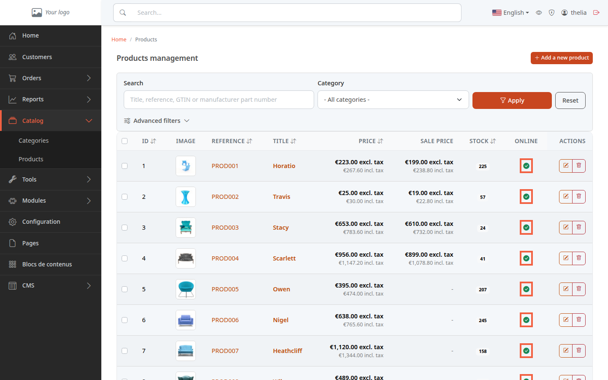
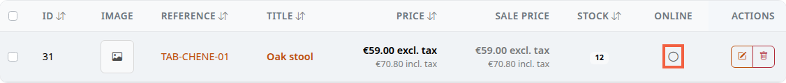
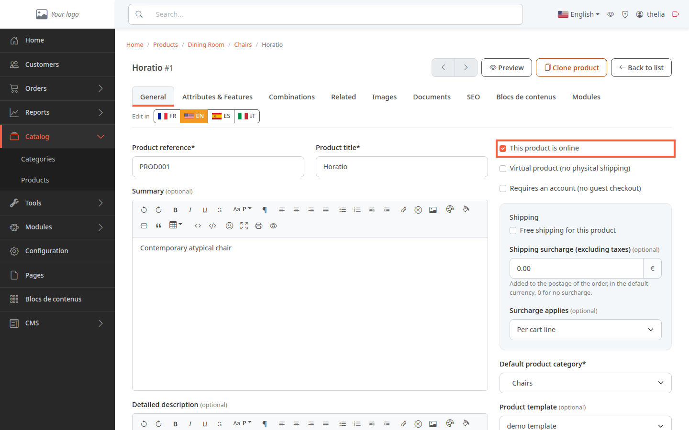

An offline product stays in your catalog, but your customers can no longer open its page. This is useful for a product that is out of stock, seasonal, or whose page is not finished. Nothing is deleted: you put it back online whenever you want.

**Before you start:** you need an existing product (see [Create a product](/en/catalog/create-product/)).

## Method 1: from the product list

1. In the left menu, click **Catalog**, then **Products**.
2. Find the **Online** column. A green dot with a check mark means the product is online. An empty gray circle means it is offline.
3. Click the dot in the product's line.

The change is immediate: there is no confirmation and no **Save** button. To undo it, click the dot again.

In this screenshot, the product **TAB-CHENE-01**, created for this example, is offline: its dot is an empty gray circle. The list shows titles in the store's default language, here English.

## Method 2: from the product page

1. In the list, click the product title to open its page.
2. In the **General** tab, find the **This product is online** box, on the right.
3. Tick the box to put the product online, untick it to put it offline.
4. Click **Save**.

Here, nothing changes until you click **Save**.

## Method 3: several products at once

1. In the product list, tick the box at the start of each line concerned.
2. A bar appears above the table with the number of selected products.
3. Open the **Bulk actions** list.
4. Choose **Put online** or **Take offline**. The change applies as soon as you choose, without confirmation.

To drop the selection, click **Clear selection**.

## What the customer sees

When a product is offline, it no longer appears in the store's category pages or search results. A customer who opens the address of its page sees a "page not found" error (404) instead of the product.

## The result

Under **Catalog**, **Products**, the **Online** column shows a green dot for a visible product and a gray circle for a hidden one. The product has not left the catalog: its page, price and stock are untouched.
