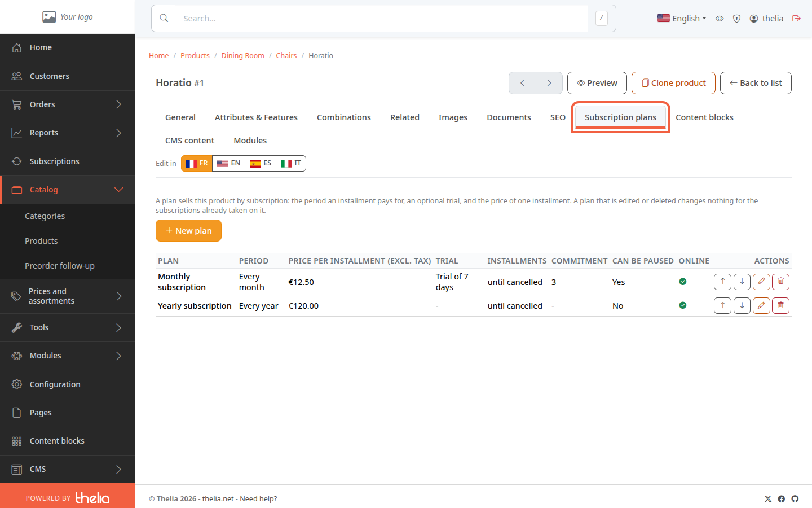
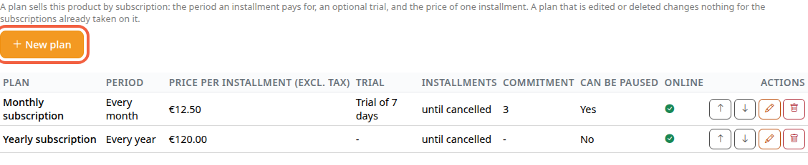
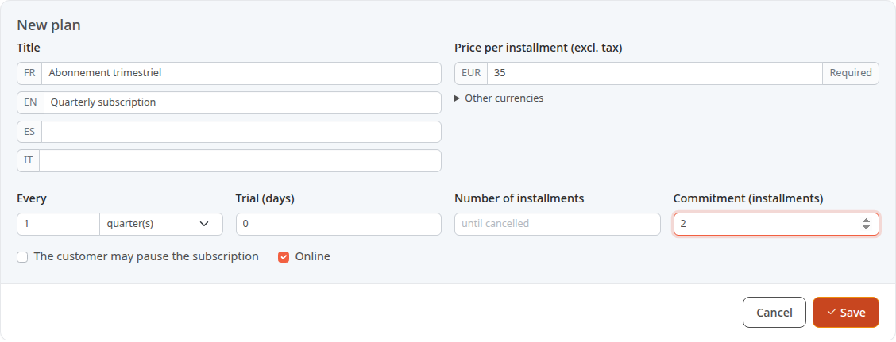
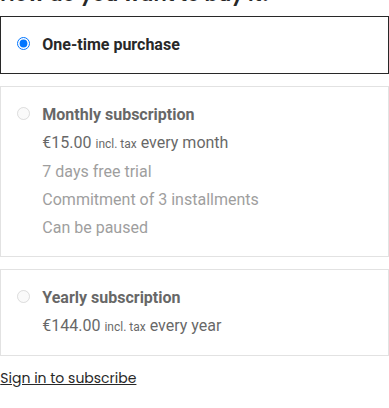

A subscription lets you sell a product once, then bill it every period without the customer ordering again. A plan sets the rules: every month, every year, with or without a trial.

Example: a box of products delivered every month at 12.50 excl. tax, with a 7-day trial.

**Before you start:** the product exists and is online (see [Create a product](/en/catalog/create-product/)). A payment module must be able to charge a card that is already stored, without the customer. No module shipped with Thelia does it yet: without such a module, the plans are shown but the customer cannot pay for a first subscription.

## Step 1: open the plans tab

1. In the left menu, click **Catalog**, then **Products**.
2. Open the product to sell by subscription.
3. Click the **Subscription plans** tab.

A product can have several plans, for example a monthly one and a yearly one. The tab only appears if your shop offers subscriptions, and only profiles that may edit products create plans there.

## Step 2: create a plan

1. Click **New plan**.

2. In **Title**, type the name of the plan in each language, for example `Monthly subscription`.
3. In **Price per installment (excl. tax)**, type the price of one installment before tax, for example `12.50`. The price in the default currency is required. **Other currencies** lets you give more.
4. In **Every**, type a number and pick the unit: week, month, quarter or year. Every 2 weeks is `2` and `week(s)`.
5. In **Trial (days)**, type the number of days offered before the first charge. `0` means no trial.
6. In **Number of installments**, type how many installments the shop bills in all. Leave it empty to go on until the customer cancels.
7. In **Commitment (installments)**, type the number of installments the customer owes even if they cancel. Leave it empty for no commitment.
8. Tick **The customer may pause the subscription** if you allow it.
9. Leave **Online** ticked to offer the plan in the shop.
10. Click **Save**.

The subscription copies the terms of the plan when the customer subscribes: price, period and commitment. Editing or deleting the plan later changes nothing for subscriptions that are running.

## Step 3: manage the existing plans

In the list, each row has buttons:

- the up or down arrow changes the order of display in the shop;
- the dot in the **Online** column takes the plan offline or puts it online;
- the pencil opens the plan to edit it;
- the bin deletes it, after a confirmation. Subscriptions already taken go on.

## What the customer sees

On the product page, the plans are shown next to **One-time purchase**, with the price of an installment, the trial, the commitment and whether a pause is possible.

- The customer must be signed in. A visitor sees the plans with **Sign in to subscribe**.
- A cart that holds a subscription holds nothing else: one order takes one subscription, with the payment method that will serve the following installments.
- With a trial, the first order is at 0 and the cart gives the date of the first charge.
- A product whose price is on request offers no plan.

## The result

The product offers its plans online. Each subscription taken then appears in the **Subscriptions** menu (see [Follow and manage subscriptions](/en/orders/follow-subscriptions/)).
