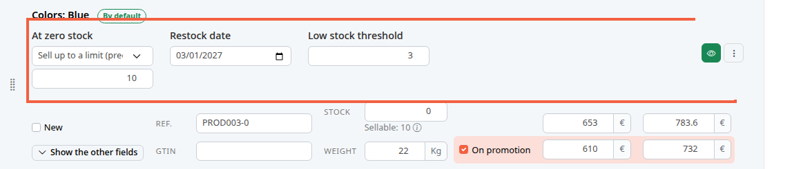
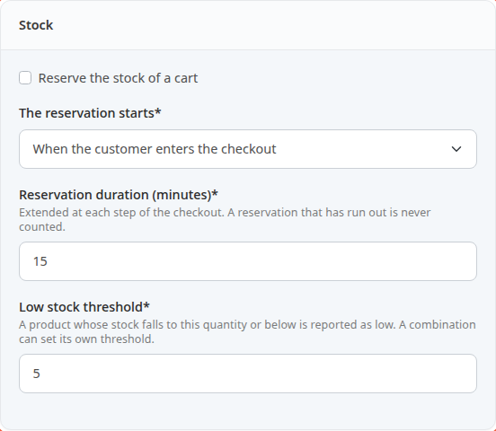
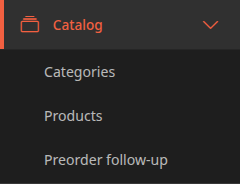
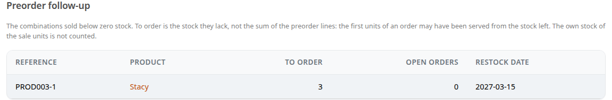
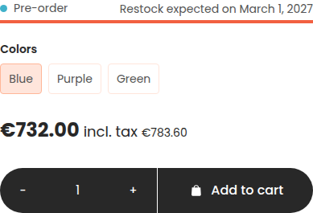
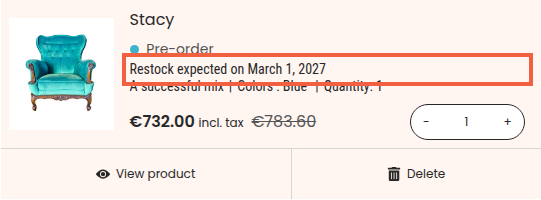

By default, a product at zero stock can no longer be sold. You can instead keep selling it as a preorder, with a restock date, and keep the last item for the customer who put it in their cart.

A preorder is a sale made before the stock arrives: the customer orders, and you deliver when the stock comes in. For example, the blue Stacy armchair is sold out and you expect 10 more at the beginning of March.

**Before you start:** the product exists and its stock is entered. See [Create a product](/en/catalog/create-product/) and [Set the price, VAT and stock of a product](/en/catalog/set-price-stock/).

## Step 1: choose what happens at zero stock

This choice is made for each combination. A combination is a variant of the product, for example a color.

1. In the left menu, click **Catalog**, then **Products**.
2. Open the product, for example Stacy.
3. Click the **Combinations** tab.
4. Find the combination, for example the one of the blue armchair (**Colors: Blue** in the demo).
5. In **At zero stock**, choose one of the three options.

The three options:

- **Refuse the sale**: this is the starting setting. At zero, the customer can no longer order.
- **Keep selling**: the customer can order any quantity, even with no stock.
- **Sell up to a limit (preorder)**: the customer can order up to a limit that you set.

With the last option, an empty field appears below it, with the grayed hint **Preorder limit**, which disappears when you enter a number. Enter the number of units that can be sold below zero, for example 10. With a stock of 0 and a limit of 10, you sell 10 units, then the 11th is refused.

For a product without combinations, the same fields are in the **Stock** block of the **Combinations** tab.

In the list, the label of the last option may appear cut off. This is a known display defect: the option itself is the right one.

## Step 2: give the restock date

1. In **Restock date**, choose the date you expect the stock, for example March 1, 2027.
2. Click **Save changes**. This button appears as soon as you change a field.

The date is shown to the customer as soon as the sale goes below the stock. Without a date, the store only says that it is a preorder.

Under the **Stock** field (or **Stock quantity** for a product without combinations), a line **Sellable: 10** shows how many units the customer can still order: the stock, plus the preorder limit, minus the units that carts are holding. Hover over the information icon to see what the carts are holding.

## Step 3: set the cart reservation

When a customer puts the last item in their cart, another customer can take it before they have paid. The reservation holds the items for the customer who is ordering, for a few minutes. During that time, nobody else can buy them.

1. In the left menu, click **Configuration**.
2. In the **System** block, click **Store info**.
3. Scroll down to the **Stock** block.

4. Tick **Reserve the stock of a cart** to turn it on. On a new store, the box is unticked.
5. In **The reservation starts**, choose **When the customer enters the checkout** (the starting setting) or **As soon as an item is added to the cart**.
6. In **Reservation duration (minutes)**, enter the duration, for example 15. It is extended at each step of the checkout, and a reservation that has run out is never counted.
7. Save the screen, as in [Fill in your store information](/en/getting-started/store-info/).

The checkout is the series of screens the customer goes through between the cart and the payment.

## Step 4: get warned before you run out

The store writes to you when the stock of a combination falls to a low level: the low stock threshold.

1. In the **Stock** block of the store configuration, enter the threshold for the whole store in **Low stock threshold**, for example 5. This is the starting setting.
2. For a combination that needs another threshold, enter it in its own **Low stock threshold** field (step 1). When it is left empty, the store threshold applies. The screen shows it in gray inside the field.

The e-mail is sent when the stock goes from above the threshold to equal to or below it. It is sent once, not for every sale that follows. It gives the product, the combination reference, the remaining stock and the threshold.

It is sent to the addresses in the **Email addresses of notification recipients** field of the **Store info** screen.

## Step 5: follow the preorders

When customers have ordered below zero stock, you need to know how many to order from your supplier.

1. In the left menu, click **Catalog**.
2. Click **Preorder follow-up**.

The screen lists each combination sold below zero stock:

- **To order**: the stock this combination lacks. On the capture, 3 units of the purple Stacy, reference PROD003-1, were sold without stock.
- **Open orders**: the number of orders that contain a preorder of this combination and that are not shipped, canceled or refunded.
- **Restock date**: the one you entered. The nearest dates come first, and the combinations with no restock date come last.

**To order** is not the sum of the preorder lines: the first units of an order may have been served by the stock that was left.

When you receive the stock, enter it in the combination's **Stock** field. The line leaves the screen as soon as the stock is no longer below zero.

## What the customer sees

On the product page, a **Pre-order** tag replaces **In stock**, with the line **Restock expected on** followed by the date. Product lists also show the **Pre-order** tag for the default combination.

In the cart, the product line carries the same tag and the same date.

The **Pre-order** tag shows as long as the next unit sold goes beyond the available stock. When the preorder limit is reached, the store shows **Out of stock**.

## The result

A combination at zero stock sells up to the limit you chose, with its restock date. The **Preorder follow-up** screen tells you what is left to order, and you receive an e-mail when the stock falls to the threshold.
