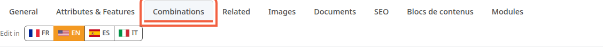
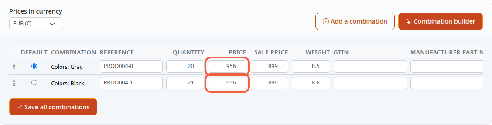
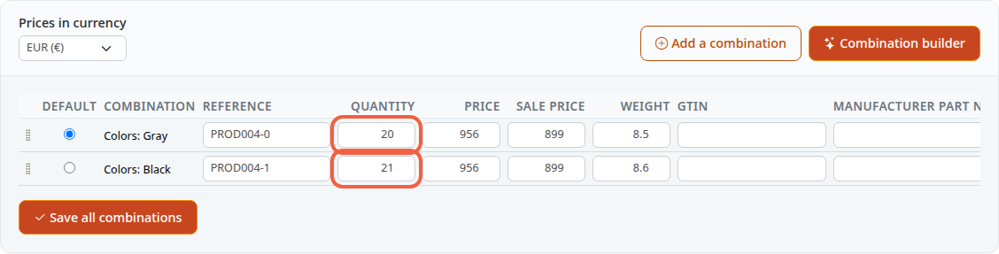

A product's price and stock are set in a single tab of its page. This tutorial takes you there and shows where the VAT is. These settings decide what the customer pays and when the product is no longer available.

**Before you start:** you need an existing product (see [Create a product](/en/catalog/create-product/)). Taxes and tax rules are explained in [Set up VAT](/en/settings/tax-rules/): this tutorial does not cover them again.

## Step 1: open the Combinations tab

Price and stock are not in the **General** tab. They are in the **Combinations** tab.

1. In the left menu, click **Catalog**, then **Products**.
2. Click the product name, for example **Scarlett**.
3. Click the **Combinations** tab.

Watch out for the neighboring **Attributes & Features** tab: it is used for something else. A combination is a sellable variant of the product, for example the armchair in gray or in black. Each combination has its own price and its own stock.

A product you just created with the **Create a new product** window has no combination yet. The tab then shows a form instead of the table: go straight to [A product without combinations](#a-product-without-combinations).

## Step 2: change the price

The table has one line per combination.

1. In the combination's line, click in the **Price** column.
2. Enter the new price, for example `950`.
3. For a sale, enter the reduced price in **Sale price**, for example `899`.
4. Scroll the table to the right, then tick the box in the **Promo** column. Without this box, the customer pays the **Price**, not the **Sale price**.

The price you enter is a price before tax (excl. tax), that is, before VAT is added. The table has no column for the price including tax: the customer will see the price before tax plus the tax of the product's tax rule. If the store has several currencies, the price entered is the one for the currency chosen in **Prices in currency**, at the top of the table.

## Step 3: change the stock

The stock is the number of units you have to sell.

1. In the combination's line, click in the **Quantity** column.
2. Enter the number of units available, for example `20`.

A product with several combinations therefore has one stock per combination. For a gray armchair and a black armchair, edit both lines.

## Step 4: save

1. Click **Save all combinations**, under the table.

The button saves all the lines at once.

## A product's VAT

A product is linked to a tax rule, not to a tax. The combinations table has no **Tax rule** field: it keeps the product's rule without changing it. This field exists only for a product without combinations.

## A product without combinations

This is the case of a product created with the **Create a new product** window, until you add a combination to it. The **Combinations** tab then shows the sentence **The default pricing is used when no combination is defined.**, followed by a form:

- **Tax rule**: a choice list, **Select a tax rule**;
- **Product price excluding taxes** and **Product price including taxes**;
- **Stock quantity**;
- **Sale price excluding taxes**, **Sale price including taxes** and the **On sale** box.

You enter one of the two prices and the other is calculated:

1. First choose the **Tax rule**, for example `Default Tax Rule`.
2. Enter the price in **Product price excluding taxes**, for example `25`, then click in another field: **Product price including taxes** fills in.
3. Or enter the price in **Product price including taxes**: the price before tax then fills in.
4. In **Stock quantity**, enter the number of units available, for example `20`.
5. For a sale, enter **Sale price excluding taxes** and tick **On sale**.
6. Click **Save**, at the bottom of the form.

Without a tax rule chosen, nothing is calculated. The calculation uses the store's default country. Only the price before tax is saved; the price including tax is a helper calculation. The demo has no product in this case, so this part has no screenshot.

## The result

After saving, the page reloads on the **Combinations** tab, which shows your new prices and quantities. The **Low stock** block of the dashboard lists at most 5 combinations with 5 units or fewer, the lowest first (see [Discover the back office](/en/getting-started/back-office-tour/)).
