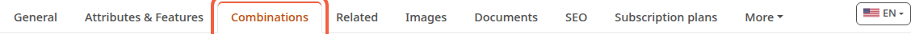
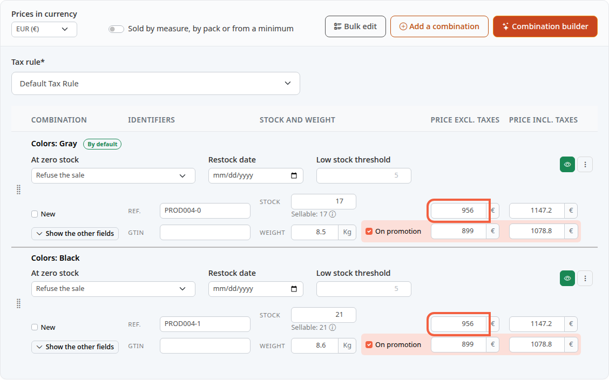
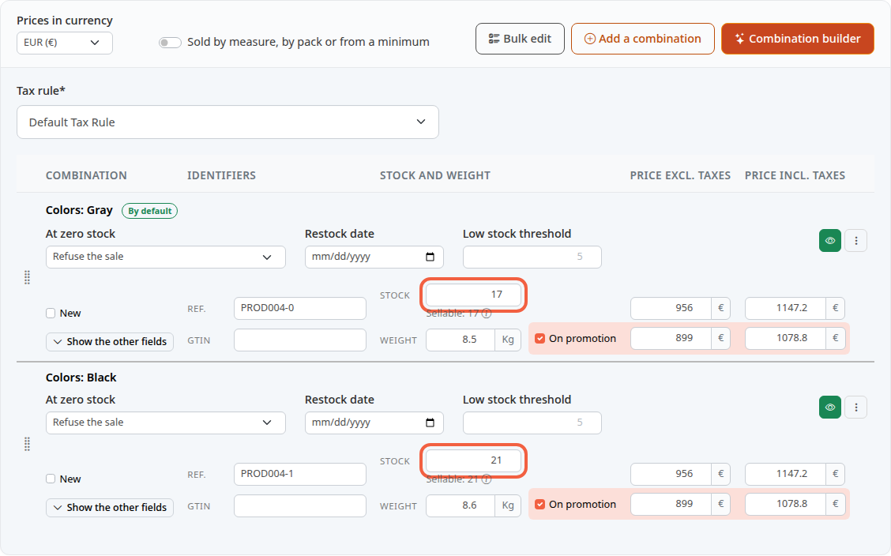
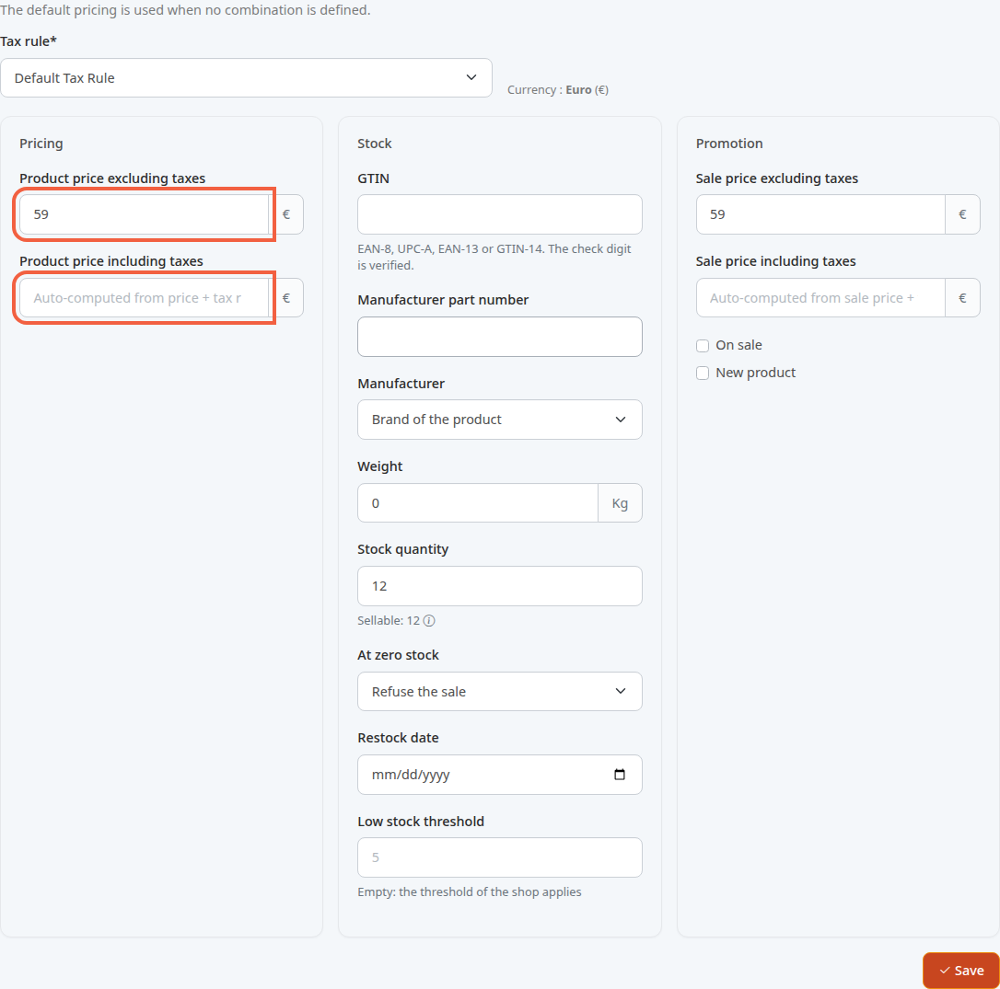

A product's price and stock are set in a single tab of its page. This tutorial takes you there and shows where the VAT is. These settings decide what the customer pays and when the product is no longer available.

**Before you start:** you need an existing product (see [Create a product](/en/catalog/create-product/)). Taxes and tax rules are explained in [Set up VAT](/en/settings/tax-rules/): this tutorial does not cover them again.

## Step 1: open the Combinations tab

Price and stock are not in the **General** tab. They are in the **Combinations** tab.

1. In the left menu, click **Catalog**, then **Products**.
2. Click the product name, for example **Scarlett**.
3. Click the **Combinations** tab.

Watch out for the neighboring **Attributes & Features** tab: it is used for something else. A combination is a sellable variant of the product, for example the armchair in gray or in black. Each combination has its own price and its own stock.

A product you just created with the **Create a new product** window has no combination yet. The tab then shows a form instead of the table: go straight to [A product without combinations](#a-product-without-combinations).

## Step 2: change the price

The table shows a block of three lines per combination. The combination's name is on the first line, the price on the second, the sale on the third.

1. In the combination's block, click in the **Price excl. taxes** field, on the second line.
2. Enter the new price, for example `950`, then click in another field: **Price incl. taxes** fills in.
3. For a sale, tick **On promotion** on the third line. The **Sale price excluding taxes** and **Sale price including taxes** fields unlock.
4. Enter the reduced price in **Sale price excluding taxes**, for example `899`.

Without the **On promotion** box, the customer pays the **Price excl. taxes**, not the **Sale price excluding taxes**. A sale scheduled in **Tools**, **Sales** ticks this box itself.

A price excl. tax is a price before VAT is added. A price incl. tax is a price with all taxes included. You can enter either one: the other is calculated with the product's **Tax rule**, shown above the table. Only the price excl. tax is saved.

If the store has several currencies, the price entered is the one for the currency chosen in **Prices in currency**, at the top of the table.

## Step 3: change the stock

The stock is the number of units you have to sell.

1. In the combination's block, click in the **Stock** field, on the second line.
2. Enter the number of units available, for example `20`.

A product with several combinations therefore has one stock per combination. For a gray armchair and a black armchair, edit both blocks.

Under the field, the note **Sellable: 20** shows what the store can still sell, once the units held in carts are taken off.

On the first line of the block, three settings decide what happens when the stock runs out:

- **At zero stock**: **Refuse the sale**, **Keep selling** or **Sell up to a limit (preorder)**. With the last choice, a **Preorder limit** field appears: it is the number of units that can be sold below zero.
- **Restock date**: the date you expect new stock.
- **Low stock threshold**: the stock level from which the combination is reported as low. Left empty, the store's threshold applies.

## Step 4: save

As soon as you change a field, a bar appears at the bottom of the screen.

1. Click **Save changes**.

The button saves all the blocks at once. **Cancel the changes** puts the fields back as they were.

## A product's VAT

A product is linked to a tax rule, not to a tax. The **Tax rule** field is above the combinations table, and in the form of a product without combinations. The rule chosen applies to the whole product: changing it recalculates the prices incl. tax shown.

## A product without combinations

This is the case of a product created with the **Create a new product** window, until you add a combination to it. The **Combinations** tab then shows the sentence **The default pricing is used when no combination is defined.**, followed by a form:

- **Tax rule**: a choice list, **Select a tax rule**;
- **Product price excluding taxes** and **Product price including taxes**;
- **Stock quantity**;
- **Sale price excluding taxes**, **Sale price including taxes** and the **On sale** box.

You enter one of the two prices and the other is calculated:

1. Check the **Tax rule**: it is already the product's rule, **Default Tax Rule** in the screenshot. Change it if it is not the right one.
2. Enter the price in **Product price excluding taxes**, for example `25`, then click in another field: **Product price including taxes** fills in.
3. Or enter the price in **Product price including taxes**: the price before tax then fills in.
4. In **Stock quantity**, enter the number of units available, for example `20`.
5. For a sale, enter **Sale price excluding taxes** and tick **On sale**.
6. Click **Save**, at the bottom of the form.

Without a tax rule chosen, nothing is calculated. The calculation uses the store's default country. Only the price before tax is saved; the price including tax is a helper calculation. In the screenshot, `59` excluding tax gives `70.8` including tax: the field shows the result rounded to six decimals at most, without a useless zero.

## The result

After saving, the page reloads on the **Combinations** tab, which shows your new prices and quantities. The **Low stock** block of the dashboard lists at most 5 combinations whose stock is at or below the low stock threshold, the lowest first: the combination's threshold if it has one, otherwise the store's, 5 by default (see [Discover the back office](/en/getting-started/back-office-tour/)).
