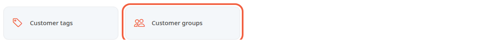
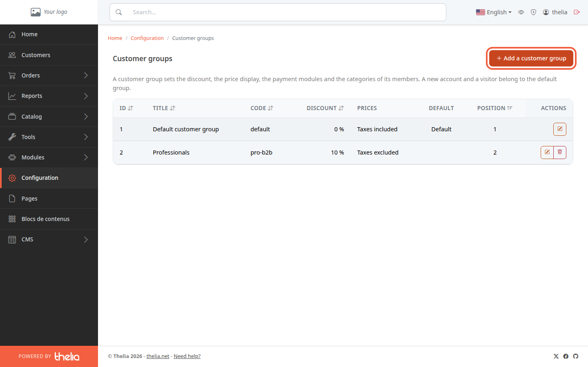
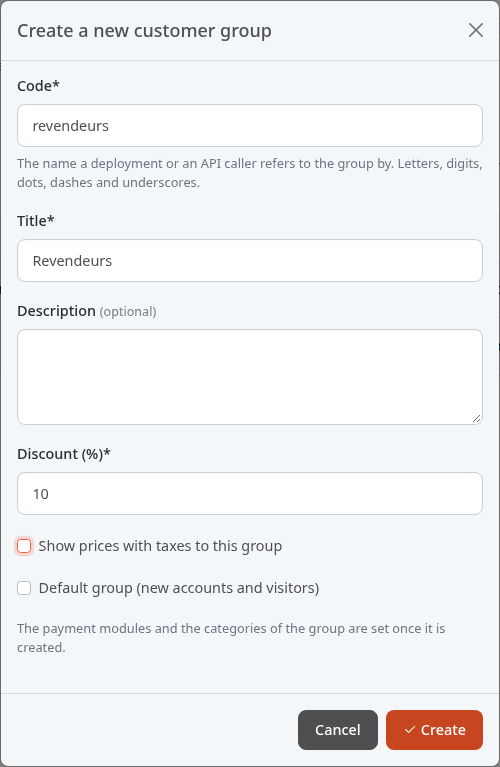
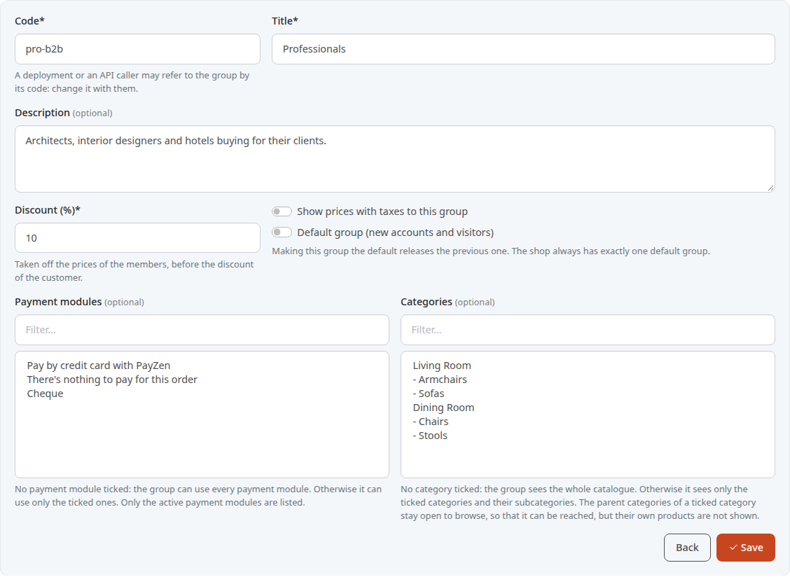
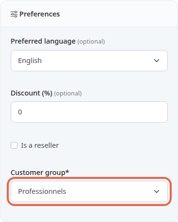
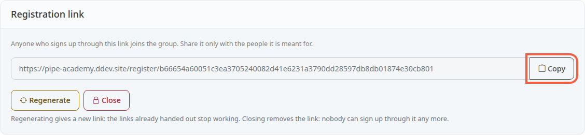
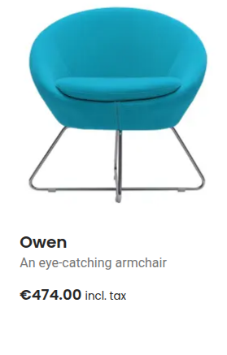
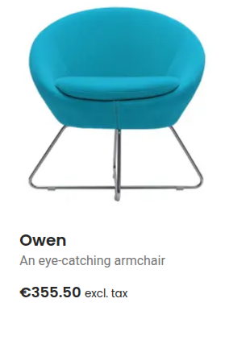
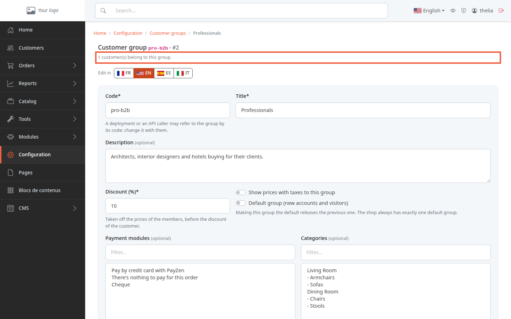

A customer group gathers customers who buy on the same terms. For example, your business customers get 10% off and see prices excluding tax, while individuals pay the displayed price including tax.

**Before you start:** you need an administrator account that is allowed to manage customer groups.

Each customer belongs to one group only. Until you create any, everyone is in the **Default customer group**: new accounts, and also visitors who have no account.

## Step 1: open the list of groups

1. In the left menu, click **Configuration**.
2. In the **Customers** section, click **Customer groups**.

For each group, the list shows its **Discount**, its **Prices** (**Taxes included** or **Taxes excluded**) and the group marked **Default**. Here, the Professionals group has already been created with the settings from this page.

## Step 2: create the group

1. Click **Add a customer group**.
2. In **Code**, enter a short name without spaces, for example `resellers`. Technical tools and modules use it to refer to the group.
3. In **Title**, enter the name of the group, for example Resellers.
4. In **Description**, note who the group is for, if you wish.
5. In **Discount (%)**, enter the group's discount, for example 10. Leave 0 for a group without a discount.
6. For a group of business customers, untick **Show prices with taxes to this group**: its members will see prices excluding tax.
7. Leave **Default group (new accounts and visitors)** unticked.
8. Click **Create**.

The discount ranges from 0 to 100. It applies to the product's normal price, not to its sale price: the customer pays the lower of the two.

The group's page opens. Payment modules and categories are set on that page, once the group is created.

## Step 3: set up the group

The page repeats the fields of the creation window and adds two.

- **Payment modules**: leave the list with nothing selected so the group can pay in every way. Select one or more modules to limit it to those, for example Cheque only.
- **Categories**: leave the list with nothing selected so the group sees the whole catalog. Select categories to reserve those and their subcategories for it, for example Dining Room for a restaurant owner.

The two lists are not tick boxes: click a line to choose it, and hold the Ctrl key (Cmd on a Mac) while clicking to choose several. The **Filter...** field above each list helps you find a line.

These lists apply to this group only: other groups keep their own settings.

Click **Save** to keep your settings.

The title and the description can be translated: switch language with the **Edit in** buttons (**FR**, **EN**...) at the top of the page, then save in each language.

## Step 4: put a customer in the group

1. In the left menu, click **Customers**.
2. Open the customer's page, for example Greta Müller.
3. In the **Preferences** block, choose the group in **Customer group**, for example Professionals.
4. Click **Save**.

The customer may also have a discount of their own, in **Discount (%)** of the same block. It applies after the group's discount, on the price that is already reduced: a customer at 5% in a group at 10% pays €100 × 0.90 × 0.95 = €85.50, not €85.00.

## Step 5: give out a registration link

Rather than moving each customer by hand, you can send a registration link. Anyone who creates an account through this link joins the group directly. The link only creates accounts: a customer who already has one is placed in the group by hand, as in step 4.

1. At the bottom of the group's page, in **Registration link**, click **Open a registration link**.
2. Click **Copy**.
3. Paste the link in the message you send to your business customers.

Nobody validates the accounts created through this link: give it only to the people concerned. If it spreads too far, click **Regenerate**: a new link replaces the old one, which stops working. **Close** removes the link.

The default group has no registration link: people join it through the store's usual sign-up form.

## What the customer sees in the store

Here is the Owen armchair in the Armchairs category. A visitor without an account sees it at €474.00 incl. tax.

Greta Müller, a member of the Professionals group, logs in and sees the same armchair at €355.50 excl. tax: the price excluding tax of €395.00, minus 10%.

The cart, the checkout, the invoice and the order emails also show amounts excluding tax; the total to pay is still shown including tax. Each order keeps the group, the discount and the excl. or incl. tax display from the day of purchase: changing the group later does not change an invoice already issued.

## The group elsewhere in the back office

Once created, the group appears in other screens:

- on a product's page, in the **Combinations** tab, the **Prices per customer group** block gives the group a price of its own, excluding tax, in place of the group's discount (the customer's own discount still applies);
- in a promo code, the condition **For one or more customer groups** reserves it for certain groups;
- a catalog price rule or a sale can be reserved for certain groups.

When a price rule or a reserved sale gives a different price from the group's, the customer pays the lower of the two.

## Delete a group

In the list, the delete button of a group opens a confirmation. Its customers then move to the default group. Its group prices are deleted with it, and it disappears from the price rules and sales that were reserved for it. Past orders keep the discount and the display from the day of purchase. The default group cannot be deleted.

A customer whose account you anonymize also goes back to the default group.

## The result

The group appears in **Customer groups** with its discount and its display. Its members see the group's prices and terms in the store as soon as they log in.

At the top of its page, a line shows how many customers it has, for example **1 customer(s) belong to this group.**

