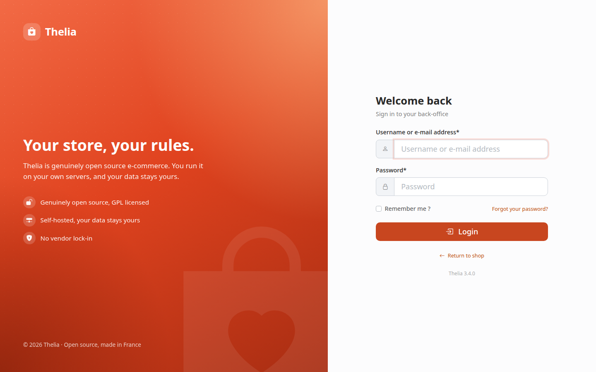
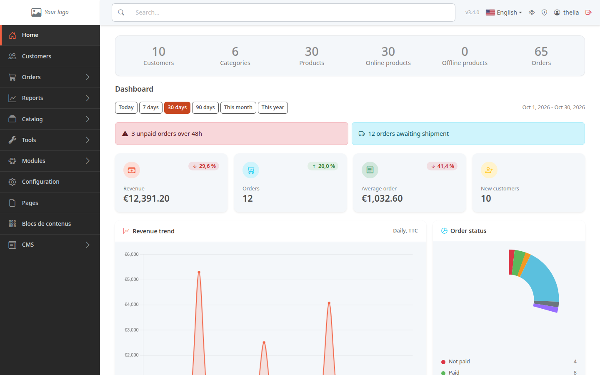
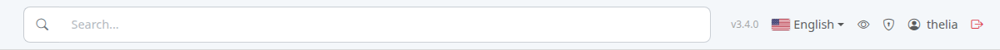

The back office is your store's administration area. This is where you manage products, orders and customers. This tutorial shows you how to get in and how to read the first page.

**Before you start:** you need your store's address and an administrator account (username and password).

## Step 1: log in

1. In your browser, type your store's address followed by `/admin`, for example `https://www.my-store.com/admin`.
2. In **Username or e-mail address**, enter your username.
3. In **Password**, enter your password.
4. Click **Login**.

Lost your password? Click **Forgot your password?** under the field.

## Step 2: read the dashboard

Once logged in, you land on the dashboard. It summarizes the store's activity.

From top to bottom:

- **The counters**: number of customers, categories, products (online and offline) and orders.
- **The period**: the **Today**, **7 days**, **30 days**, **90 days**, **This month** and **This year** buttons change the period of the figures below.
- **The alerts**: for example orders unpaid for more than 48 hours, or awaiting shipment. Click an alert to open the list of the orders concerned. An alert only shows up when there is something to handle.
- **The indicators**: revenue, orders, average order and new customers. The percentage compares the selected period with the previous period of the same length.
- **The charts**: daily revenue trend and the split of orders by status.

Further down, scroll to see **Recent orders**, **Top selling products** and **Low stock** (products with 5 units or fewer).

## Step 3: find your way in the menu

The menu on the left opens each part of the store: **Customers**, **Orders**, **Catalog**, **Configuration**, and so on. An arrow on the right of an entry means it has a submenu.

The top bar holds the tools available on every page:

- the **Search...** field, to find a product, a category, a brand, a content, a customer or an order;
- the installed Thelia version (here v3.4.0), to give when you ask for help;
- the **interface language**: click the flag to switch the back office to another language;
- the eye: **View site**, opens your store in a new tab;
- the shield: **Account security**;
- your username: **Edit profile**;
- the red icon: **Logout**.

## The result

You know how to get into the back office and read the store's activity at a glance. Remember to log out on a shared computer.
