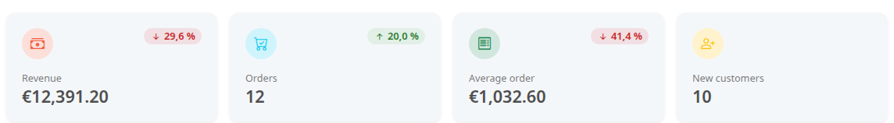
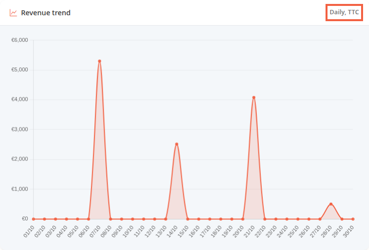
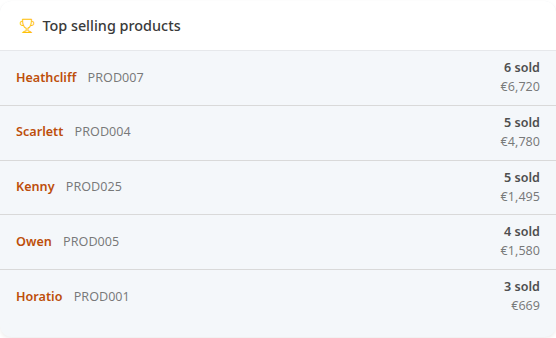
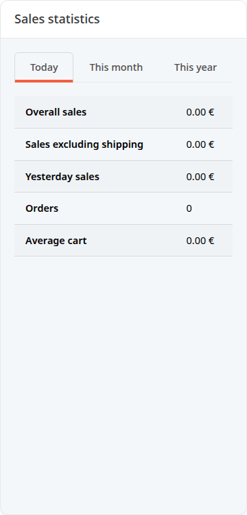
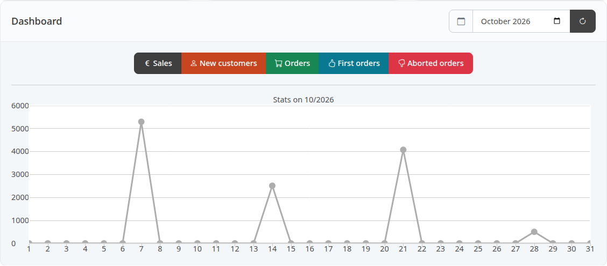

The dashboard shows several families of figures that do not all count the same orders or cover the same period. For each figure, this page says what it counts, so you can read it without being misled. It assumes you have read [Discover the back office](/en/getting-started/back-office-tour/), which introduces the screen and the period buttons.

**Before you start:** you need an administrator account with access to orders. Without that right, the sales figures, the charts and the order lists do not appear.

## Paid orders: what the revenue counts

On this page, a paid order is an order with the status **Paid**, **Processing** or **Sent**. A status declared equivalent to one of these three also counts, such as **Partially shipped**, which ships with Thelia and is equivalent to **Paid**. **Not paid**, **Canceled** and **Refunded** orders are left out of the sales amounts.

## Step 1: choose the period

When the page loads, the period is **30 days**. The buttons change the period of the four cards, the **Revenue trend** chart and the **Top selling products** list:

- **Today**: from midnight to 11:59 pm today.
- **7 days**: today and the 6 previous days.
- **30 days**: today and the 29 previous days.
- **90 days**: today and the 89 previous days.
- **This month**: from the 1st of the month to today.
- **This year**: from January 1st to today.

The exact dates are shown to the right of the buttons.

## Step 2: read the four cards

- **Revenue**: total of the paid orders placed during the period. It includes all taxes and shipping costs, with discounts deducted.
- **Orders**: number of orders placed during the period, whatever their status. Unpaid and canceled orders are counted.
- **Average order**: **Revenue** divided by **Orders**. Because unpaid and canceled orders are in the denominator, it can be lower than the average amount of a paid order.
- **New customers**: customer accounts created during the period.

The percentage at the top of each card compares the period with the previous period of the same length, just before it. For **30 days**, that is the 30 days before.

It does not appear if the previous period is zero and the current period is above zero. Under a 0.5% difference, the arrow is replaced by a dash.

Clicking **Revenue** or **Orders** opens the full list of orders, with no period filter, and **New customers** opens the customer list. **Average order** cannot be clicked.

## Step 3: read the charts

- **Revenue trend**: one point per day of the period. Each point is the revenue of the card, calculated for that day with the same paid orders. The subtitle on the screen is **Daily, TTC**.
- **Order status**: number of orders per status, over the whole life of the store. This block does not follow the period buttons. A status with no orders is not listed.

## Step 4: read the lists

- **Recent orders**: the last 8 orders placed, any status, whatever the period.
- **Top selling products**: the 5 best-selling products during the period, ranked by quantity. The **sold** line gives the number of units. The amount below is the price of the order lines, excluding taxes, at the sale price if the product was on promotion, without deducting the order discount, shown without cents. All orders count, even unpaid or canceled ones.
- **Low stock (≤ 5)**: a combination is a sellable variant of a product, for example a size or a color. The list shows up to 5 combinations, across all products, with a stock of 5 units or fewer, lowest first, whatever the period. Each line shows the product name, the combination reference and its stock. A product that is offline appears too.

## Step 5: read the Sales statistics block

Further down, the **Sales statistics** block does not follow the period buttons. It has three tabs: **Today**, **This month** (the current month) and **This year** (the current year).

- **Overall sales**: paid orders, with all taxes and shipping costs included and discounts deducted. They are attached to their invoice date, meaning the day the order became paid, not their creation date.
- **Sales excluding shipping**: the same sum without shipping costs.
- **Yesterday sales** (**Today** tab), **Previous month sales**, **Previous year sales**: the **Overall sales** of the period before.
- **Orders**: paid orders created during the period.
- **Average cart**: **Sales excluding shipping** divided by **Orders**.

The amounts in this block and the **Revenue** card use the same statuses, but not the same date: order creation for the card, invoice date for the block. An order placed on October 31 and paid on November 1 therefore counts in October on the card and in November in the block.

## Step 6: read the month chart

At the very bottom, the **Dashboard** card plots one month at a time, day by day. Choose the month in the field next to the calendar: the chart updates. The figures are kept for 10 minutes. The refresh button only recalculates them on the second click: the first one still shows the old figures.

Changing the month also replaces the figures in the **This month** tab of the **Sales statistics** block with those of the chosen month.

Each button shows or hides its curve. When the page loads, only **Sales** is shown.

- **Sales**: the day's sales, calculated like **Overall sales** (paid orders, invoice date).
- **New customers**: accounts created that day.
- **Orders**: orders whose invoice date falls on that day, whatever their current status. An order that was never paid has no invoice date: it is not counted.
- **First orders**: orders placed that day by a customer who had never ordered before.
- **Aborted orders**: orders with status number 5 and an invoice date that falls on that day. In a default installation, that status is **Canceled**. The curve therefore counts orders canceled after being paid, not visitors who did not order: an order canceled without ever being paid does not appear.

## The result

You know which order goes into which figure: the sales amounts count only paid orders, while the **Orders** card and **Top selling products** count the others too. If two blocks disagree, first compare the period and the date they use.
