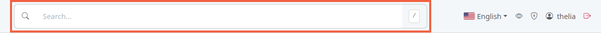
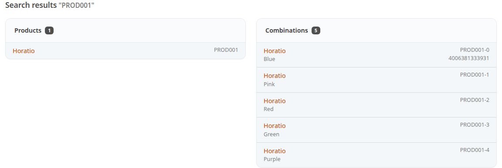

The search bar of the back office looks through the catalog, the customers, the orders and the settings at once. It saves you from going from menu to menu to find a sheet.

Example: type `PROD001` to open the product with that reference, or the name of a customer to find their sheet.

**Before you start:** nothing in particular. You only see what your profile may view.

## Step 1: type a term

1. Click the **Search...** field at the top of any screen. Without the mouse, press the **/** key: the cursor goes there. The key does nothing if you are already typing in a field.
2. Type at least 2 characters, for example `PROD001`.
3. Press Enter.

With a single character, the page shows **Please enter at least 2 characters to search.**

## Step 2: read the results

The results come in groups. A group only appears if it has a match.

| Group | The search covers |
|---|---|
| Products | the reference, the reference or barcode of a combination, the title |
| Combinations | the reference, the barcode (GTIN) |
| Categories, folders, contents, brands, sales | the title |
| Customers | the reference, first name, last name, full name, e-mail, phone number |
| Orders | the reference, the invoice reference, the transaction reference |
| Coupons | the code, the title |
| Administrators | the login, the name, the e-mail |
| Modules | the code, the title |

A combination is a variant of the product, for example a color. A product found through a combination shows the name of that combination under its title.

## Step 3: understand the order and the limits

- In each group, a reference or title equal to the term comes first, then those starting with the term, then those containing it. The best matches are at the top.
- For a product or a combination, type the full reference: the shop finds it at once, even in a large catalog.
- A barcode is found when it is typed in full. Spaces and dashes are accepted: `4006381333931`, `4 006381 333931` or `4006381-333931`. Part of a code finds nothing.
- The symbols `%` and `_` are searched as typed.
- Titles are shown in the language of your interface. If one is missing there, the shop takes the default language, then another. The search covers the titles in every language.
- A group shows 25 results at most. When there are more, its title says for example **25 of 30**. For products, customers and orders, the **Open the list filtered on this term** link opens the full list. For the other groups, **See the 30 results** shows them page by page.
- Orders are limited to the sale units of the administrator.

## What depends on your profile

A group is only searched if your profile may view the matching resource. A profile limited to the catalog sees no customers, orders, coupons or administrators.

Above 120 searches in one minute, the page answers **Too many searches in a row. Please try again in a minute.**

If the TntSearch module is active, the search page of that module replaces the one of the back office.

## The result

The **Search results** page lists the groups that match. Click a title to open the sheet.
