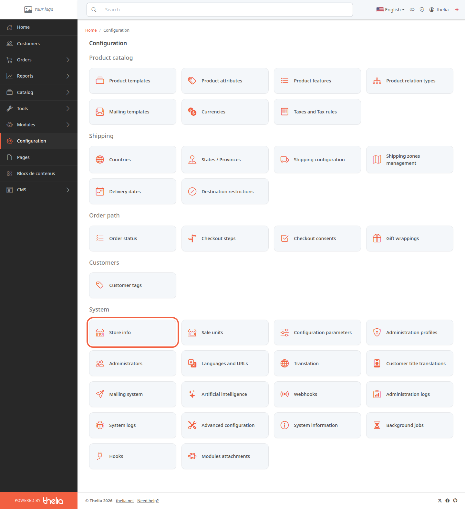
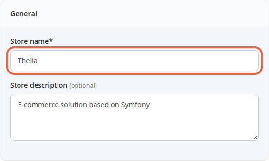
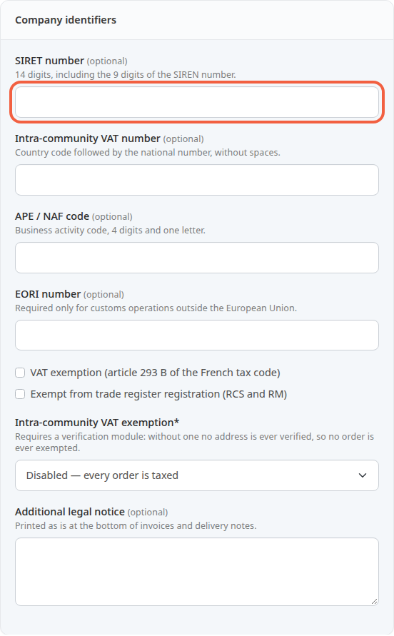
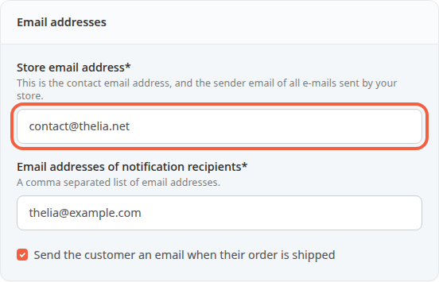
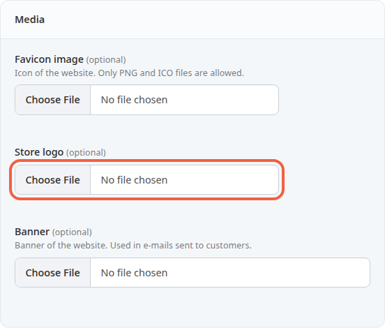
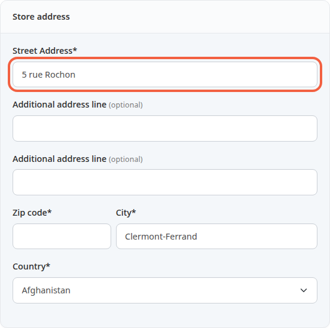
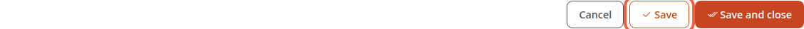

This screen holds your store's identity: its name, address, e-mail addresses and logo. This information is used in the e-mails sent to your customers and on your documents: fill it in first.

**Before you start:** you need an administrator account (see [Discover the back office](/en/getting-started/back-office-tour/)) and your store's postal address at hand.

## Step 1: open the screen

1. In the left menu, click **Configuration**.
2. In the **System** block, click **Store info**.

The screen is called **Store configuration**. It is split into blocks. Fields followed by an asterisk are required.

## Step 2: give the store a name

1. In **Store name**, enter your store's name, for example `Oak Workshop`.
2. In **Store description**, you can add a short presentation, for example `Handmade wooden furniture`. This field is optional.

## Step 3: enter the company identifiers

This block is optional. The numbers identify your company, for example on sales documents.

1. In **SIRET number**, enter the 14 digits of your number. Spaces and dots are accepted.
2. In **Intra-community VAT number**, enter the country code followed by the number, without spaces, for example `FR12345678901`. VAT is the tax added to the selling price.
3. In **APE / NAF code**, enter 4 digits and a letter, for example `4759A`.
4. Tick **VAT exemption (article 293 B of the French tax code)** only if your company does not charge VAT. The box prints the exemption notice on invoices. Then leave **Intra-community VAT number** empty: the two together are rejected.
5. In **Additional legal notice**, add a text if needed (500 characters at most). It is printed as is at the bottom of invoices and delivery notes.

The exemption box does not remove VAT from prices: VAT comes from the tax rules (see [Set up VAT](/en/settings/tax-rules/)).

The other fields in the block (**EORI number**, **Exempt from trade register registration (RCS and RM)**, **Intra-community VAT exemption**) can stay as they are.

A number in the wrong format, or a SIRET with a wrong check digit, is rejected when you save, with a message under the field.

## Step 4: enter the e-mail addresses

1. In **Store email address**, enter the store's contact address, for example `contact@oak-workshop.com`. It is also the sender address of all e-mails sent by the store: your customers see it as the sender. Messages from the store's contact form arrive at this address.
2. In **Email addresses of notification recipients**, enter the addresses that receive the store's alerts, for example `orders@oak-workshop.com`. For several addresses, separate them with commas.
3. Leave **Send the customer an email when their order is shipped** ticked if you want Thelia to tell your customers about the shipment. Untick it if you notify them another way. A delivery module can send its own e-mail, which this box does not control.

The notification recipients receive the message announcing each new order. An empty field is rejected: enter at least one address.

## Step 5: add the logo

1. In **Store logo**, click **Choose File** and choose your logo (PNG, JPEG, GIF, WebP or SVG). It appears at the top of the e-mails sent to customers.
2. In **Banner**, choose a wide image. It appears in the body of the order confirmation e-mail and of the newsletter subscription confirmation e-mail, not in the other e-mails.

Both fields are optional. Once the file is chosen, a preview of the image appears next to the field, or below it for the banner.

Leave **Favicon image** empty: with the store theme delivered by default, the browser tab icon comes from the theme files, not from this field.

## Step 6: enter the address and phone number

1. In **Street Address**, enter the street, for example `12 Linden Street`.
2. In **Additional address line**, add a building or a floor if needed. There are two lines, both optional.
3. In **Zip code**, enter for example `63000`, then in **City**, `Clermont-Ferrand`.
4. In **Country**, choose the store's country from the list. As long as no country has been saved, the list shows the first one in alphabetical order, for example Afghanistan: check it before saving.
5. In the **Phone & Fax** block, enter your number in **Phone**. **Fax** is optional.

## Step 7: save

- Click **Save** to keep the values and stay on the screen.
- Click **Save and close** to go back to the **Configuration** page.
- Click **Cancel** to leave without saving.

Further down, the screen has other blocks (checkout, administrators, public page cache, videos). They are not part of this tutorial.

## The result

After saving, the values are still displayed when you reopen **Store info**. Your customers now receive e-mails from the store address and you receive the order notifications.
