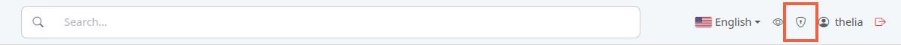
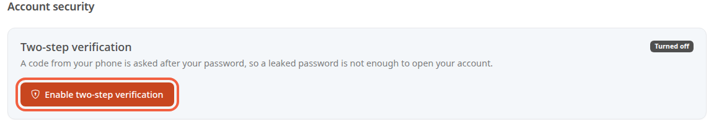
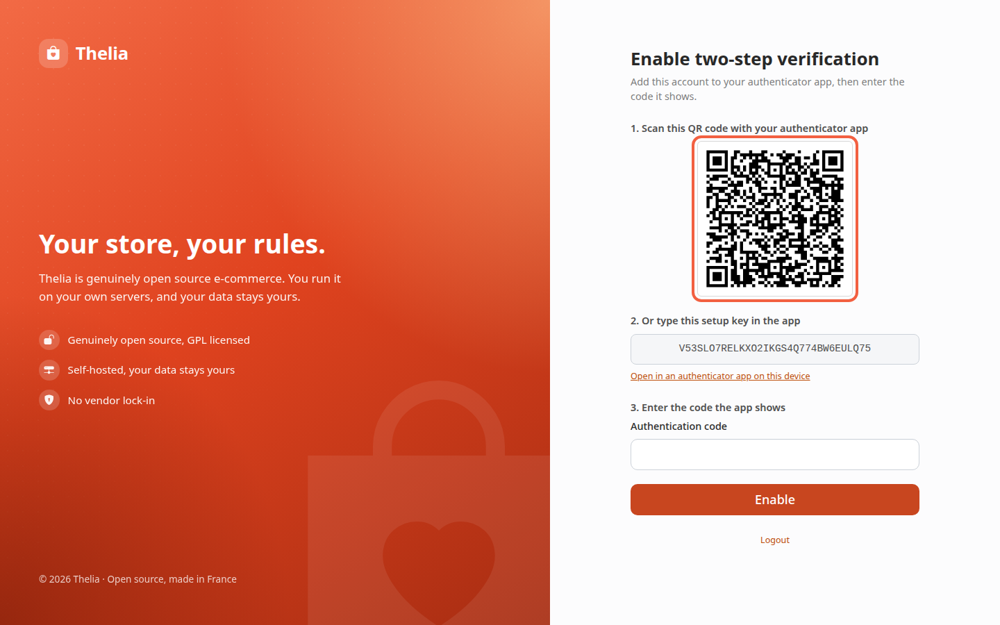
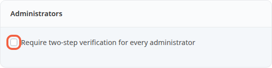

Two-step verification adds a temporary code to your password when you log in to the back office. If your password leaks, someone else cannot open your account without that code.

The code comes from an authenticator app: a free app on your phone that shows a 6-digit number, renewed every 30 seconds.

**Before you start:** you need an administrator account and an authenticator app installed on your phone.

## Step 1: open the account security page

1. In the top bar, click the shield.

The **Account security** page opens. The **Two-step verification** block shows **Turned off** until you enable it.

2. Click **Enable two-step verification**.

## Step 2: add your account to the app

The **Enable two-step verification** screen shows a QR code and a key.

1. Open your authenticator app on your phone.
2. Choose to add an account.
3. Scan the QR code under **1. Scan this QR code with your authenticator app**.

QR code not working? Under **2. Or type this setup key in the app**, copy the key shown in the grey field into the app. On the phone that opens this page, the **Open in an authenticator app on this device** link does the same thing.

## Step 3: enter the code and keep the backup codes

1. Read the 6-digit number the app shows for your account.
2. Enter it in **Authentication code**, under **3. Enter the code the app shows**.
3. Click **Enable**.

A code that does not match is refused, with the message "This code does not match. Check the time of your device and try again." Codes depend on the time: make sure your phone's clock is set automatically.

Once the code is accepted, the **Save your backup codes** page shows 10 codes of 10 characters. Each one signs you in once if you do not have your phone.

1. Click **Copy the codes**, or write them down.
2. Store them somewhere other than your phone: they will not be shown again.
3. Click **Continue**.

If you lose both your phone and your backup codes, you can no longer log in.

Another administrator who is allowed to edit administrators must then choose **Reset the two-step verification** on your account, in the administrator list. Only a superadministrator can do this for another superadministrator. Otherwise, the person who manages the store's server can reset it.

## Step 4: log in afterwards

At every login, after the password, the **Two-step verification** screen asks for a code.

1. Enter the code from the app in **Authentication code**.
2. Click **Verify**.

Without your phone: click **Use a backup code** and enter one of your codes. Spaces and dashes you type are ignored. A backup code that has been used no longer works.

A refused code shows "Invalid credentials.". After the fifth refused code, or 5 minutes after the password, you go back to the login screen.

## Manage the protection afterwards

On **Account security**, once the protection is on, the page shows **Turned on** and the number of backup codes left.

- **Generate new backup codes** creates ten new codes. The previous ones stop working.
- To remove the protection, enter your password in **Your password**, then click **Disable**.

## When the protection is required

An administrator can require the protection for every account: in **Configuration**, **Store info**, the **Require two-step verification for every administrator** box is in the **Administrators** block. Tick it, then click **Save**.

Enable the protection on your own account first: otherwise, you are sent to the setup screen on the next page.

When it is ticked, an administrator without the protection is sent to the setup screen right after logging in. The screen then shows "This shop requires two-step verification for every administrator."

## The result

The **Account security** page shows **Turned on**, and every login asks for your password and then a code.
