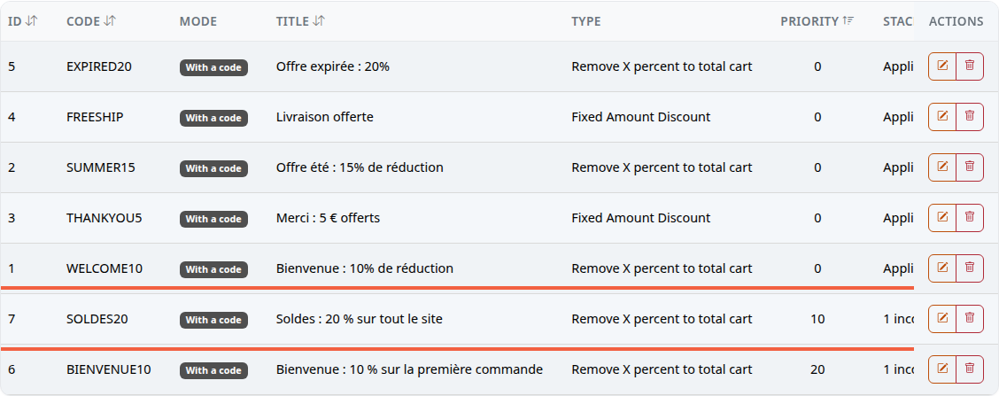
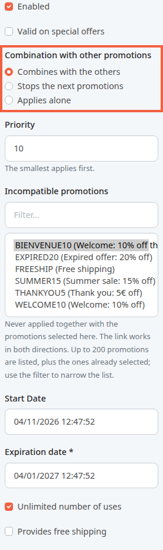
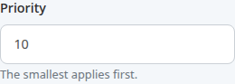
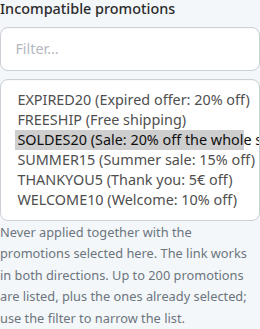
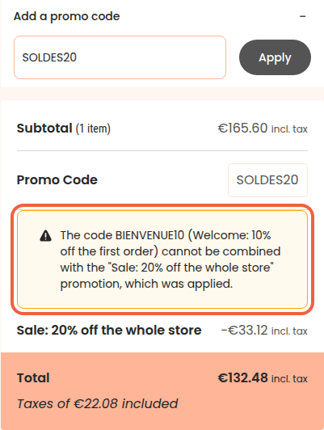

Your store offers a welcome code, BIENVENUE10 (10% off the first order), and starts its sales with SOLDES20 (20% off the whole store). You do not want a buyer to add the two together. This page shows how to set the order of promotions, how they combine and which ones are incompatible, so that the store chooses on its own, whatever order the buyer types the codes in.

**Before you start:** you need an administrator account and the promo codes to set up, already created.

## The three settings at a glance

Each promo code (and each automatic promotion, which applies without a code) has three settings:

- **Priority**: a whole number, 0 by default. The store examines promotions from the smallest priority to the largest. At equal priority, automatic promotions come before codes, then the oldest before the newest.
- **Combination with other promotions**: the promotion combines, stops the ones that follow, or applies alone.
- **Incompatible promotions**: the list of promotions it is never applied with.

A promotion set aside does not use up one of its uses: if the code is limited to 100 uses, an order where it was set aside does not count.

## Step 1: see the order of promotions

1. In the left menu, click **Tools**.
2. Click **Coupons**.
3. Click the header of the **Priority** column to sort the list in the order the store examines promotions.

Here, SOLDES20 (priority 10) comes before BIENVENUE10 (priority 20). The demo codes stay at 0.

The **Stacking** column does not appear in the screenshot: scroll the table to the right to see it. It shows **Applies alone**, **Stops the next promotions** or the number of incompatible promotions, for example **1 incompatible** on the SOLDES20 row. It stays empty for a promotion that combines with no incompatibility.

## Step 2: choose how the promotion combines

1. On the SOLDES20 row, click the **Edit** icon (the pencil).
2. Find the **Combination with other promotions** block.
3. Choose one of the three options.

- **Combines with the others**: the discount adds to those of the other promotions kept. Example: 20% off for a sale and free shipping from another code.
- **Stops the next promotions**: the promotion applies, with those kept before it, and all those that come after it in the order are set aside.
- **Applies alone**: it combines with no other. If a promotion has already been kept before it, it is the one set aside. Otherwise, it applies and the following ones are set aside.

A code saved before this version opens on **Combines with the others** if it was stackable, and on **Applies alone** if not.

## Step 3: set the priority

1. In the **Priority** field, enter a whole number. Example for SOLDES20: 10.
2. Click **Save**.

Leave gaps between your priorities (10, 20, 30): you can then slip a new promotion between two without renumbering everything. A negative number is accepted and comes before 0.

## Step 4: declare incompatible promotions

1. Still on the SOLDES20 page, find the **Incompatible promotions** list.
2. If the list is long, type a few letters of the code in **Filter...**, for example BIEN.
3. Click BIENVENUE10 to select it. To choose several, hold the Ctrl key (Cmd on a Mac) while clicking.
4. Click **Save**.

The link works both ways: reopen BIENVENUE10 and SOLDES20 is already selected there. You do not have to declare it a second time.

To remove an incompatibility, deselect the code (Ctrl or Cmd + click) then save. The link also disappears from the other promotion.

## What the buyer sees

A buyer adds an armchair to the cart, enters BIENVENUE10, then SOLDES20. SOLDES20 has the smallest priority: the store examines it first and keeps it. BIENVENUE10 is incompatible with it: it is set aside.

In the cart summary:

- the **Promo Code** line shows only the code applied, SOLDES20;
- a box explains: "The code BIENVENUE10 (Welcome: 10% off the first order) cannot be combined with the "Sale: 20% off the whole store" promotion, which was applied.";
- the discount line carries the title of the promotion applied.

The result is the same if the buyer types SOLDES20 first. An automatic promotion set aside is never named to the buyer: they did not ask for it.

## If you update your store without setting anything

All your existing promotions take priority 0 and no incompatibility. A cart with no code, or with a single code, plus any automatic promotions, keeps the same discount as before the update. Only a cart that contains several codes, one of them not stackable, can change: the store now examines those codes in the order they were created, not in the order the buyer entered them.

## The result

In the promo code list, the **Priority** column shows the order of examination and the **Stacking** column shows each promotion's rules. In the cart, a buyer who enters two incompatible codes sees the discount of the priority code and a message naming the code that was set aside.
