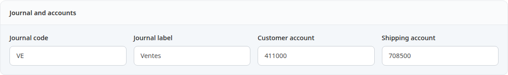
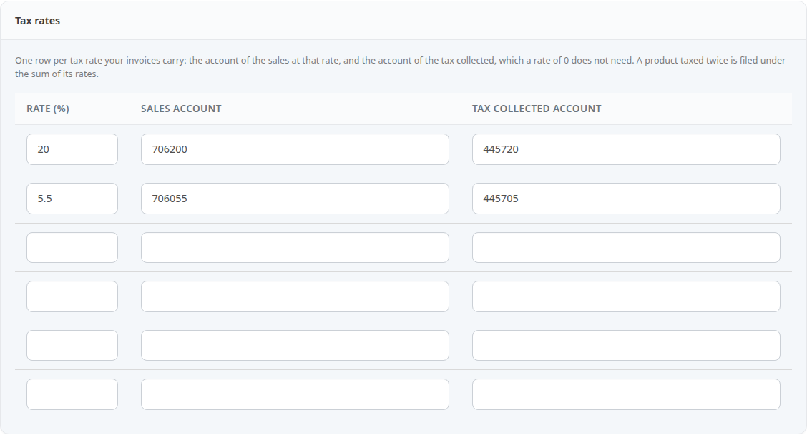
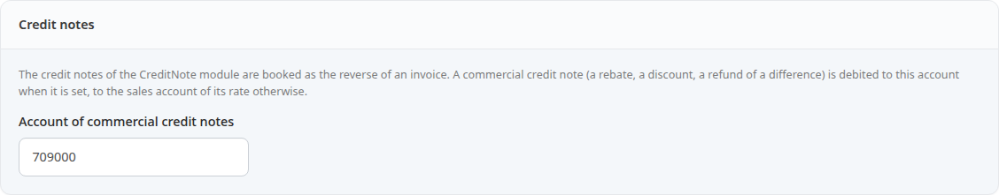
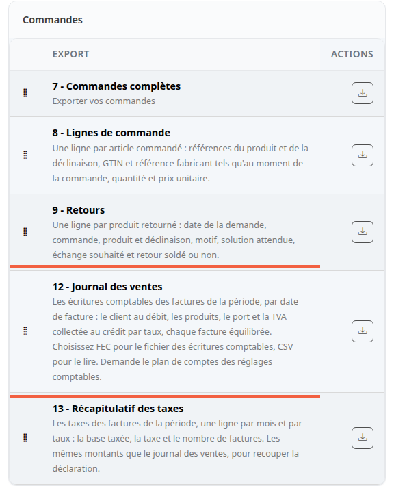
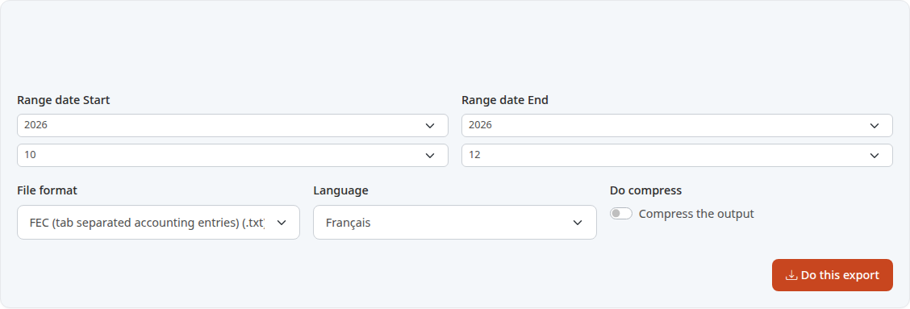

The sales journal gives your accountant the invoices of a period as accounting entries, in a file their software can load. You no longer rework the orders export by hand.

**Before you start:** your orders must be invoiced (see [Print the invoice and the delivery slip](/en/orders/print-documents/)). Ask your accountant which account numbers to use.

## Step 1: set the chart of accounts

The chart of accounts says on which accounts each amount is written. You set it once, before the first export. While it is incomplete, the sales journal refuses to run.

1. In the menu, click **Configuration**.
2. Click **Accounting**.

The **Chart of accounts** page opens. While accounts are missing, a banner says so: **Still to set: the customer account, the shipping account, the accounts of the tax rates.**

## Step 2: enter the journal and the accounts

The first block, **Journal and accounts**, has four fields.

1. **Journal code**: the code of the sales journal in your books, for example `VE`.
2. **Journal label**: its name, for example `Ventes`. Left empty, these two fields are `VE` and `Ventes`.
3. **Customer account**: the account debited with the total of each invoice, for example `411000`.
4. **Shipping account**: the account credited with the shipping, excluding tax, for example `708500`.

An account number is written with digits or letters, 20 characters at most. Any other value is refused and nothing is saved.

## Step 3: enter one account per tax rate

The **Tax rates** block has one row per VAT rate that appears on your invoices.

1. In **Rate (%)**, write the rate, for example `20`.
2. In **Sales account**, the account of the sales at that rate, for example `706200`.
3. In **Tax collected account**, the account of the matching VAT, for example `445720`.
4. Add one row per other rate, for example `5.5`.

For a rate of 0, leave the tax collected account empty. A product taxed twice is filed under the sum of its rates: if you sell any, add a row for that sum.

## Step 4: credit notes, if you issue any

The last block, **Credit notes**, only matters with the CreditNote module. Credit notes are written there as the reverse of an invoice.

A commercial credit note is a reduction granted after the invoice: a rebate, a discount, a refund of a difference. If you fill in **Account of commercial credit notes**, for example `709000`, it is debited to that account. Otherwise it is debited to the sales account of its rate.

Click **Save**. The message **The chart of accounts has been saved.** appears.

## Step 5: choose the sales journal

1. In the menu, click **Tools**, then **Export**.
2. In the **Orders** card, find **12 - Sales journal**.
3. Click the download button on that row.

The row just below, **13 - Tax summary**, is covered in the last section of this page.

## Step 6: choose the period and the format

1. In **Range date Start**, choose the year then the month of the first month to export.
2. In **Range date End**, choose the year then the month of the last one. That month is included in full.
3. In **File format**, choose the format you want.
4. Click **Do this export**.

Invoices are filed by invoice date: an order placed in January and invoiced in February is in February.

Two formats are useful:

- **FEC (tab separated accounting entries) (.txt)**: the French accounting entries file that your accountant's software loads. It is tab separated, with a decimal comma. Do not open it in a spreadsheet: it is made for accounting software.
- **CSV (.csv)**: to read in a spreadsheet.

If the chart of accounts is incomplete, the export does not start and a message says what is missing.

## Step 7: get the file

On a shop set up as at installation, the file downloads as soon as you click **Do this export**. It is named `sales_journal.txt` in FEC, `sales_journal.csv` in CSV.

If your shop runs exports in the background, a page **Export: Sales journal** opens instead. It offers **Download sales_journal.txt** and a **Report of the export** block: the number of pieces, the total debit and the total credit, which must be equal. The **To check before using the file** box lists what the journal could not write.

Among these points are orders of the period that have an invoice date but no invoice number: they are not in the journal. Orders that are not invoiced are counted separately. An order that cannot be written, for example because its VAT rate has no row in the chart of accounts, is left out and named.

If you hand the file to your accountant or to the tax administration, keep a copy: the shop deletes the file when it is a day old.

## Tax summary

To check a VAT return, repeat step 5 with **13 - Tax summary**. It gives one row per month and per rate: the amount taxed, the tax and the number of pieces. It is read from the same pieces as the sales journal, so its tax amounts add up to it exactly. The FEC format is not offered for it: choose CSV.

## The result

You have a file of the period for your accountant.
