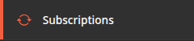
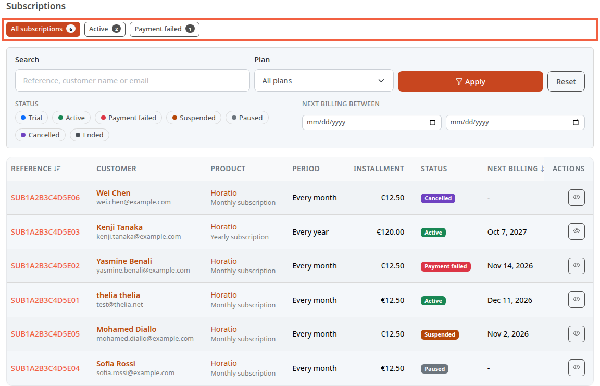
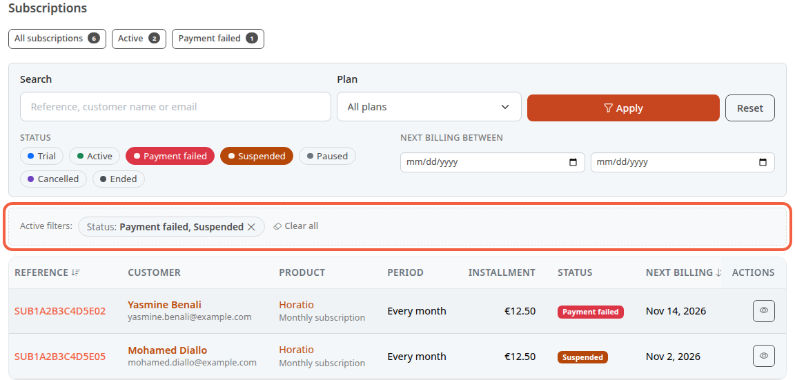
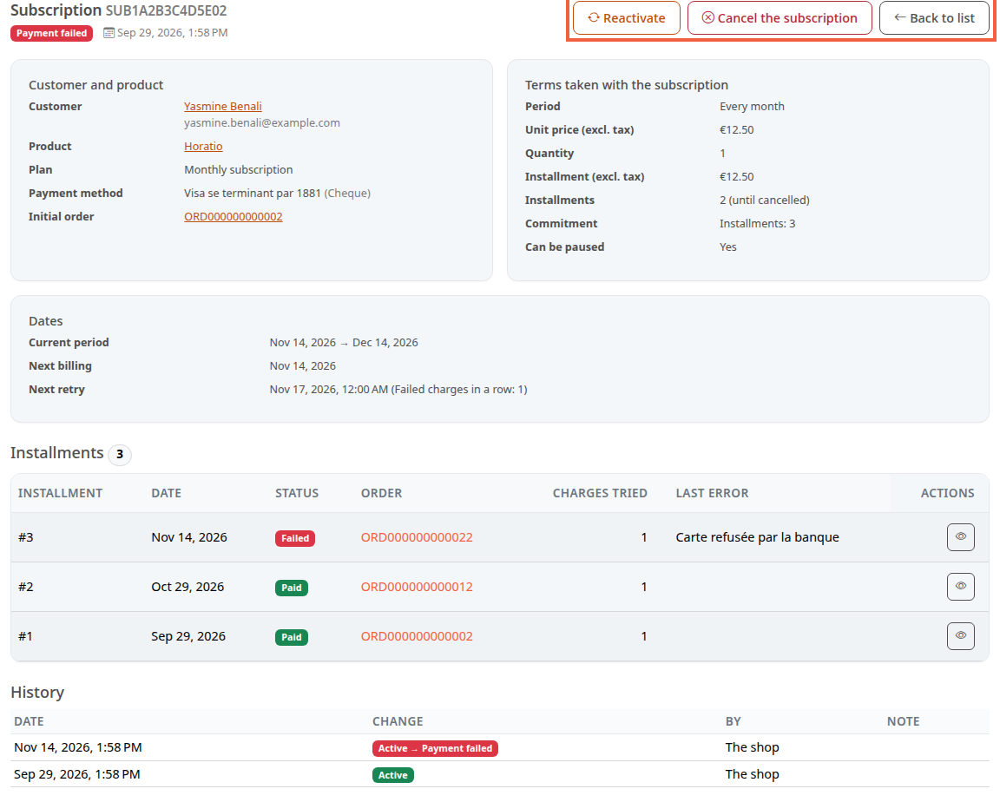
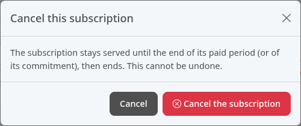

Each subscription a customer takes has its own sheet: state, next installment, orders already billed, history. It lets you act when a charge fails or when a customer asks.

**Before you start:** plans exist on a product (see [Sell a product by subscription](/en/catalog/sell-by-subscription/)) and at least one customer has subscribed. Your profile needs the **Subscriptions** right (code `admin.subscription` in the resource list of a profile). The right is granted profile by profile: an existing profile does not have it until it is given.

## How the shop charges

Each installment is an ordinary order, with its own reference, invoice and e-mail. The shop places it and charges it by itself on the planned date, to the payment method the customer stored.

If a charge is declined, the shop tries again after 2 days, up to 3 declined charges. Then the subscription becomes **Suspended** and nothing is charged until someone acts. A developer can change these two values.

## Step 1: open the list

1. In the left menu, click **Subscriptions**.

For each subscription, the list gives the reference, the customer, the product and the plan, the period, the price of an installment, the state and the next installment. Click the eye, or the reference, to open the sheet.

Above the list, two buttons count the **Active** and **Payment failed** subscriptions. Click one to see only those.

## Step 2: filter

1. In **Search**, type a reference, a customer name or an e-mail address.
2. In **Plan**, pick a plan.
3. Under **Status**, tick one or more states: **Trial**, **Active**, **Payment failed**, **Suspended**, **Paused**, **Cancelled**, **Ended**.
4. In **Next billing between**, type two dates.
5. Click **Apply**. **Reset** clears the filters.

The active filters appear under the form. Click one to remove it, or **Clear all**.

## Step 3: read the sheet

Open a subscription. The sheet gathers:

- **Customer and product**: the customer, the product, the plan, the payment method (its label, never the card number) and the initial order;
- **Terms taken with the subscription**: period, price, quantity, number of installments and commitment, as the customer took them;
- **Dates**: current period, next billing and, for a declined payment, the next retry;
- **Installments**: each installment with its date, state, order, the number of charges tried and the last error;
- **History**: each change of state, with who made it: the customer, an administrator or the shop.

## Step 4: act on a subscription

The buttons at the top of the sheet depend on the state of the subscription. You also need the right to edit subscriptions.

| Button | When | Effect |
|---|---|---|
| **Pause** | Active subscription whose plan allows a pause | Nothing is charged during the pause. |
| **Resume** | Paused subscription | Billed again at the end of the current period. If it is already over, the installment is charged at once. |
| **Reactivate** | Suspended subscription or one whose payment failed | The failed installment is charged again now. The subscription becomes active when the charge is paid. |
| **Cancel the subscription** | Subscription that is neither cancelled nor ended | The customer is served until the end of the paid period, or of the commitment, then the subscription ends. |

1. Click the button you need.
2. Read the confirmation window, then confirm.

A cancellation is final. An action the state refuses comes back with a message and changes nothing.

## The result

The state changes and the line appears in the **History**, with your name. The dashboard shows the **Monthly recurring revenue**, and the sheet of a customer lists their subscriptions.
