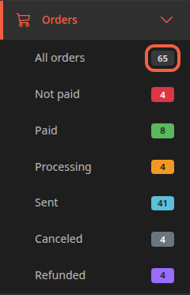
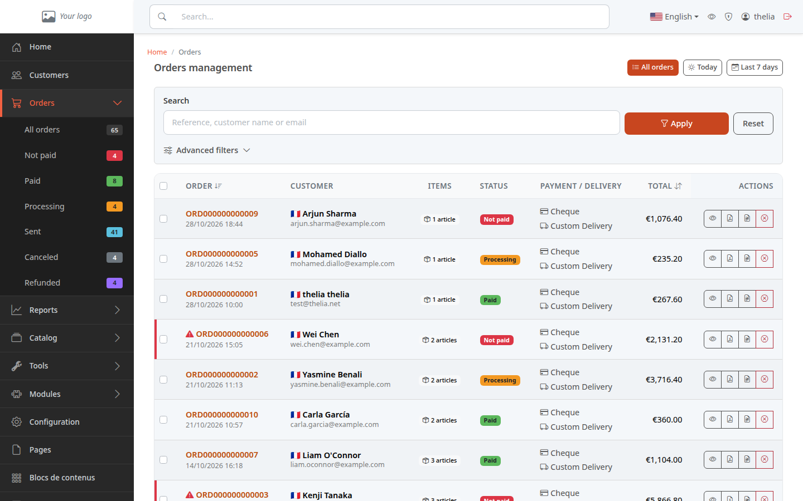
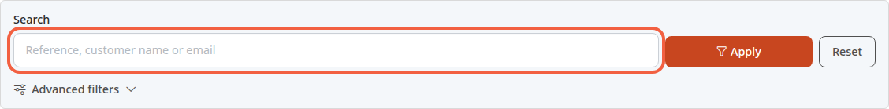
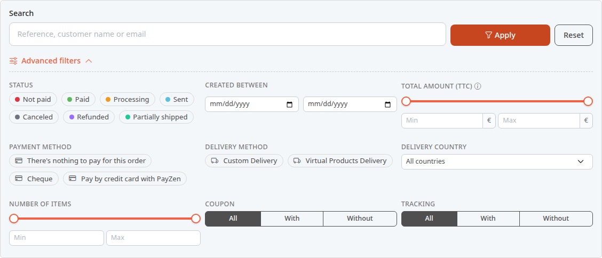
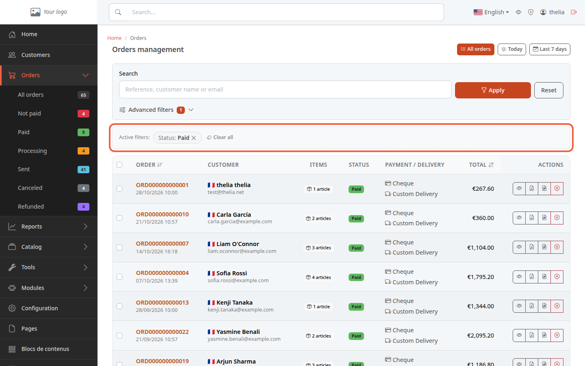

An order arrives as soon as a customer confirms their cart on your store. The order list tells you which orders are waiting for payment, which ones are to be processed and which ones have shipped.

**Before you start:** you need access to the [back office](/en/getting-started/back-office-tour/) and, to see any rows, at least one order in the store.

## Step 1: open the list

1. In the menu on the left, click **Orders**.
2. Click **All orders**.

The **Orders** submenu shows a counter on the right of each line. In the demo store, 65 orders have been placed.

A line's counter gives the number of orders with that status. A status is the stage an order has reached, for example **Paid** or **Sent**. A status with no orders does not appear in the menu.

## Step 2: understand the statuses

Each order has a status, shown in the **STATUS** column as a colored badge. These are the ones you see with a new store:

- **Not paid**: the order is recorded, but payment has not been received yet. An order placed more than 48 hours ago and still unpaid has a red triangle in front of its reference.
- **Paid**: payment is recorded. The invoice date is set at that moment.
- **Processing**: the order is paid and being processed. Thelia counts it as paid.
- **Sent**: the parcel has left. Thelia also counts it as paid.
- **Canceled**: the order has been canceled.
- **Refunded**: the order is marked as refunded to the customer.
- **Partially shipped**: some of the parcels have left, the rest are still to come. Thelia also counts it as paid. This status only appears in the menu when an order has it.

Your store may have other statuses that you added: they appear in the menu by themselves. To move an order from one status to another, see [Move an order forward](/en/orders/process-order/).

## Step 3: read the list

The list shows 25 orders per page, most recent first.

Each row contains:

- **ORDER**: the order reference, which opens its detail, and the date it was placed;
- **CUSTOMER**: the customer's name and e-mail address;
- **ITEMS**: the number of different products in the order. A product ordered in 3 copies counts as 1;
- **STATUS**: the status;
- **PAYMENT / DELIVERY**: the payment method chosen, for example Cheque, and the delivery method;
- **TOTAL**: the total amount of the order;
- **ACTIONS**: up to four buttons, in this order: **View order**, **Download invoice PDF**, **Download delivery slip PDF** and **Cancel order**, which is missing when the order can no longer be canceled.

Click the **ORDER** header to sort the list by order date, or **TOTAL** to sort by amount.

To see only one status, click that status in the menu, for example **Paid**.

To read what an order contains, see [Read an order's details](/en/orders/read-order/).

## Step 4: find an order

At the top of the page, three buttons filter by date:

- **All orders**: no limit;
- **Today**: today's orders;
- **Last 7 days**: orders from today and the six previous days.

To look for a specific order:

1. Click the **Search** field.
2. Enter a reference, a customer name or an e-mail address, for example `Rossi`.
3. Click **Apply**.

To go back to the full list, click **Reset**.

## Step 5: narrow down with advanced filters

1. Click **Advanced filters**. The panel opens.
2. Choose one or more criteria.
3. Click **Apply**.

The available criteria:

- **STATUS**: tick one or more statuses;
- **CREATED BETWEEN**: a start date and an end date;
- **TOTAL AMOUNT (TTC)**: a minimum and a maximum. TTC means taxes included. The amount includes shipping costs and discounts;
- **PAYMENT METHOD** and **DELIVERY METHOD**: tick the ones you want;
- **DELIVERY COUNTRY**: a country from the list;
- **NUMBER OF ITEMS**: a minimum and a maximum of different products;
- **COUPON**: **All**, **With** or **Without** a promo code;
- **TRACKING**: **All**, **With** or **Without** a parcel tracking number.

The filters in use appear in an **Active filters** strip. Click the cross on a filter to remove it, or **Clear all** to remove them all.

If nothing matches, the list shows **No order matches the current filters.**

To change the status of several orders at once, tick their boxes in the list: a **Move the selected orders to** bar appears. The details are in [Move an order forward](/en/orders/process-order/).

## The result

You find an order by its number, its customer, its date or its status. The counters in the **Orders** menu show you at a glance what is waiting for payment or shipment.
