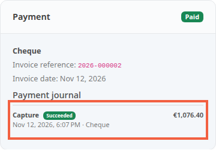

The payment journal keeps a trace of every movement of money on an order: authorization, capture, release. It tells you what the bank has set aside, what has been taken and what is left to take.

An authorization is an amount the customer's bank reserves without charging it. The capture is the step that actually charges it. Some payment modules separate the two: you authorize when the order is placed and take the money when it ships, for example.

**Before you start:** a paid order. To capture, you also need a payment module that authorizes first and an administrator account with the right to capture (step 4).

## Step 1: open the journal of an order

1. In the left menu, click **Orders**, then open an order.
2. In the right-hand column, find the **Payment** card.
3. Under **Payment journal**, read the lines. The most recent is at the top.

Each line shows:

- the type of movement: **Authorization**, **Capture** or **Void** (the release of a reserved amount);
- its state: **Succeeded**, **Pending** or **Failed**;
- the amount, the date, the author (the payment module or an administrator) and the reference given by the payment provider.

An order placed before the update to 3.4 has no journal. The card shows **No payment movement recorded for this order**.

## Step 2: know what the journal writes by itself

A module that takes the money at once, such as cheque, only tells the shop "paid". As soon as the order goes from unpaid to paid, the shop writes one **Capture** line for the full total. The provider reference stays empty in this case.

The same applies when you set the order to **Paid** yourself on receiving a cheque. The same order never gets this line twice.

## Step 3: take an authorization

With a module that authorizes first, the order arrives with the status **Awaiting capture**. This status counts as unpaid: the order is not paid until the money is taken.

1. Open the order. The **Payment** card shows **Authorized**, **Captured** and **Remaining to capture**.
2. A warning reminds you that marking the order paid by hand takes nothing from the buyer.
3. Click **Capture payment**.
4. In the window, **Amount to capture** is filled with what is left. Keep it to take everything, or enter a smaller amount.
5. Click **Capture now**.

A partial capture leaves the rest to capture later, and the order stays **Awaiting capture**. When nothing is left to capture, the order becomes **Paid**. The shop refuses an amount above what the authorization holds, or a zero amount.

If you ask for the same amount twice within a minute, the second request is refused: a double click does not charge twice.

Some providers take only one capture per authorization. The window says so: what you do not capture is released with it.

## Step 4: grant the right to capture

Capturing is a right of its own, **Order payment capture**. After the update no profile has it: only the super administrator captures. Add this right, with create access, to the profiles that should take payments.

Without this right, an administrator sees the card and the journal but not the **Capture payment** button. They cannot cancel an order whose authorization still holds an amount either.

## When the provider refuses or does not answer

- **Refusal.** The line becomes **Failed**. The provider's code and message appear below it in red. The amount can still be captured: you can try again.
- **No answer.** The line stays **Pending** and the shop does not count it as failed. When the provider confirms, the line settles by itself.
- **Answer read at the provider.** On a **Pending** line, an administrator with the right to capture can enter what they read in the provider's own space. Under **Outcome read at the provider**, they choose **Succeeded** or **Failed**, with the reference if known.

## Cancel an authorized order

Cancelling an order whose authorization still holds an amount releases that amount: a **Void** line is added to the journal, and **Released** appears in the totals. You need the right to capture for this.

## The result

The **Payment** card of each order tells where the money stands, line by line, with who did what. For an authorized order, the **Authorized**, **Captured** and **Remaining to capture** totals update with every capture.
