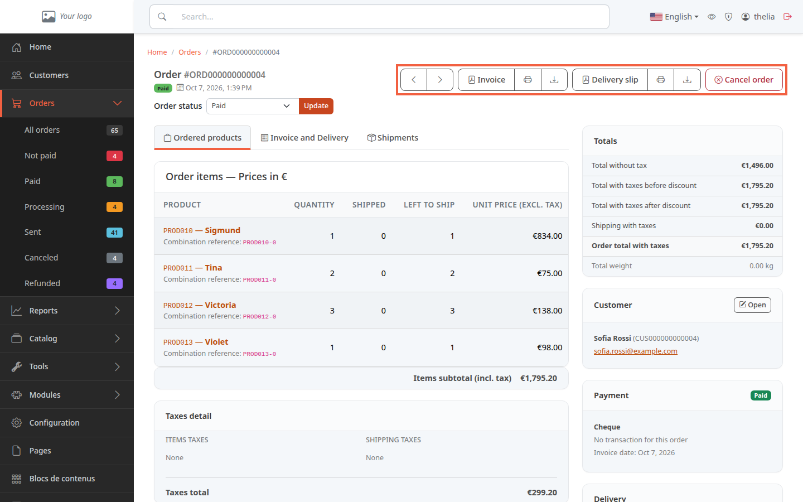

The invoice is the document you give the customer for a paid order. The delivery slip goes with it in the parcel. This tutorial shows where to display them, print them and save them as PDF.

**Before you start:** you need an order, see [Track your orders](/en/orders/list-orders/). For the invoice, the order must be paid.

## Step 1: open the order

1. In the menu on the left, click **Orders**, then **All orders**.
2. Click the order reference, for example **ORD000000000004**.

The buttons are at the top of the page, under the order status.

## Step 2: display, print or download the invoice

The **Invoice** group contains three buttons.

1. Click **Invoice** to open the PDF in a new tab. The tooltip reads **View invoice PDF**.
2. Click the printer icon to open your browser's print window (**Print invoice**).
3. Click the download icon to save the PDF on your computer (**Download invoice as PDF**). The file is named `invoice-` followed by the order reference, for example `invoice-ORD000000000004.pdf`.

The invoice shows the invoice date, the invoice number, the customer number, and the delivery and billing addresses.

## Step 3: display, print or download the delivery slip

The **Delivery slip** group works the same way.

1. Click **Delivery slip** to open the PDF in a new tab.
2. Click the printer icon to print it.
3. Click the download icon to save it. The file is named `delivery-` followed by the reference, for example `delivery-ORD000000000004.pdf`.

The delivery slip shows the invoice date, the order number, the customer number and both addresses. It is always available, whether the order is paid or not.

The tooltips of these three buttons say "purchase order" (**View purchase order as PDF**): it is the same document.

## Step 4: understand when the invoice is available

The **Invoice** button does not appear on every order. It is shown in two cases:

- the order is **Paid**, **Processing**, **Sent** or **Partially shipped**;
- or it already has an invoice date, for example because it was paid before being refunded.

On a **Not paid** order, there is only the delivery slip.

The invoice date is set the first time the order moves to a paid status. A paid order therefore always has its invoice.

The invoice number is assigned at that moment, in sequence: `2026-000001`, `2026-000002`, and so on. Each year starts a new series at `000001`. This numbering is active on a freshly installed store.

When a paid order has no recorded invoice number, the PDF builds one from the order number. This is the case for the demo orders: the invoice of ORD000000000004 carries the number `FA000000000004`.

To find the documents without opening the order, the order list offers the same PDFs in the **ACTIONS** column: **Download invoice PDF** and **Download delivery slip PDF**. Note that the list offers the invoice even for an unpaid order: that PDF has no invoice date and no invoice number.

## The result

The PDF opens in a tab, goes to the printer, or lands in your browser's downloads folder. It carries the order's information.
