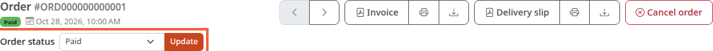
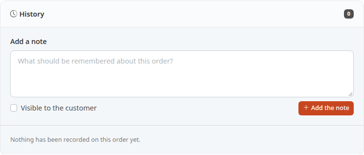

An order's status tells you where it stands: to be paid, paid, being prepared, shipped. You change it by hand as you process the order, so that you and your customer know where the order stands.

**Before you start:** you need at least one order in the store. To find it, see [Track your orders](/en/orders/list-orders/).

## Step 1: open the order

1. In the menu, click **Orders**.
2. Click the order to process, for example ORD000000000001.

The order page opens. To understand its blocks, see [Read an order's details](/en/orders/read-order/).

## Step 2: choose the new status

The status is changed at the top of the page, under the order reference.

1. Find the **Order status** line.
2. Open the dropdown list. It first shows the current status (here **Paid**), then the statuses you can choose.
3. Click the status you want, for example **Processing** to say you are preparing the parcel.

The statuses shipped with Thelia are **Not paid**, **Paid**, **Processing**, **Sent**, **Canceled**, **Refunded** and **Partially shipped**.

## Step 3: save the change

1. Click **Update**, to the right of the list.

The page reloads with the new status in the list. Check it in the next step.

If the parcel is leaving, the tutorial [Ship an order and enter the tracking number](/en/orders/ship-order/) adds the tracking number.

## Step 4: check the history

Further down the page, the history block keeps one line per status change. In the screenshot, it is empty: **Nothing has been recorded on this order yet.**

## Which statuses are offered

Depending on the store's configuration, the list does not always offer every status.

- As long as no transition is set from the current status, the order can go to any status.
- As soon as at least one transition is set from that status, only the allowed statuses are listed. A line under the list says so: **Only the statuses allowed from the current status are listed.**
- If no transition is allowed, the list and the button are grayed out and the line reads: **No transition is allowed from the current status.**

This setting is not described here: if a status you need is missing, ask the person who administers the store.

## What the change triggers

- **History:** each change is recorded in the order's history.
- **E-mail to the customer:** when the order moves to **Sent**, the customer receives a shipping e-mail, unless the **Send the customer an email when their order is shipped** box is unticked in [Store information](/en/getting-started/store-info/). The details are in [Ship an order and enter the tracking number](/en/orders/ship-order/).
- **Shipment:** when the order moves to **Sent**, everything left to ship is recorded as sent, in one parcel that takes over the order's tracking reference. To enter the tracking number first, use the **Shipments** tab (see the same tutorial).
- **Invoice number:** with the default setting, an order that moves to a paid status (**Paid**, **Processing**, **Sent** or **Partially shipped**) without an invoice number gets one.
- **Stock:** Thelia counts an order as paid when it is **Paid**, **Processing**, **Sent** or **Partially shipped**. When it leaves these statuses, for example for **Canceled**, its products are put back in stock. When the order later returns to a paid status, they are taken out of stock again.

## The result

The order shows its new status at the top of the page, and the history keeps a record of it.
