An order gathers everything you need to prepare a parcel: the products bought, the addresses, the payment and the delivery. This tutorial walks you through the screen block by block, using the demo order ORD000000000004.

**Before you start:** you need an order in the store. To find it, see [Track your orders](/en/orders/list-orders/).

## Step 1: open the order

1. In the menu on the left, click **Orders**, then **All orders**.
2. Click the order reference, for example **ORD000000000004**.

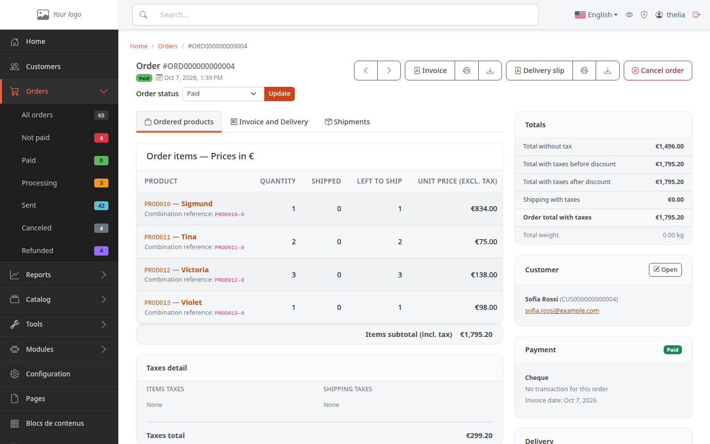

The page reads in two columns. On the left, three tabs and the history. On the right, the totals, the customer, the payment and the delivery.

## Step 2: read the header

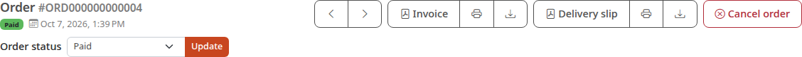

From top to bottom:

- the **Order** title and its reference;
- a badge with the status (here **Paid**) and the date the customer ordered;
- the **Order status** list and the **Update** button, used to move the order forward: see [Move an order forward](/en/orders/process-order/);
- the two arrows, which open the previous or the next order;
- the **Invoice** button, present on a paid order, even if it was canceled or refunded since, and the **Delivery slip** button: see [Print the invoice and the delivery slip](/en/orders/print-documents/);
- the **Cancel order** button, which only appears if the order can still be canceled.

## Step 3: read the ordered products

The **Ordered products** tab is open by default. It lists what the customer bought.

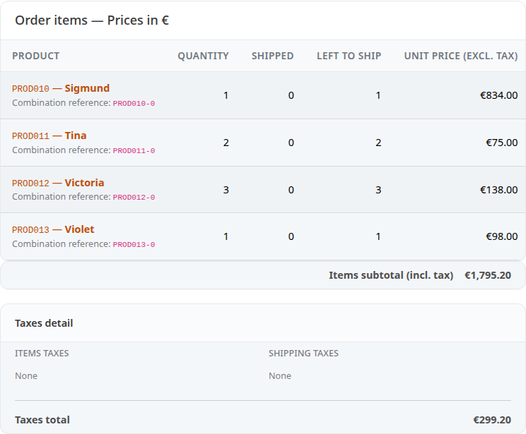

Each line shows the product with its reference, for example **PROD010**. Click the name to open the product page. The columns read as follows:

- **QUANTITY**: the number of copies ordered;
- **SHIPPED**: the number already sent;
- **LEFT TO SHIP**: what remains to be sent;
- **UNIT PRICE (EXCL. TAX)**: the price of one unit without taxes;
- **TAX**, **UNIT PRICE (INCL. TAX)**, **LINE TOTAL (EXCL. TAX)**, **LINE TAX** and **LINE TOTAL (INCL. TAX)**: these columns are further right. Scroll the table to the right to see them.

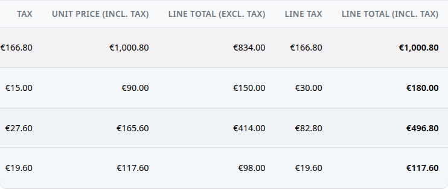

Excl. tax means without taxes, incl. tax means taxes included. A tax here is VAT: see [Set up VAT](/en/settings/tax-rules/).

Below the table, **Items subtotal (incl. tax)** gives the total of the lines, then the **Taxes detail** block lists the taxes on the items and on the delivery.

## Step 4: check the addresses

1. Click the **Invoice and Delivery** tab.

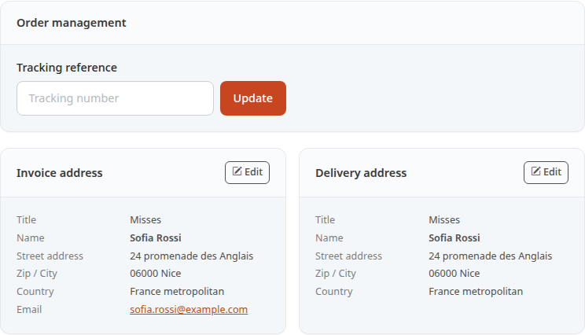

The tab contains:

- **Order management**: the **Tracking reference** field, where you enter the parcel's tracking number;
- **Invoice address**: the name and address to put on the invoice;
- **Delivery address**: the address where to send the parcel.

Each address shows the title (**Misses**), the name, the street address, the zip code and the city, and the country. The **Edit** button lets you correct an address.

## Step 5: follow the shipments

1. Click the **Shipments** tab.

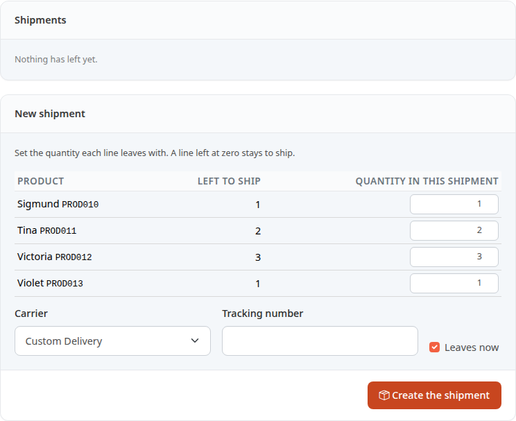

The **Shipments** block lists the parcels declared for this order, with their state. As long as no parcel is declared, it shows **Nothing has left yet.** The **New shipment** block is used to declare a parcel: see [Ship an order](/en/orders/ship-order/).

The next screenshot shows another order, ORD000000000005, shipped for this example. Each parcel has one line that gives:

- its reference, **ORD000000000005-1**, and the date it left (**Shipped on** …);
- its status, **Shipped**;
- the carrier, with the tracking number below it;
- the products in the parcel, with their quantity.

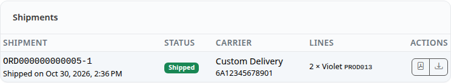

## Step 6: read the right-hand column

The **Totals** block summarizes the amounts.

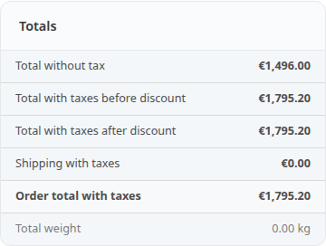

- **Total without tax**: the sum of the products without tax;
- **Total with taxes before discount**: the same sum, taxes included;
- **Discount with taxes**: the amount of the discounts, shown only when the order has one;
- **Total with taxes after discount**: the amount once discounts are deducted. It is the same as the previous one when the customer has no discount;
- **Shipping with taxes**: the shipping costs;
- **Order total with taxes**: what the customer has to pay;
- **Total weight**: the weight of the products.

Further down, the **Customer** block gives their name, reference and e-mail address. The **Open** button opens their page.

The **Payment** block shows the method chosen, here **Cheque**, and whether the order is paid.

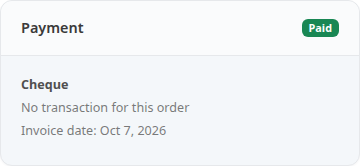

It also shows the **Transaction reference** when the payment has one (here **No transaction for this order**). Once the order is paid, it adds the **Invoice date**, and the **Invoice reference** when an invoice number has been assigned.

The **Delivery** block gives the delivery method chosen, here **Custom Delivery**. It adds the **Tracking reference** once entered.

Depending on the order, other blocks are added: **Coupons** if the customer used any, **Gift** if they chose a gift service or wrote a message for the recipient, **Consents** when they accepted or declined consents during the order.

At the very bottom of the left column, the **History** block keeps track of what happened on the order, most recent first. The **Add a note** field lets you write a comment there.

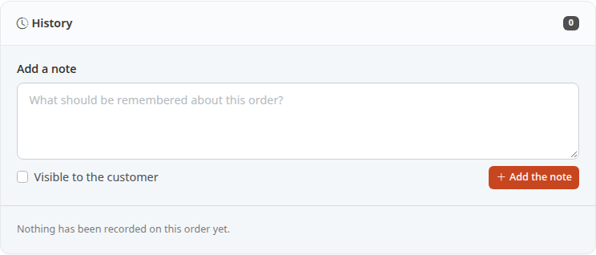

On this order, the block is empty (counter at 0). On ORD000000000005, shipped for this example, it has six lines. Each one says what happened, who did it and when, for example **Status changed from Processing to Sent** or **Tracking reference set to 6A12345678901**.

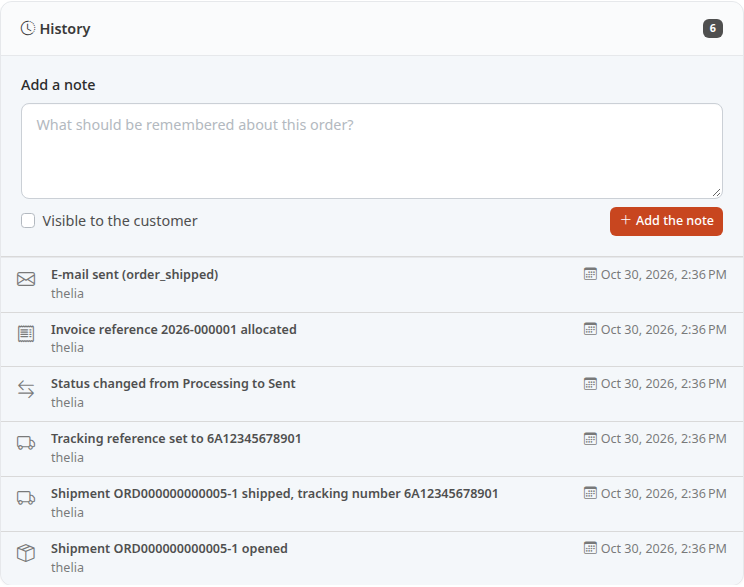

## The result

You know where to find each piece of information: the products in the first tab, the addresses in the second, the parcels in the third, and the amounts and payment on the right.
