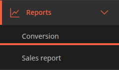
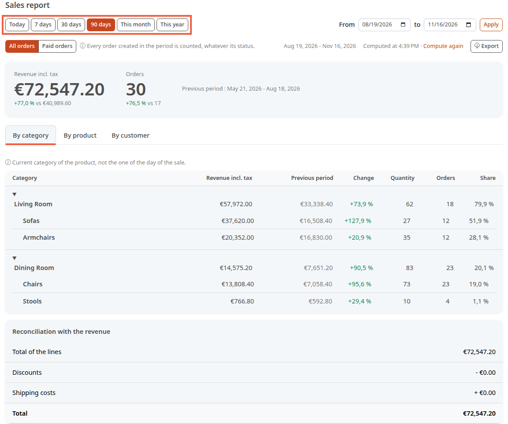
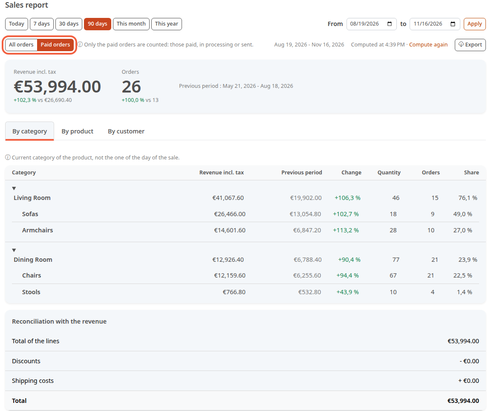
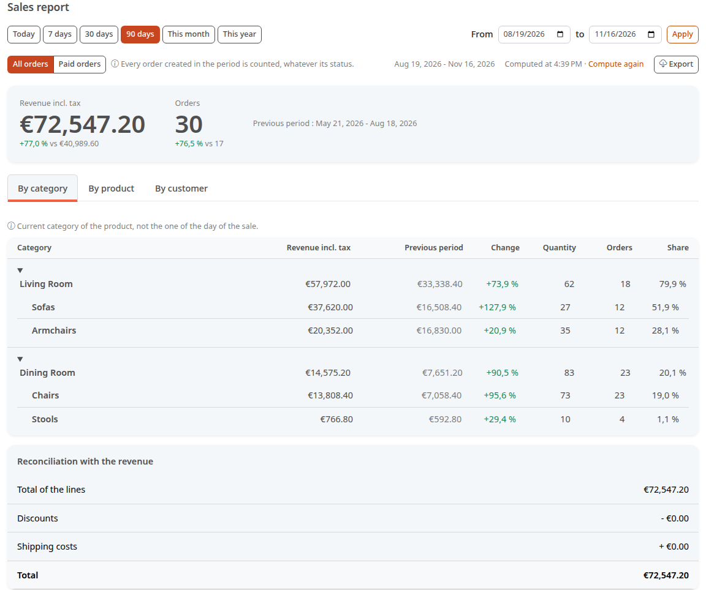
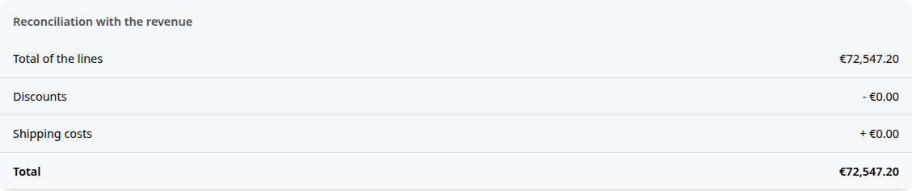
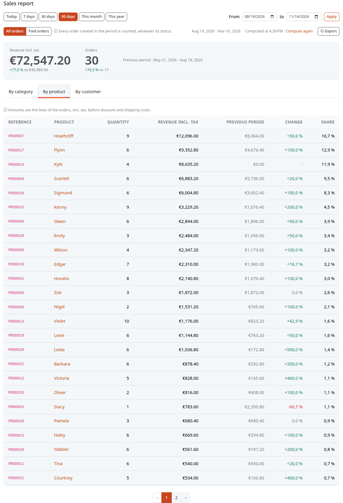
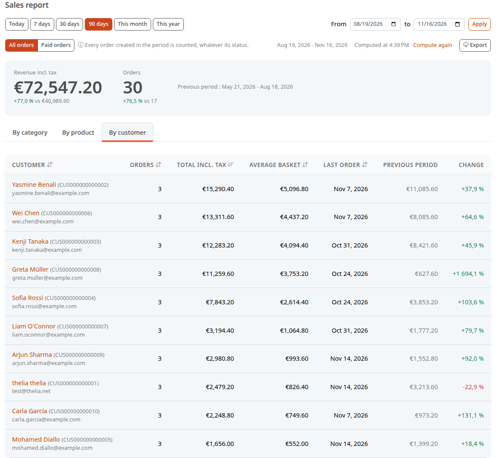
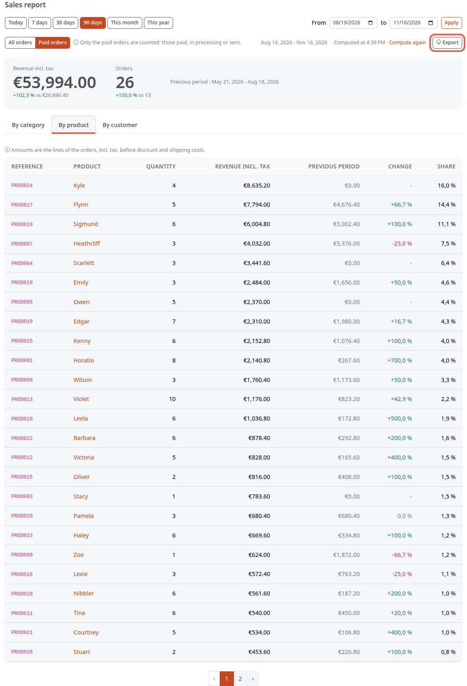

The sales report shows what the shop sold over a period, ranked by category, by product or by customer, and compares it with the previous period. Use it to see what carries the revenue and what is falling.

**Before you start:** the shop has orders. The **By category** and **By product** tabs need the right on orders (`admin.order`), the **By customer** tab the right on customers (`admin.customer`), the **Export** button the export right (`admin.export`). A tab your profile cannot read is not offered.

## Step 1: open the report

1. In the left menu, click **Reports**.
2. Click **Sales report**.

If your profile has the right on customers but not on orders, the **Reports** menu holds **Sales report** only, and the screen opens on **By customer**.

## Step 2: choose the period

1. Click **Today**, **7 days**, **30 days**, **90 days**, **This month** or **This year**. Without a choice, the screen shows the last 30 days.
2. For exact dates, enter them in **From** and **to**, then click **Apply**.

Dates go up to today, over three years at most. Rejected dates bring you back to 30 days.

At the top, the **Revenue incl. tax** and the number of **Orders** are compared with the **Previous period**: it ends the day before yours starts and lasts as many days. An increase shows in green with its percentage, a decrease in red.

## Step 3: choose the orders counted

Two buttons set what is counted:

- **All orders** (the starting setting) counts every order created in the period, whatever its status, canceled ones included;
- **Paid orders** counts only the orders that are paid, in processing or sent.

1. Click **Paid orders**.

A sentence next to the buttons recalls what is counted. A status you created counts as paid when its equivalent code is paid, processing or sent. An administrator attached to some sale units sees the orders of those units only.

## Step 4: read the sales by category

1. Click the **By category** tab.

Each line is a category, with its **Revenue incl. tax**, the **Previous period**, the **Change**, the **Quantity** sold, the number of **Orders** and its **Share** of the total. A category adds up its subcategories: **Living Room** includes **Sofas** and **Armchairs**. Click the arrow of a category to fold its subcategories.

Three rules to know:

- a product is counted in its default category only, so a sale is counted once;
- the category is the one of the product today, not the one on the day of the sale;
- deleted products and products without a category are under **Uncategorized goods**, service lines, such as a gift wrapping, under **Services**.

Under the tree, the **Reconciliation with the revenue** table goes from the **Total of the lines** to the **Total** by taking off the **Discounts** and adding the **Shipping costs**. This total is the revenue of the home page for the same period.

## Step 5: read the sales by product

1. Click the **By product** tab.

Each product sold appears with its **Reference**, the **Quantity**, the **Revenue incl. tax**, the **Previous period**, the **Change** and its **Share**. Best sellers come first, 25 products per page. The amounts are those of the order lines, before discounts and shipping costs. A quantity sold by weight keeps its decimals: 0.4 kg shows as 0.4.

Click a product name to open its sheet, if your profile can see products.

## Step 6: read the sales by customer

1. Click the **By customer** tab.

Each customer who ordered in the period appears with the number of **Orders**, the **Total incl. tax**, the **Average basket** (the total divided by the number of orders), the **Last order**, the **Previous period** and the **Change**. The biggest total comes first, 25 customers per page. Click a column title to sort on it, and a customer name to open the customer sheet.

## Step 7: export

1. Click **Export**.

The browser downloads a CSV file of the tab on screen, for the same days and the same orders as the screen. A spreadsheet opens it. If the file takes time, a progress page shows first. A period without any sale has nothing to export. To receive them by e-mail on a fixed schedule, see [Schedule reports by e-mail](/en/orders/schedule-email-reports/).

## The result

You read the revenue of the period by category, by product and by customer, with the change since the previous period. Adding up a long period can take a few seconds: the screen keeps its figures for 15 minutes, shows **Computed at** the time of the calculation, and **Compute again** redoes them. An order placed, updated or deleted renews them by itself.
