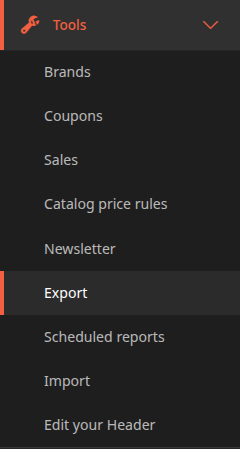
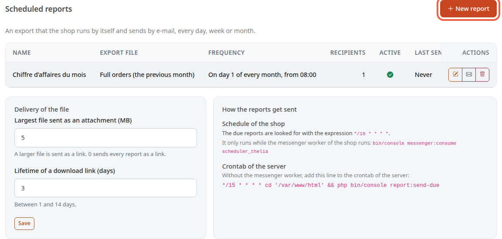
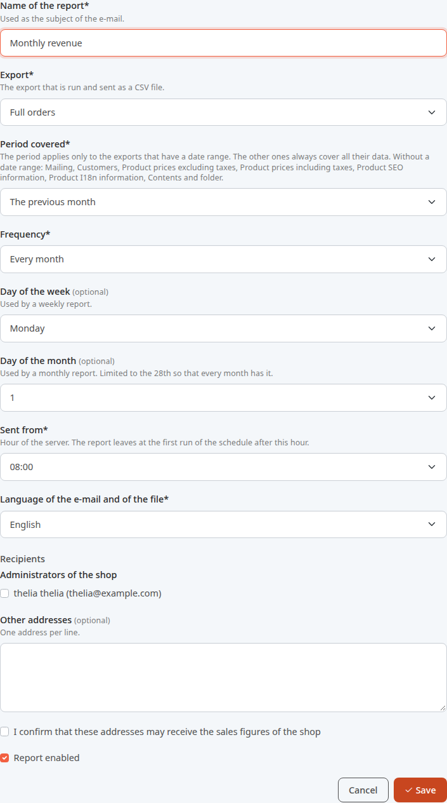
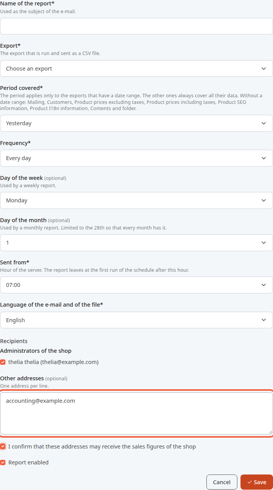
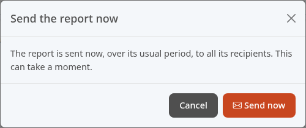
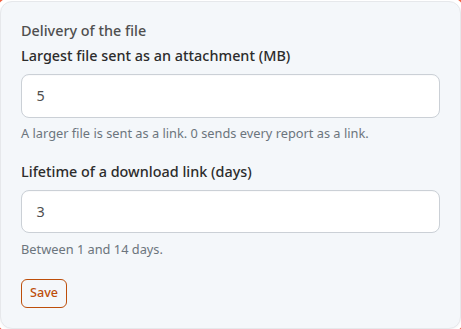
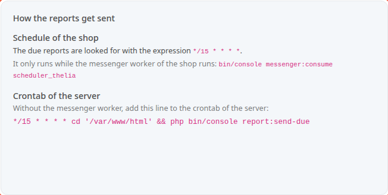

A scheduled report is an export that the store runs and sends by e-mail on its own, for example on Monday morning. You receive the week's sales without opening the back office.

An export is a file of data from your store, such as the list of orders. The report sends it as a CSV file, which a spreadsheet can read.

**Before you start:** the store's e-mails go out (see [Check that the store sends emails](/en/settings/mailing-test/)). For the automatic sends to leave, your host or the person who runs your server must also have set up step 7.

## Step 1: open the screen

1. In the left menu, click **Tools**.
2. Click **Scheduled reports**.

The screen lists your reports. One line per report: its name, the export, the schedule and the number of recipients. The table scrolls to the right: the **Active**, **Last sent** and **Retries pending** columns are there too.

On a line, the switch in the **Active** column stops or restarts a report. The three buttons on the right edit the report, send it now or delete it.

## Step 2: create the report

1. Click **New report**.
2. In **Name of the report**, enter for example `Monthly revenue`. This name is the subject of the e-mail.
3. In **Export**, choose the export to send, for example **Full orders**.
4. In **Period covered**, choose what the report contains, for example **The previous month**.

The period is relative to the day of sending. Five choices:

- **Yesterday**
- **The last 7 days**
- **The previous week (Monday to Sunday)**
- **The previous month**
- **The month so far (up to yesterday)**

Some exports have no date range: the screen lists them under the field, after **Without a date range**. They always send all their data, whatever the period.

## Step 3: choose the schedule

1. In **Frequency**, choose **Every day**, **Every week** or **Every month**.
2. For a weekly report, choose the day in **Day of the week**, for example **Monday**. Otherwise leave this field as it is.
3. For a monthly report, choose the day in **Day of the month**, for example 1, as in the capture. The list stops at the 28th so that every month has that day.
4. In **Sent from**, choose the hour, for example 08:00. This is the server's time.
5. In **Language of the e-mail and of the file**, choose the language, for example **English**.

The report does not leave on the dot: it leaves at the first run of the schedule after this hour (see step 7). The store's schedule runs every 15 minutes by default.

## Step 4: choose the recipients

1. In **Administrators of the shop**, tick the people who receive the report.
2. For an address outside the team, enter it in **Other addresses**, one per line, for example `accounting@example.com`.
3. Tick **I confirm that these addresses may receive the sales figures of the shop**. This box is required as soon as you enter another address.
4. Leave **Report enabled** ticked. Untick it to stop the report without deleting it.
5. Click **Save**.

A report carries the store's sales figures: only send it to people who may read them. At least one recipient is required. An address that is not written correctly is flagged before saving.

## Step 5: send the report right now

To check the content without waiting for the planned time:

1. In the list, click the envelope-shaped button on the report's line.
2. Read the **Send the report now** window: the report leaves over its usual period, to all its recipients.
3. Click **Send now**.

The screen then shows how many recipients received it, how many failed and how many were rejected, for example **Report sent to 1, failed for 0, rejected for 0.** A recipient is rejected when their address is not valid. This send needs neither the schedule nor a crontab. The scheduled report keeps leaving on its own schedule.

## What the e-mail contains

The subject of the e-mail is the name of the report, followed by the dates of the period. The text recalls the period and the export. The CSV file follows, attached or as a link (next step).

For two exports, the e-mail opens with key figures:

- **Full orders**: **Orders**, **Paid orders**, **Revenue incl. tax** and **Average order value**. The average order value is the revenue divided by the number of paid orders.
- **Conversion funnel**: **Carts created**, **Orders created**, **Orders paid** and **Paid orders out of created orders**.

The other exports have no key figures: the e-mail carries the file alone. When the period holds no data, the e-mail says so and attaches no file.

## Step 6: set how the file is delivered

A file that is too big does not always go through as an attachment. The store then sends it as a download link.

1. In **Largest file sent as an attachment (MB)**, enter the size limit, for example 5. Above it, the file leaves as a link. With 0, every report leaves as a link. The maximum value is 100.
2. In **Lifetime of a download link (days)**, enter the duration, for example 3. It runs from 1 to 14 days. After that time, the link no longer works: the e-mail gives the expiry date.
3. Click **Save** under these two fields.

The starting settings are 5 MB and 3 days. They apply to all reports.

## Step 7: make the reports leave automatically

The reports do not leave on their own: the server must regularly look for the reports to send. The **How the reports get sent** card says what to set up. Pass it on to the person who runs your server.

Two ways, your choice:

- **The store's schedule.** It looks for the reports to send according to the expression shown, `*/15 * * * *` at the start (every 15 minutes). It only runs while the store's worker runs: the command is shown on the card.
- **The server's crontab.** The card also shows **Crontab of the server** and the line to add to the crontab if the worker does not run.

If the WebScheduler module is active, the card offers **WebScheduler task** instead. The **Prepare the WebScheduler task** button creates the task, and the card gives the address to call from the host's scheduled tasks.

If the card shows **The schedule of the shop does not look for the reports (empty expression).**, the automatic sending is turned off.

If a send fails for a recipient, the store tries again on the next runs. It gives up after three attempts. The **Retries pending** column shows how many recipients are waiting for another try.

## The result

On the day and at the hour you chose, the recipients receive the e-mail with the key figures and the file. The **Last sent** column of the list shows the date of the last send, or **Never**.
