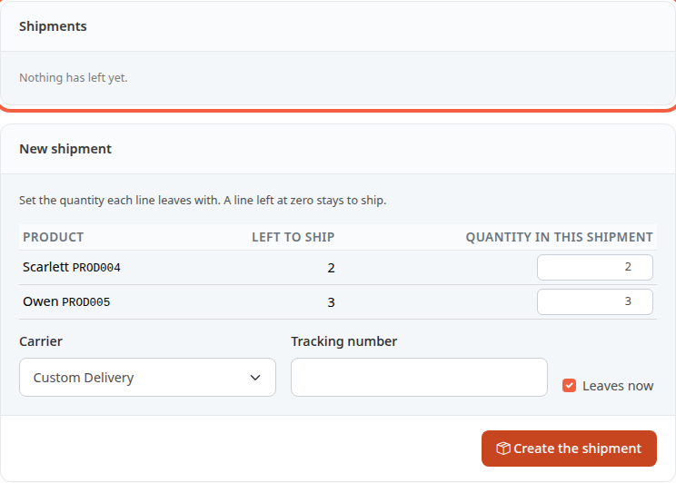
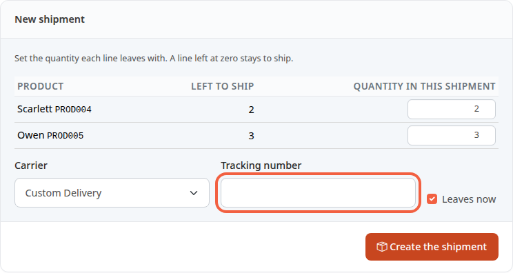
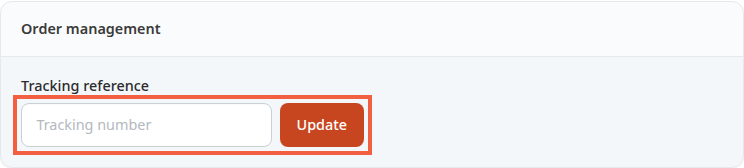

A shipment is one parcel leaving your premises, with its carrier and tracking number. You record it so that the order moves to **Sent** and your customer knows the parcel is on its way.

**Before you start:** you need a paid order to prepare. To only change its status, see [Move an order forward](/en/orders/process-order/).

## Step 1: open the Shipments tab

1. In the menu, click **Orders**, then the order to ship, for example ORD000000000002.
2. Click the **Shipments** tab.

As long as no parcel has left, the **Shipments** block shows **Nothing has left yet.** The **New shipment** block is used to prepare the parcel.

## Step 2: choose what leaves

The **New shipment** block lists the products still to ship.

1. Read the **Left to ship** column: it is the quantity still to send for each product.
2. In **Quantity in this shipment**, keep the suggested quantity if everything leaves in the same parcel.
3. To send in several parcels, enter a smaller quantity. A line left at zero stays to ship.

The field does not accept more than the remaining quantity.

## Step 3: enter the carrier and the tracking

1. In **Carrier**, keep the carrier chosen by the customer, or choose another one.
2. In **Tracking number**, enter the number given by the carrier, for example `6A12345678901`.
3. Leave the **Leaves now** box ticked if the parcel leaves today. Untick it to only prepare the parcel.
4. Click **Create the shipment**.

The tracking number is optional, 100 characters at most. Without a number, the shipment is recorded and the line shows **No tracking number**.

## Step 4: ship a prepared parcel

If you unticked **Leaves now**, the parcel is a **Draft**: it has not left yet. When it leaves:

1. In the **Shipments** tab, find the parcel's line.
2. Click **Ship**.

The **Cancel** button on that line drops the draft: its products go back to **Left to ship**.

## What changes for the order

- When all the products have left, the order moves to **Sent**.
- If some remain to be sent, it moves to **Partially shipped**, provided that status exists in the store.
- A **Canceled** or **Refunded** order cannot be shipped.
- If you move the order to **Sent** yourself from the status list, the parcels in **Draft** leave first, each as a separate parcel, then Thelia records everything that remains in a single parcel, which takes over the order's tracking reference. To give the parcel a tracking number, create the shipment here instead of changing the status.

## What the customer receives

When the order enters the **Sent** status, the customer receives a shipping e-mail. It contains:

- the order number;
- the carrier, if known;
- the tracking number of the first parcel, if one was entered;
- a tracking link, if there is a number and the carrier provides one.

The tracking link needs a number and a tracking address. The delivery module builds the address itself or, otherwise, you enter it for that delivery method in **Shipping configuration**, in the **Tracking address** field, with `%ID%` in place of the number. Without an address, the customer receives the number without a link.

This e-mail goes out when the order moves to **Sent**. It is not sent again if you correct the tracking number afterwards. To not send it, untick **Send the customer an email when their order is shipped** in [Store information](/en/getting-started/store-info/). This turns off Thelia's e-mail, not the one a delivery module might send on its own.

## Correct the tracking number later

1. Open the order, then the **Invoice and Delivery** tab.
2. In the **Order management** block, find **Tracking reference**.
3. Change the number in the **Tracking number** field.
4. Click **Update**.

The new number is also copied to the order's first parcel.

## The result

The order is **Sent** and the **Shipments** tab lists the parcel with its carrier and tracking number. A parcel that has left is marked **Shipped** with its date. When a tracking link exists, the number is clickable.
