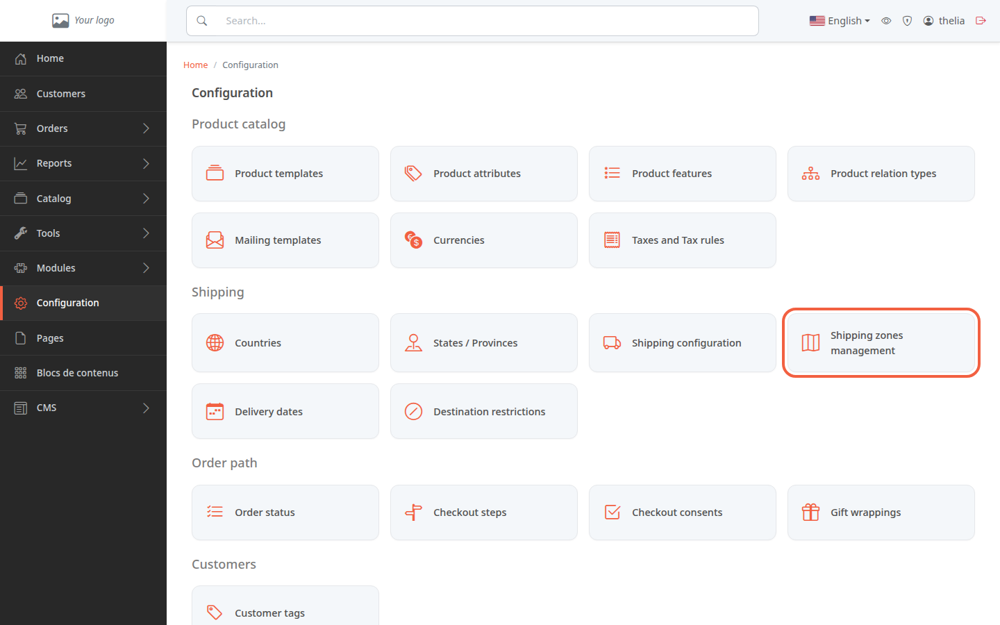
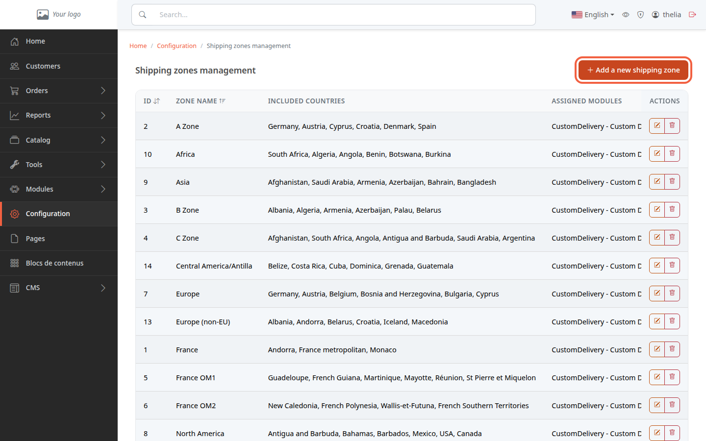
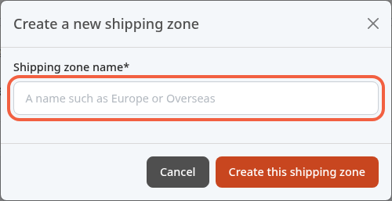
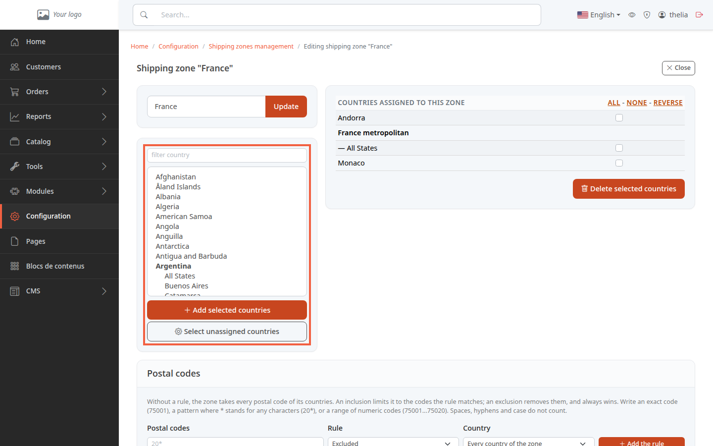
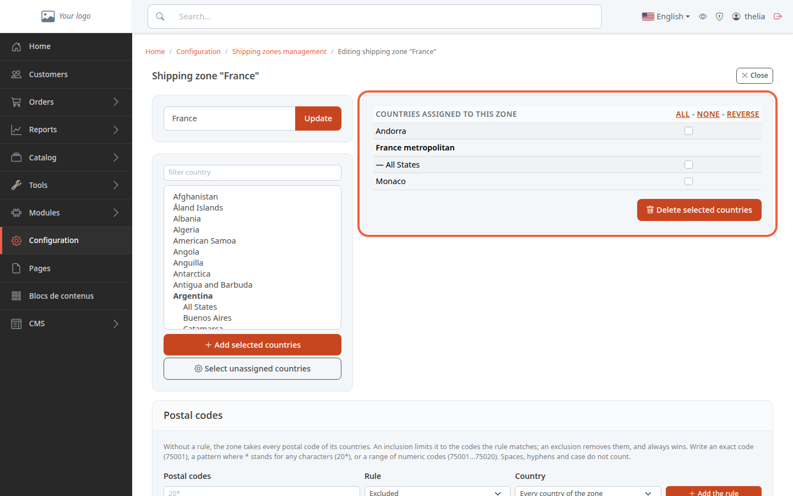

A shipping zone is a group of countries, for example "France" or "Europe". You create your zones once, then tell each delivery method which zones it delivers to. At checkout, customers only see the delivery methods whose zones include the country of their address.

**Before you start:** you need access to the back office (see [Discover the back office](/en/getting-started/back-office-tour/)). The demo store already contains zones: you can look at them without changing anything.

## Step 1: open the shipping zones

1. In the left menu, click **Configuration**.
2. In the **Shipping** section, click the **Shipping zones management** card.

Do not confuse it with the **Shipping configuration** card next to it, which attaches zones to delivery methods (see [Enable a delivery method](/en/payment-delivery/enable-delivery/)).

The **Shipping zones management** page lists the existing zones, with their countries and the delivery modules attached to them.

## Step 2: name the zone

1. Click **Add a new shipping zone**.
2. In **Shipping zone name**, enter the name of the zone, for example `Overseas`.
3. Click **Create this shipping zone**.

The zone page opens. It does not contain any country yet.

## Step 3: add countries

The zone page has two columns. On the left, the countries you can add. On the right, **Countries assigned to this zone**. The screenshot shows the demo store's **France** zone.

1. In the **filter country** field, type the name of the country. The list gets shorter.
2. Click a country. To pick several, hold down the Ctrl key (Cmd on Mac) while clicking.
3. Click **Add selected countries**.

Some countries expand into states or provinces (for example Argentina, with **All States** followed by the list of states). Select **All States** to deliver to the whole country, or a single state to deliver to that part of the country only.

To select all the countries that are in no zone at once, click **Select unassigned countries**, then **Add selected countries**.

## Step 4: remove a country or rename the zone

To remove countries:

1. In the right column, tick the countries to remove. The **All**, **None** and **Reverse** links tick, untick or invert the whole column.
2. Click **Delete selected countries**.

To rename the zone:

1. Change the name in the field at the top left, for example `Overseas territories`.
2. Click **Update**.

## The result

The zone's countries appear in the right column of the zone page, and in the **Included countries** column of the list. You still need to attach the zone to a delivery method: a zone with no delivery method is flagged by a warning in **Shipping configuration**.
