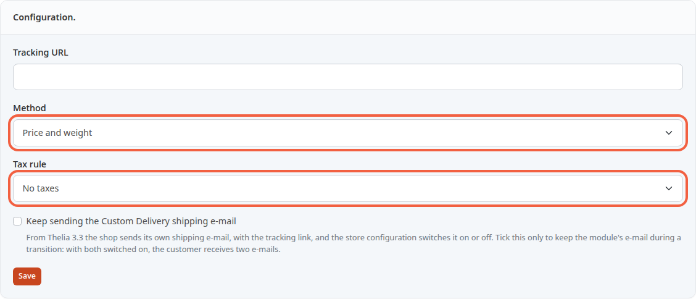
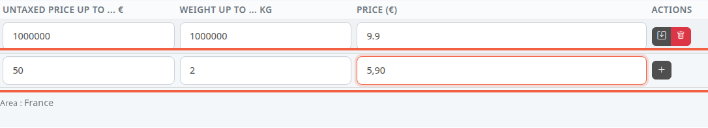

With the **CustomDelivery** delivery method, you set the delivery price yourself. It depends on the cart total or its weight, and can differ from one zone to another. For example: €5.90 up to 2 kg, €9.90 up to 5 kg.

**Before you start:** the **CustomDelivery** module must be enabled and attached to your shipping zones (see [Enable a delivery method and attach zones to it](/en/payment-delivery/enable-delivery/)). With no zone attached, the screen shows no table of slices.

## Step 1: open the module configuration

1. In the left menu, click **Modules**, then **Modules**.
2. Above the list, click **Delivery**.
3. On the **CustomDelivery** row, click the gear icon (**Configure this module**).

The **Configure : CustomDelivery - Custom Delivery** screen has two blocks: **Configuration.** at the top, **Slices.** below.

## Step 2: choose how the rate is calculated

1. In **Method**, choose what makes the price vary:
   - **Price**: the cart total;
   - **Weight**: the weight of the products;
   - **Price and weight**: both at once (the default).
2. In **Tax rule**, choose the VAT rule applied to shipping costs. **No taxes** is the default. Rules are created in [Set up VAT](/en/settings/tax-rules/).
3. Click **Save**, below the block.

The **Tracking URL** field and the checkbox about the shipping e-mail do not affect rates: leave them as they are.

After saving, the table of slices adapts: the **Weight up to ... kg** column disappears with the **Price** method, and the **Untaxed price up to ... €** column with the **Weight** method.

## Step 3: add slices

Each zone attached to the module has its own table, with its name under the table (**Area : France**). A slice says: "up to this limit, the delivery price is this amount".

1. In the zone's table, find the empty row at the bottom.
2. In **Untaxed price up to ... €**, enter the maximum cart total excluding tax, for example `50`.
3. In **Weight up to ... kg**, enter the maximum weight, for example `2`.
4. In **Price (€)**, enter the delivery price excluding tax, for example `5,90`.
5. Click the **+** button at the end of the row.

The slice is added above the empty row, which empties for the next one. Only the columns of your method are shown: with **Weight**, fill in only the weight and the price.

To change a slice, edit its fields then click the floppy disk icon. To delete it, click the trash icon: the slice disappears at once, with no confirmation.

- Write decimals with a comma: `5,90`. A period is ignored, and `5.90` becomes 590. The amounts in this page's examples use a comma for the same reason.
- Values that are already saved are displayed with a period (`9.9`). Before saving an existing row, retype every value that contains a period with a comma (`9,9`), otherwise `9.9` becomes 99.
- A limit must be greater than 0. Otherwise a **Message** window appears, for example "The weight max value is not valid".
- A price of `0` is accepted: delivery is then free for that slice.

## Step 4: understand which slice applies

When the customer chooses their delivery, the store compares their cart with the slices of the zone for their country.

- It picks the smallest slice whose limits are **strictly** greater than the cart. With a slice "up to €50", a cart of €50.00 falls into the next slice.
- The cart total is the total of the products excluding tax, after discounts. The weight is the weight of the products multiplied by their quantities.
- A product's weight is entered when you create it, in **Weight (kg)** (see [Create a product](/en/catalog/create-product/)), or later in the **Combinations** tab of its page, in the **Weight** column (see [Set the price, VAT and stock of a product](/en/catalog/set-price-stock/)). A product with no weight counts as 0 kg.
- With **Price and weight**, the slice must fit both the price and the weight.
- If no slice fits, **CustomDelivery is not offered** to that customer: there is no default rate. If your slices stop at 5 kg, a cart of 8 kg does not get this delivery method.
- A zone with no slice does not get this method either.

In the demo store, each zone has a single, very wide slice (up to 1000000 € and 1000000 kg) at €9.90: delivery costs €9.90 whatever the cart.

## The result

Each zone shows its slices, from the smallest to the largest. At checkout, a customer whose cart fits a slice sees the **CustomDelivery** method with its price.
