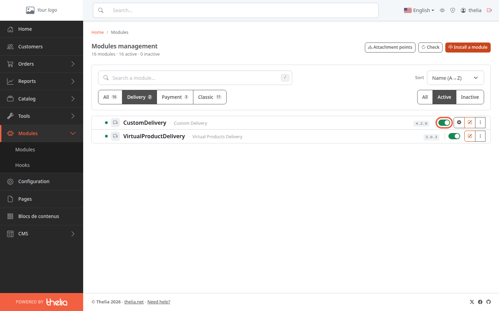
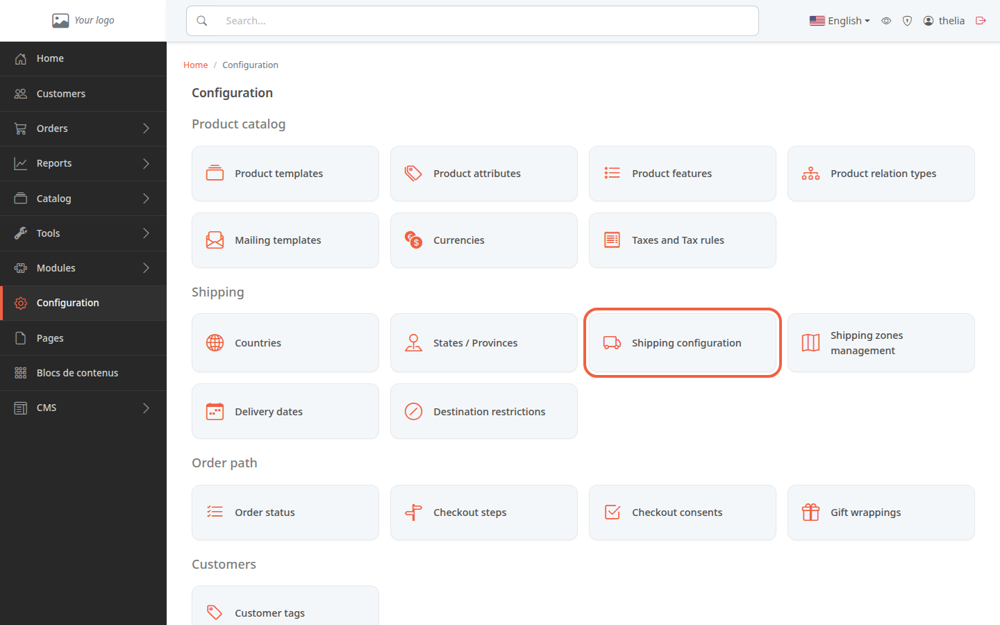
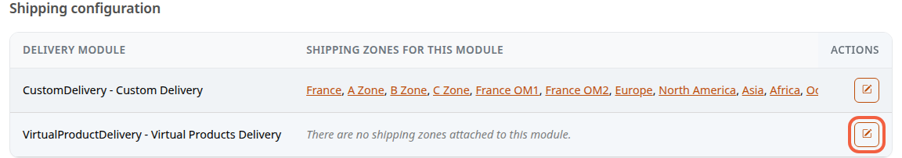
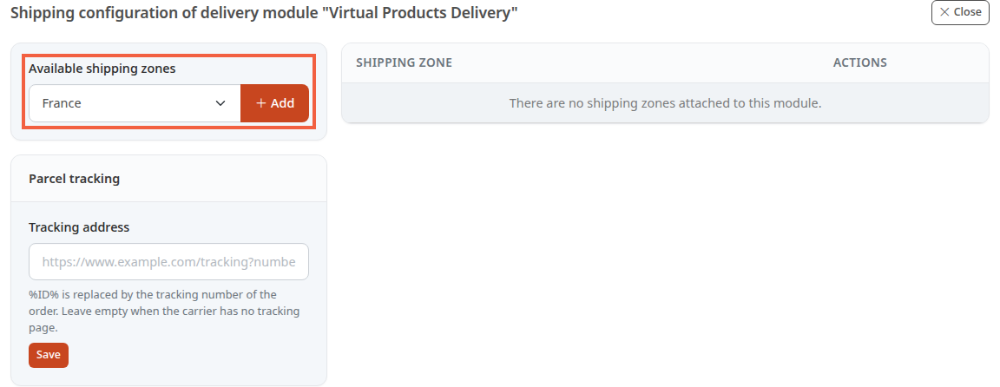

A delivery method is the way the customer receives their order, for example home delivery. To appear at checkout, it must be enabled and attached to the zones it delivers to.

**Before you start:** you need at least one shipping zone, that is, a group of countries such as "France". The demo store already has some; to create your own, follow [Create a shipping zone](/en/payment-delivery/create-shipping-zone/).

## Step 1: check that the delivery method is enabled

A delivery method is a module, a small program added to the store. The demo store has two: **CustomDelivery** (delivery at rates you set) and **VirtualProductDelivery** (downloadable products, no configuration).

1. In the left menu, click **Modules**, then **Modules**.
2. Above the list, click **Delivery**.
3. Look at the switch on the right of the module's row: if it is green, the module is enabled.

If the switch is gray, click it to enable the module. If the module is not in the list, remember that the **Active** filter is selected by default: click **All**, on the right, to see disabled modules too.

A disabled module is never offered to the customer: the store only looks for delivery methods among enabled modules.

## Step 2: open the shipping configuration

1. In the left menu, click **Configuration**.
2. In the **Shipping** block, click the **Shipping configuration** card.

Do not confuse it with the neighboring **Shipping zones management** card, which is used to create zones and choose their countries.

The **Shipping configuration** screen lists each delivery method and, next to it, the zones it delivers to.

A method with no zone shows "There are no shipping zones attached to this module." A **Warning** banner may also appear above the table. It is explained in step 4.

## Step 3: attach a zone to the delivery method

1. On the delivery method's row, click the pencil icon.
2. In **Available shipping zones**, choose a zone, for example **France**.
3. Click **Add**.

The zone moves to the table on the right. Repeat for each zone, for example **Europe**. Once all zones are attached, the screen shows "This delivery module handles all shipping zones." instead.

To remove a zone, click the trash icon on its row, then confirm with **Delete**.

The screenshot shows **VirtualProductDelivery**, the only demo module without a zone. On your store, attach the **CustomDelivery** zones the same way. That module then needs its rates: see [Set your delivery rates by price or weight](/en/payment-delivery/custom-delivery-rates/).

## Step 4: understand the warning about unattached zones

The banner appears when at least one zone is attached to no delivery method. It reads "**Warning**, some of your shipping zones are not attached to any delivery module:", followed by the list of the zones concerned.

For a customer whose country belongs only to those zones, no delivery method is offered for physical products: the store offers a method only if the zone of the delivery country is attached to it. To fix it, attach the zone to a delivery method as in step 3. The zone name in the banner opens the screen of its countries, not the attachment screen.

The banner does not tell you whether the module is enabled: a zone attached to a disabled module does not trigger it. Check step 1 as well.

The **VirtualProductDelivery** module does not need a zone: for a cart that contains only downloadable products, the store does not check zones.

## The result

The delivery method is enabled and each zone you deliver to is attached to it: the **Shipping configuration** table shows its zones and the **Warning** banner no longer lists those zones. Customers in the countries concerned can then choose it at checkout.
