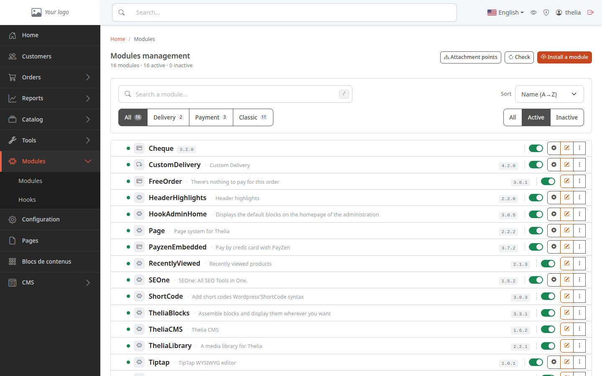
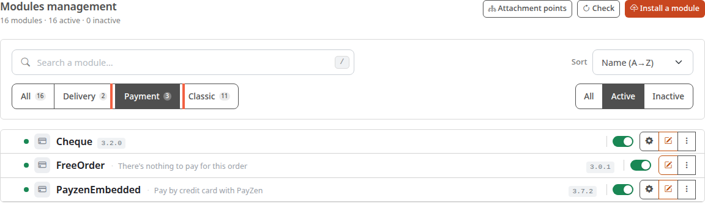
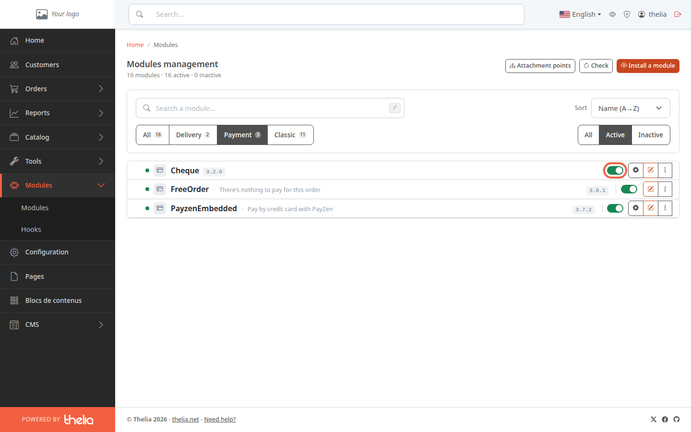
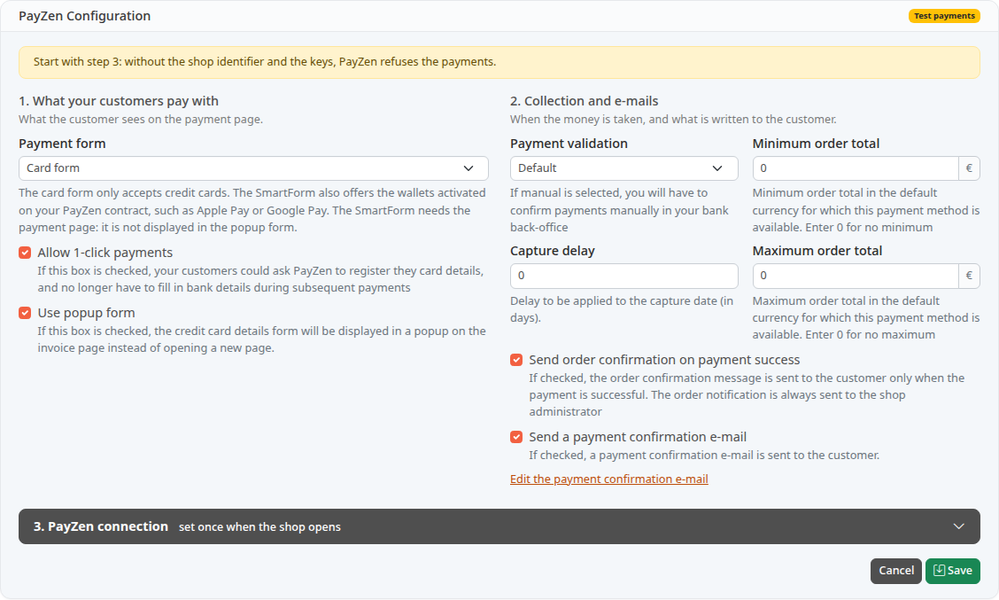

A payment method is the way your customers pay for their order, for example by check or by credit card. In Thelia, each payment method is a module: you only need to enable the ones you want to offer.

**Before you start:** you need access to the back office (see [Discover the back office](/en/getting-started/back-office-tour/)) and the payment modules installed on the store.

## Step 1: open the list of modules

1. In the left menu, click **Modules**.
2. In the submenu, click **Modules**.

The **Modules management** page lists every module in the store. Under the title, a line gives the total, for example "16 modules · 16 active · 0 inactive".

## Step 2: show the payment methods

A module can do something other than take payments: deliver orders, or add a feature to the store. To see only the payment methods:

1. Click **Payment**, in the row of buttons on the left under the search field.
2. Look at the row of buttons on the right: **Active** is selected by default, so disabled modules are hidden. Click **All** or **Inactive** to see them.

In the demo store, three payment methods are installed:

- **Cheque**: the customer pays by check. It is offered when the order total is greater than 0.
- **FreeOrder**: "There's nothing to pay for this order". It is offered when the order total is exactly 0, for example after a promo code that covers everything. It marks the order as paid, without the customer having to pay anything.
- **PayzenEmbedded**: payment by credit card, with the payment provider PayZen. It requires an account with that provider. It is offered only once configured (see step 4), and when the order total is between the minimum and maximum amounts you set. Until it is in production mode, only visitors whose IP address is allowed in its settings can see it.

## Step 3: enable or disable a module

Each row has a switch. When it is green and turned on, as in the screenshot, the module is active.

1. Find the row of the payment method, for example **Cheque**.
2. Click the switch on the right of the row.

The page reloads and shows all active modules again, so a module you have just disabled no longer appears: click **Inactive** to find it.

An enabled module is offered to your customers at checkout, as long as its condition is met (see the three modules above). To remove it, click the switch again.

A module with no editable switch is mandatory: it cannot be disabled.

## Step 4: configure a payment method

A gear icon appears to the right of the switch on active modules that have settings (here **Cheque** and **PayzenEmbedded**). **FreeOrder** has none: there is nothing to configure. A disabled module has no gear icon: enable it first.

1. Click the gear icon, or the module name.
2. Fill in the fields on the screen that opens.

For credit cards, the **PayZen Configuration** screen opens. It groups the payment form, the moment the money is collected, the minimum and maximum order amounts, and the e-mails sent to the buyer.

The **Test payments** badge, at the top right, shows that the module is not yet in production mode.

The **3. PayZen connection** block asks for your shop identifier and your keys. PayZen provides them when you sign a contract: without them, the screen shows "Start with step 3: without the shop identifier and the keys, PayZen refuses the payments."

## The result

The payment method appears in the list with a green switch, and the **active** counter at the top of the page has gone up by one. Next, enable a delivery method: [Enable a delivery method](/en/payment-delivery/enable-delivery/).
