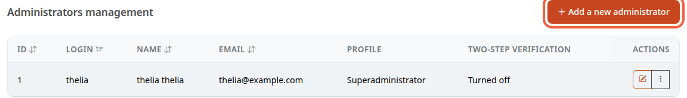
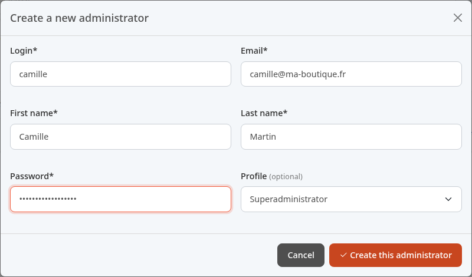

Everyone who works in the store should have their own administrator account: you know who did what, and you can remove one person's access without changing everyone else's password. This tutorial creates the account of Camille Martin, a colleague.

**Before you start:** you have an administrator account allowed to manage administrators. Have the person's e-mail address at hand.

## Step 1: open the list of administrators

1. In the menu, click **Configuration**.
2. In the **System** section, click **Administrators**.

The table shows each account: **Login** (the username), **Name**, **Email**, **Profile** and **Two-step verification**. This last column says whether the person has turned on two-factor authentication.

## Step 2: fill in the form

1. Click **Add a new administrator**.
2. Fill in the **Create a new administrator** form.

Example:

- **Login**: `camille`. This is the username she will enter to log in (her e-mail works too).
- **Email**: `camille@ma-boutique.fr`.
- **First name**: `Camille`.
- **Last name**: `Martin`.
- **Password**: a starting password. Thelia requires at least 4 characters, choose more.
- **Profile**: see step 3.

All fields marked with a star are required; **Profile** is optional. The **Login** and the **Email** must not already belong to another administrator: otherwise, Thelia refuses the creation.

## Step 3: choose the profile

The **Profile** decides which parts of the back office the person can access.

- Left on **Superadministrator**, the account has all rights.
- Another profile from the list limits the account to that profile's rights.

Only a superadministrator can give the **Superadministrator** profile.

In the demo, no profile exists yet: the list only offers **Superadministrator**. A real store creates its profiles (for example one limited to orders) before adding its colleagues. Do not leave **Superadministrator** with someone who does not need it.

## Step 4: save and tell the person

1. Click **Create this administrator**.
2. Give Camille her username and starting password through a safe channel, not in a message open to everyone.

She logs in as described in [Discover the back office](/en/getting-started/back-office-tour/).

If your store requires two-step verification, Camille is sent to the setup screen on her first visit to the back office, until she has turned it on. Guide her with [Turn on two-step verification for your account](/en/getting-started/two-factor/).

## The result

Camille appears in the table, with her profile. The **Two-step verification** column shows **Turned off**, then **Turned on** once she has set up two-factor authentication. To delete or edit an account later, use the buttons on its row in the **Actions** column.
