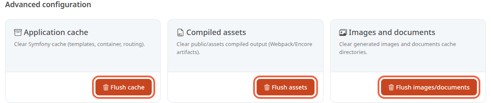

The cache is a copy of pages and files that the store keeps aside to display faster. When you change something, the old copy can stay on screen: clearing the cache deletes it, and the store rebuilds it on demand.

**Before you start:** you need an administrator account.

## Step 1: open the page

1. In the left menu, click **Configuration**.
2. In the **System** group, click **Advanced configuration**.

The page offers three cards, each with its own button.

## Step 2: choose the right button

- **Flush cache** (card **Application cache**): deletes the application's cache directory. The card text says what it covers: templates, container, routing. A confirmation window warns that the next pages load more slowly while the cache is rebuilt.
- **Flush assets** (card **Compiled assets**): deletes the files in the store's `public/assets` folder. The confirmation window says so: **Flush the compiled assets? The files under public/assets are deleted.**
- **Flush images/documents** (card **Images and documents**): deletes the copies of images and documents already generated, by default in `public/cache/images` and `public/cache/documents`. The original files are kept, as the confirmation window says. The copies are regenerated the next time they are displayed.

Only use **Flush assets** if the person who looks after your site asks you to.

On a production store (the site open to your customers) whose styles and scripts were prepared at launch, this folder holds them for the store and the back office. They are not recreated on their own: the site and the back office may display without their styling until they are prepared again.

## Step 3: flush

1. Click the button you chose.
2. In the confirmation window, click the button with the same label.

When you return to the page, a message shows the result: **Application cache cleared.**, **Web assets cache cleared.** or **Images and documents cache cleared.** An error message appears instead if the flush fails.

## When to use it

When a theme change made by the person who looks after your site does not show up, try **Flush cache** first. For an image or a document that does not update, try **Flush images/documents**. This button does not touch the thumbnails in the `public/media/cache` folder, such as those of the store's product cards. In both cases, reload the store page in your browser afterwards.

Do not flush after every change: after a flush, pages are slower until the cache is rebuilt.

## The result

You know which button clears what, and which one to try first. After a flush, the confirmation message appears at the top of the page. The cache and the image copies are rebuilt as visitors browse.
