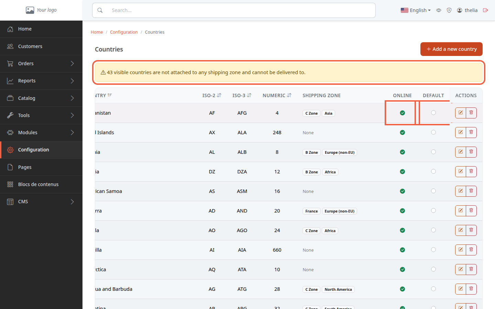
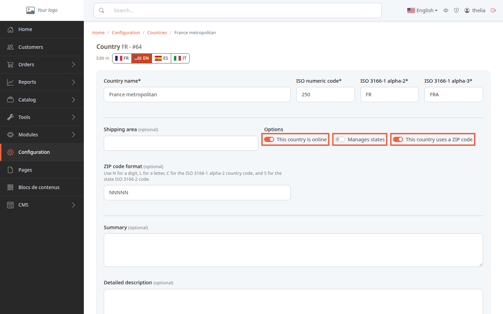

This page lists the countries the store knows. You decide here which ones are offered to customers, for example for a delivery address, and which country is the default.

**Before you start:** you need an administrator account. Nothing in this tutorial requires you to save: you can look at everything without changing anything.

## Step 1: open the list of countries

1. In the left menu, click **Configuration**.
2. In the **Shipping** section, click **Countries**.

The list shows the **Country**, its **ISO-2**, **ISO-3** and **Numeric** codes (the country's official codes), its **Shipping zone** and two settings: **Online** and **Default**. The table is wider than the screen: to see the **Online** and **Default** columns, scroll it to the right, for example with the mouse wheel while holding the Shift key.

A yellow banner appears if some online countries have no shipping zone: "visible countries are not attached to any shipping zone and cannot be delivered to".

## Step 2: understand what "Online" means

**Online** matches the **This country is online** box on the country's form. An online country appears in the list of countries the customer picks from when entering an address (customer account or order without an account). An offline country does not appear there: the customer cannot choose it for an address.

Putting a country online is not enough to deliver to it: as the yellow banner says, a country attached to no shipping zone cannot be delivered to. The only exception is an order that contains only virtual products (for example a file to download), which does not need a zone. To attach a country to a zone, see [Create a shipping zone](/en/payment-delivery/create-shipping-zone/).

## Step 3: open a country's form

1. On the row of the country, for example **France metropolitan**, click the pencil button.
2. Read the settings in the **Options** section.

- **This country is online**: see step 2.
- **Manages states**: the country has states or provinces to pick in the address.
- **This country uses a ZIP code**: the ZIP code entered in the address is checked against the **ZIP code format** (N for a digit, L for a letter, for example NNNNN for five digits).

Click **Cancel** to leave without changing anything.

## Step 4: understand the default country

The **Default** column marks the default country. Only one country is the default at a time. It is the reference country when the store does not yet know where the customer is, for example to calculate the taxes of a visitor without an account (see [Set up VAT](/en/settings/tax-rules/)). Clicking the round button of another country makes it the new default country.

## The result

You can read the list of countries, you know what **Online** means and where the default country is set. If an online country is flagged without a zone, attach it to a shipping zone.
