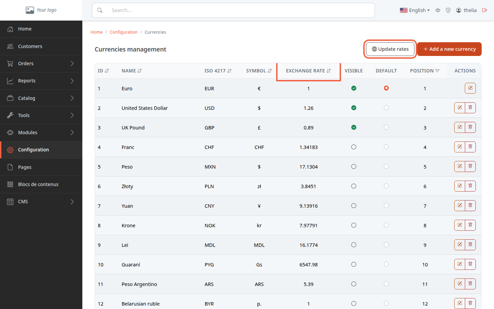
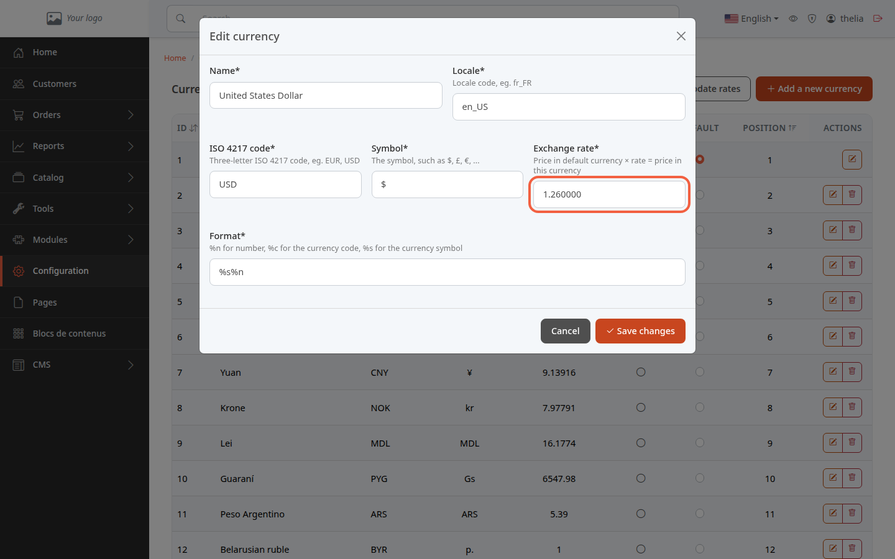

A currency is the money your prices are shown in, for example the euro or the US dollar. To show your prices in dollars as well, set the **United States Dollar** currency to **Visible**: your customers can then choose to see prices in that currency.

**Before you start:** you need an administrator account. You enter your prices in one currency only, the default currency; the others are calculated.

## Step 1: open the list of currencies

1. In the left menu, click **Configuration**.
2. In the **Product catalog** section, click **Currencies**.

The **Currencies management** page lists every currency the store knows. Each row shows the **Name**, the **ISO 4217** code (three letters, for example EUR or USD), the **Symbol** and the **Exchange rate**.

## Step 2: understand the exchange rate

The exchange rate says how much one unit of the default currency is worth in this currency. With the euro as default and a rate of 1.26 for the dollar, a 10 euro product is shown at 12.60 dollars. The default currency has a rate of 1, which **Update rates** sets back to 1.

You do not need to enter your product prices again: each price is calculated by multiplying the price in the default currency by the rate. The one exception is a price you entered by hand on the product for this currency: it is then used as is.

To view or correct a rate:

1. On the row of the currency, for example **United States Dollar**, click the pencil button.
2. Read the **Exchange rate** field. Its help text gives the rule: price in default currency × rate = price in this currency.

The form also contains the **Name**, the **Locale** (language code, for example fr_FR), the **ISO 4217 code**, the **Symbol** and the **Format**. In **Format**, **%n** is the number, **%s** the symbol and **%c** the code: **%n %s** displays "12.60 $", **%s%n** displays "$12.60".

Click **Cancel** to close the form without changing anything.

## Step 3: update the rates

Rates do not update by themselves. The **Update rates** button at the top of the list fetches today's rates for every currency except the default one. The rates come from the European Central Bank's daily file.

1. Click **Update rates**.
2. If a message says **No exchange rate could be fetched for:** followed by a list of currencies, for example "Lei (MDL)", those currencies have no published rate: their rate has not changed, so correct it by hand.

Warning: this update overwrites every rate it fetches, including the ones you entered by hand. An automatic update exists, but it is turned off by default; it is set up on the hosting side, by the person who manages your server.

## Step 4: choose what customers see

In the list, two columns decide the role of each currency.

- **Visible**: the currency is offered to customers. A currency that is not visible stays in the list but is not offered.
- **Default**: the currency in which you enter your prices. Clicking the round button on another row changes the default currency and immediately starts an update of all the rates. That currency is also made visible. Warning: this change does not convert the prices already entered, which stay saved in the old currency.

The default currency cannot be hidden or deleted. To delete another currency, use the trash button on its row.

In the store, the customer sees a currency selector in the header, for example "€ EUR". It only appears if at least two currencies are **Visible**. Choosing a currency converts the prices displayed.

## The result

You know which currencies the store offers, how a converted price is calculated and how to refresh the rates. To set a product's price, see [Set the price, VAT and stock of a product](/en/catalog/set-price-stock/).
