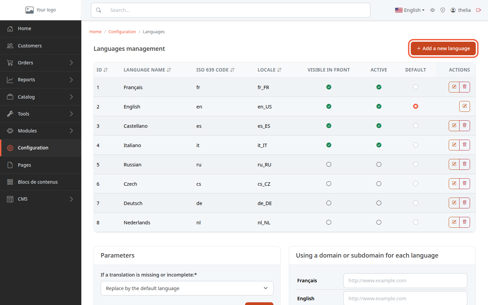
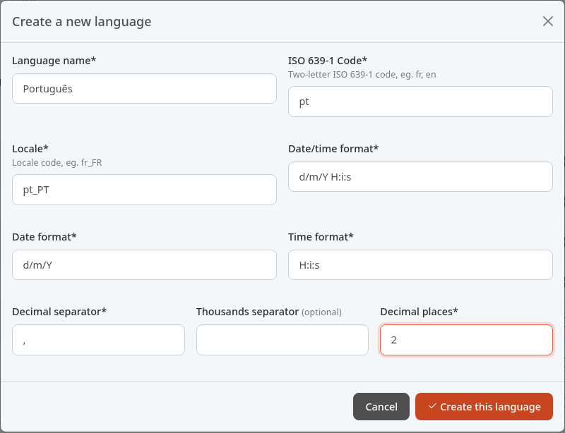
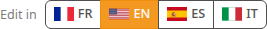
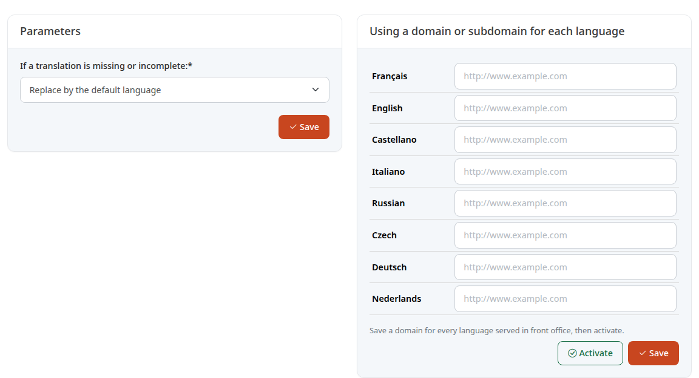

Selling in several languages, for example French and English, lets you welcome customers from other countries. This tutorial shows you how to add a language, make it available on the site and what is left to translate afterwards.

**Before you start:** you need an administrator account. Also have your store's texts ready in the new language (products, categories, pages).

## Step 1: open the list of languages

1. In the menu, click **Configuration**.
2. In the **System** section, click **Languages and URLs**.

The table lists the languages the store knows. Three columns decide their role:

- **Visible in front**: the language is offered to the store's visitors.
- **Active**: the language can be used.
- **Default**: the store's reference language. Only one language is the default.

In the demo, French, English, Spanish and Italian are active, and English is the default language. The other languages in the list already exist but are switched off: if yours is there (for example **Deutsch**), you do not need to create it, just activate it in step 3.

## Step 2: create a language missing from the list

1. Click **Add a new language**.
2. Fill in the **Create a new language** form.

Example for Portuguese:

- **Language name**: `Português`.
- **ISO 639-1 Code**: `pt` (two letters).
- **Locale**: `pt_PT`.
- **Date/time format**: `d/m/Y H:i:s`.
- **Date format**: `d/m/Y`.
- **Time format**: `H:i:s`.
- **Decimal separator**: `,`.
- **Thousands separator**: a space (optional).
- **Decimal places**: `2`.

These values are those of the demo's French (day/month/year, then hours:minutes:seconds). For another language, adapt the order and the separators: the demo's English uses `m-d-Y` and a decimal point. They are used to display dates and numbers in that language.

3. Click **Create this language**.

A newly created language is **switched off**: neither **Active** nor **Visible in front** is ticked at first.

## Step 3: activate the language

On the language's row, click the dot in the column you want. The change applies immediately, with no button to confirm.

1. Click the **Visible in front** dot to offer the language to visitors. Thelia then also ticks **Active** if needed.
2. To remove it, untick **Active**: **Visible in front** is unticked at the same time.

What each box changes:

- **Active**: the language appears in the site's language selector (if the store has at least two active languages) and in the back office's editing languages (step 4). An inactive language is not accepted when a visitor requests it in the address (`?lang=`).
- **Visible in front**: the language is marked as public. It counts for the list of language versions in the sitemap, when the matching module is active, and for choosing the language by domain (the card in step 5). On the demo's Flexy theme, the site's language selector follows the **Active** box, not this one.
- **Default**: clicking the dot of another language makes it the default language, and ticks **Active** and **Visible in front**. It is the language served to a visitor who has not chosen anything.

A common error: the default language cannot be deactivated, hidden or deleted. To remove the demo's English, first choose another default language.

When the language is created, and again when you tick **Active**, Thelia adds the translations shipped with it for that locale, if any (for example country names, order statuses and e-mail subjects).

## Step 4: translate your products and content

Activating a language translates nothing: your products, categories and pages stay in their original language. Each form has an editing language selector, **Edit in**, which lists the active languages.

1. Open the form, for example a product.
2. Click the flag of the language to fill in.
3. Enter the title and the descriptions in that language, then save.

Repeat for each language. The selector only appears if there are at least two active languages.

## Step 5: choose what to show when a translation is missing

Under the table, the **Parameters** card sets what happens with an untranslated text.

In **If a translation is missing or incomplete:**, there are two choices:

- **Replace by the default language**: the text in the default language takes its place. This is the demo's setting.
- **Use strictly the requested language**: nothing is replaced.

Click **Save** on this card to confirm the choice.

On the right, the **Using a domain or subdomain for each language** card gives each language its own address, for example `fr.my-store.com`. Fill in an address for each language served, click **Save**, then **Activate**. Thelia refuses to activate this setting while a served language has no address. Leave this card empty if all your languages share the same address.

## The result

The language appears in the table with its boxes ticked, and visitors can choose it in the site's language selector. It appears in the **Edit in** selector of every product, category or page.
