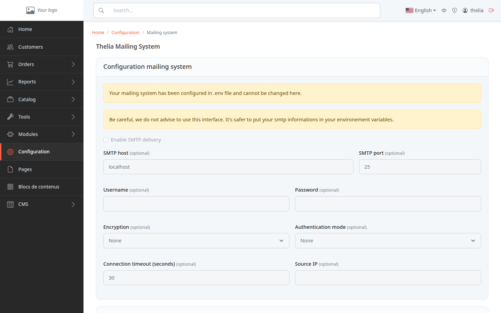
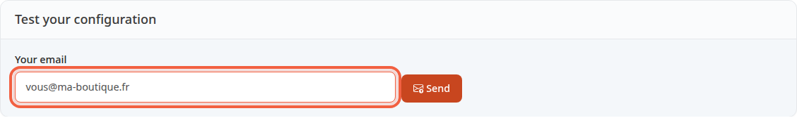

Your store sends emails to your customers, for example to confirm an order. This tutorial shows you how to send a test email to your own address, so you know sending works before a customer is waiting for one.

**Before you start:** you need an administrator account and the store's email address entered in the store information. It is used as the sender of the test message.

## Step 1: open the page

1. In the left menu, click **Configuration**.
2. In the **System** group, click **Mailing system**.

At the top of the page, a **Configuration mailing system** block lists the sending settings: host, port, username, password, encryption. You do not need to change anything there to run the test.

If the message **Your mailing system has been configured in .env file and cannot be changed here.** appears, the form is greyed out: these settings are handled by whoever hosts your site.

Without that message, the form can be edited. The page still always shows the warning **Be careful, we do not advise to use this interface. It's safer to put your smtp informations in your environement variables.** Leave the form as it is and ask whoever hosts your site to set up sending.

## Step 2: send the test email

1. Scroll down to the **Test your configuration** block.
2. The **Your email** field already contains the store's email address. Replace it with the address where you want to receive the test, for example `you@my-store.com`.
3. Click **Send**.

One click is enough: the message goes out right away, with no confirmation step. Each administrator can send at most ten tests in ten minutes. Beyond that, the page answers **Too many test mails in a short time: wait a few minutes before the next one.**

## Step 3: read the answer

The result appears to the right of the button, without leaving the page.

- Sent successfully, in green: **Your configuration seems to be ok. Checked out your mailbox : you@my-store.com**. The message you receive has the subject **Email test from : Your store name**.
- Store address missing, in red: **You have to configure your store email first !** Enter it in the store information, then try again.
- Empty field: the page shows **Please enter an email**.
- Malformed address, in red: a message reproduces the address you typed, for example `Email "you@" does not comply with addr-spec of RFC 2822.` Correct the address, then try again.
- Sending refused, in red: the page shows the mail server's answer, or **The test mail could not be sent. The details are in the server log.** Pass this text on to whoever hosts your site.

The green message only means that sending was not refused. Then open the inbox of the address you entered: if the message is not there, check the spam folder too. If it still does not arrive, tell whoever hosts your site: sending may be set up to deliver nothing, for example on a test site.

## The result

You know whether your store can send emails. A green message and a received email confirm that sending works. Otherwise, you have an exact text to pass on to whoever hosts your site.
