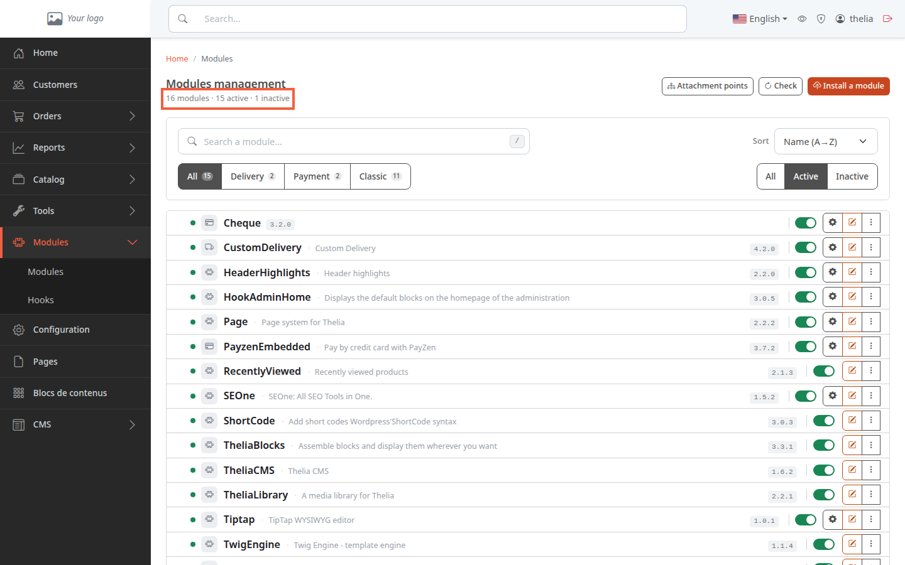
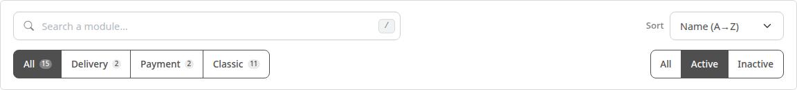
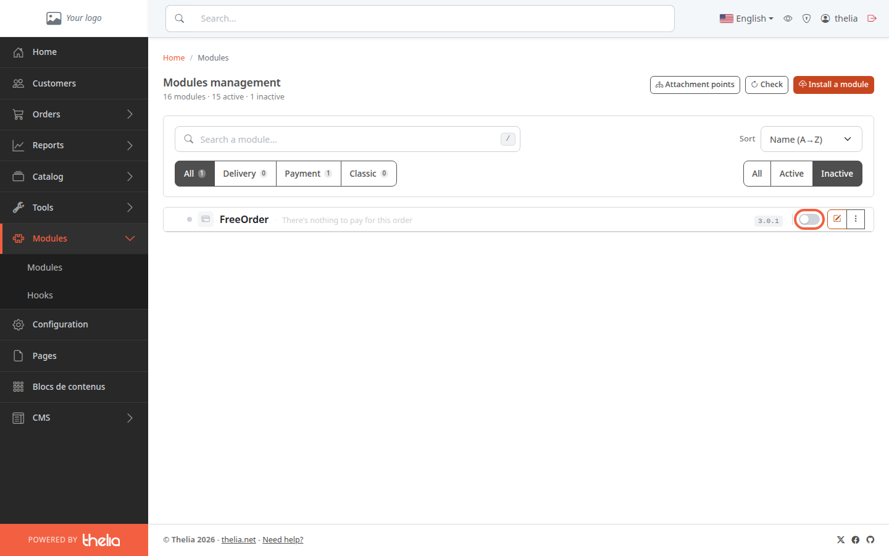
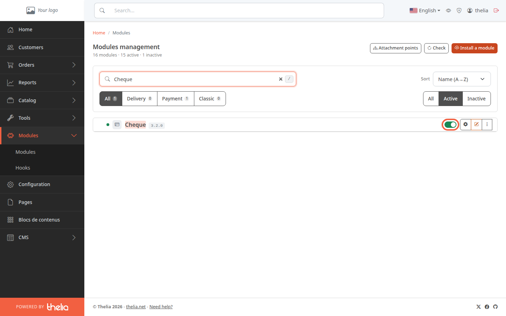
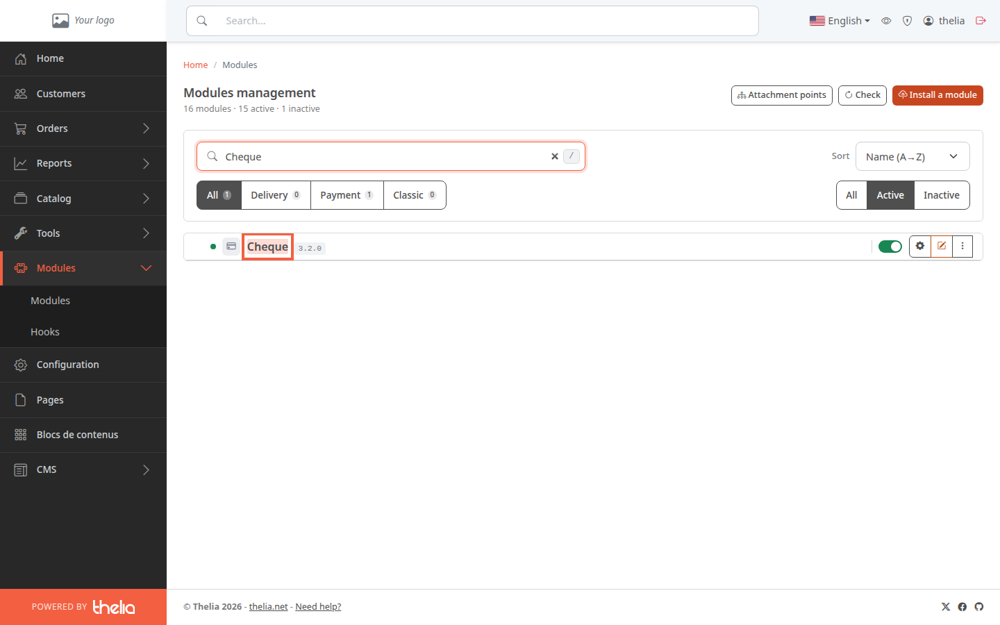
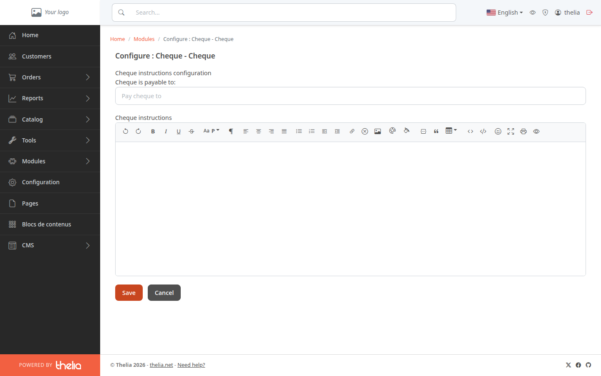
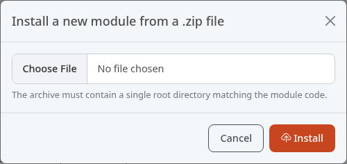

A module is an extension that adds a feature to your store, for example a payment method or a carrier. This page shows you how to read the list of modules, enable or disable one, and install a new module.

**Before you start:** you need an administrator account. To find out how to get into the back office, see [Discover the back office](/en/getting-started/back-office-tour/).

## Step 1: read the list of modules

1. In the menu, click **Modules**.
2. In the submenu, click **Modules**.

Under the title **Modules management**, one line sums up the number of modules: the total, the active ones and the inactive ones. On the demo store, it shows "16 modules · 15 active · 1 inactive".

Each row of the list shows:

- a green dot (active module) or a grey one (inactive module);
- the module name, its title when it differs from the name, and its version number;
- a switch to enable or disable it;
- on the right, action buttons: the gear (configure), the pencil (edit the module's information) and the three dots (other actions).

## Step 2: filter the list

At first, the list only shows active modules. To see the others, use the bar above the list.

- **Search a module…**: type part of the name, title or version.
- **Sort**: **Name (A→Z)**, **Most recent** or **Status**.
- **All**, **Delivery**, **Payment**, **Classic**: the module type. A payment module lets customers pay for an order, a delivery module offers a delivery method, a classic module adds another feature. The number next to each button counts the modules that match the other filters.
- **All**, **Active**, **Inactive** (on the right): the module status. Click **Inactive** to see the ones that are switched off.

## Step 3: enable or disable a module

1. Find the module in the list, for example **Cheque** (payment by check).
2. Click its switch.

The click takes effect immediately: no window asks for confirmation. The page reloads with the **Active** filter: a module you have just disabled no longer appears there. A green switch is an active module, a grey switch is an inactive module, for example **FreeOrder** in the screenshot of the previous step.

What changes in the store: a disabled payment or delivery module disappears from the choices offered to the customer at checkout, because only active modules are listed. Thelia also clears its cache on every change: the cache is the data Thelia keeps aside to display pages faster.

A required module has a locked switch: it cannot be disabled.

To go further with a payment method, see [Enable a payment method](/en/payment-delivery/enable-payment/). For a delivery method, see [Enable a delivery method and attach zones to it](/en/payment-delivery/enable-delivery/).

## Step 4: open a module's configuration

Some modules have settings, for example the name to write on checks.

1. In the list, click the module name, here **Cheque**, or the gear at the right of the row.

The **Configure : Cheque - Cheque** page opens.

2. In **Cheque is payable to:**, type the name to write on checks, for example "My Store Ltd".
3. Click **Save**.

Only an active module that has a settings page shows the gear. For the others, the name opens the module's information form (title and descriptions).

## Step 5: install a new module

1. At the top right of the page, click **Install a module**.
2. In the **Install a new module from a .zip file** window, click **Choose File**.
3. Choose the module's archive on your computer.
4. Click **Install**.

The window only accepts a `.zip` file. The archive must contain a single folder at its root, the module's folder, for example `Cheque`. If it contains several, or if the module requires a more recent version of Thelia, the installation fails and an error message appears. Check the module before installing it: it runs on your store.

If the **Install a module** button does not appear, installing from an archive is disabled on your site.

A new module arrives inactive: click **Inactive** to see it, then enable it with its switch. If the module was already installed, the new version keeps its status, active or inactive. Some modules are not installed from this page but by the person who manages your site technically; the **Check** button, next to it, then refreshes the list.

## The result

You know how to read the list of modules, enable or disable them and open their settings. An active module appears with a green dot and its switch on.
