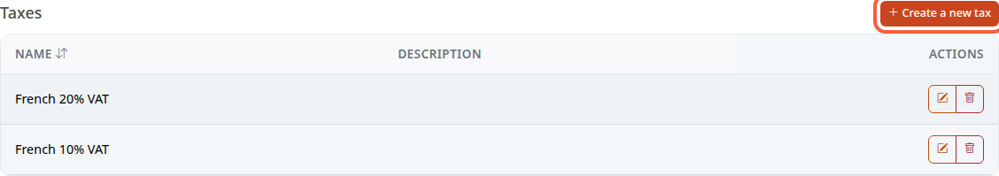
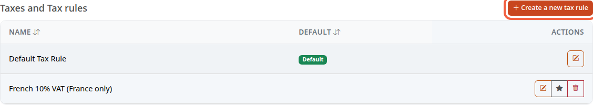
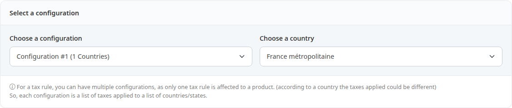
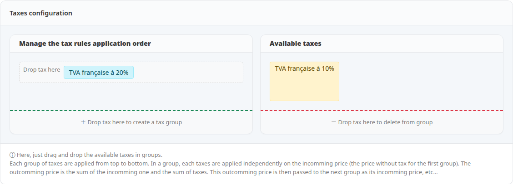
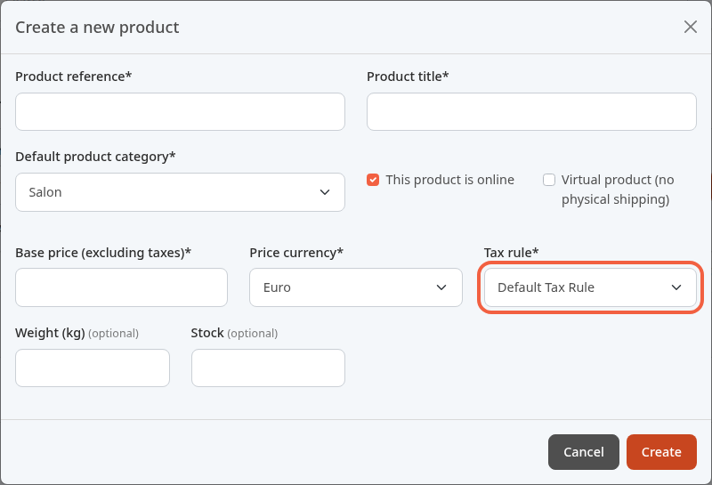
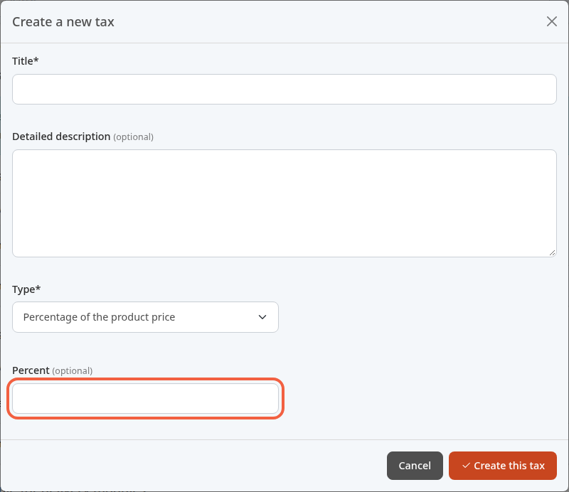

VAT is the tax added to a product's price excluding tax to give the price including tax. This tutorial explains how Thelia calculates it and how to apply it, for example 20% on all your products.

**Before you start:** you need an administrator account (see [Discover the back office](/en/getting-started/back-office-tour/)). The demo store already contains taxes and rules: you have nothing to create to apply 20%.

## Tax and tax rule

- **A tax** is a calculation. Example: **French 20% VAT** adds 20% of the product price.
- **A tax rule** is a set of taxes, country by country. Example: the rule says that, for France, the 20% tax applies.
- **A product** is attached to a tax rule, never directly to a tax.

To change the VAT on your products, you therefore switch to another rule, or change what the rule contains.

## Step 1: open the tax rules

1. In the left menu, click **Configuration**.
2. In the **Product catalog** block, click **Taxes and Tax rules**.

The screen shows two help sentences, then two lists.

The **Taxes** list holds the calculations. In the demo: **French 20% VAT** and **French 10% VAT**.

The **Taxes and Tax rules** list holds the rules. The **Default** badge marks the default rule, here **Default Tax Rule**. The star icon on another row sets it as the default rule.

## Step 2: see what a rule contains

1. In the **Taxes and Tax rules** list, click the pencil on the **Default Tax Rule** row.
2. Click the **Taxes** tab.
3. In **Choose a country**, choose **France métropolitaine**.

Choosing the country selects the configuration that covers it: here **Configuration #1 (1 Countries)**.

Further down, the **Taxes configuration** block shows the tax applied: **TVA française à 20%** is in the left column. **TVA française à 10%** is in **Available taxes**, so it is not applied.

If you opened the rule only to look at it, click **Taxes rules** in the breadcrumb at the top to leave without changing anything.

## Step 3: attach the rule to a product

Each product carries a **Tax rule**. You choose it when you create the product.

1. In the left menu, click **Catalog**.
2. Click **Products**.
3. Click **Add a new product**: the **Create a new product** window opens.
4. In **Tax rule**, choose the rule to apply, for example **Default Tax Rule**.

This list shows the rule names in the store's default language: in the demo, English.

The price entered in **Base price (excluding taxes)** is a price excluding tax: the chosen rule is used to calculate the price including tax. Creating a product in full is described in the catalog tutorial.

To change the rule of an existing product, open it, then the **Combinations** tab: the **Tax rule** field is there, with the **Save** button. This field only appears if the product has no combination (sizes, colors). Otherwise, the screen does not let you change its rule.

## Step 4: create a tax (if needed)

Only create a tax if no existing tax fits, for example for a 5.5% rate.

1. In the **Taxes** list, click **Create a new tax**.
2. In **Title**, enter for example `5.5% VAT`.
3. In **Type**, choose **Percentage of the product price**.
4. In **Percent**, enter the rate, for example `5.5`.
5. Click **Create this tax**.

The tax is not applied to any product until it is placed in a rule.

## Step 5: put a tax in a rule

1. Open the rule with the pencil, then the **Taxes** tab.
2. In **Choose a country**, choose the country concerned, for example **France métropolitaine**.
3. Drag the tax from **Available taxes** to **Manage the tax rules application order**. Dropped on an existing group (the **Drop tax here** area), it joins that group. Dropped on **Drop tax here to create a tax group**, it forms a new group, placed below.
4. Click **Apply**.
5. In the **Update tax rule taxes** window, click **Save tax rule taxes**.

Choosing the country only works for a country that already has a configuration in the rule: otherwise, the configuration shown does not change. That case is not covered here. The change applies to all the countries of the configuration.

The taxes in one group each apply to the starting price. The groups apply from top to bottom, the price obtained by one group becoming the starting price of the next.

A second VAT placed in the same rule does not replace the first: the two add up. For a reduced rate, you need a separate rule, like **French 10% VAT (France only)** in the demo.

## The result

Your products are attached to a rule, and the rule contains the 20% tax for France.
